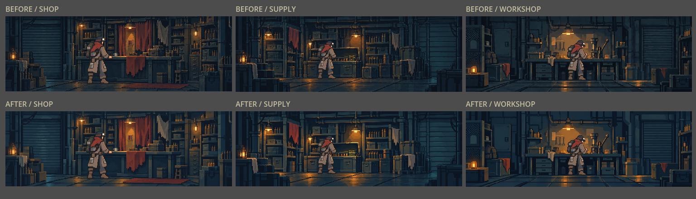
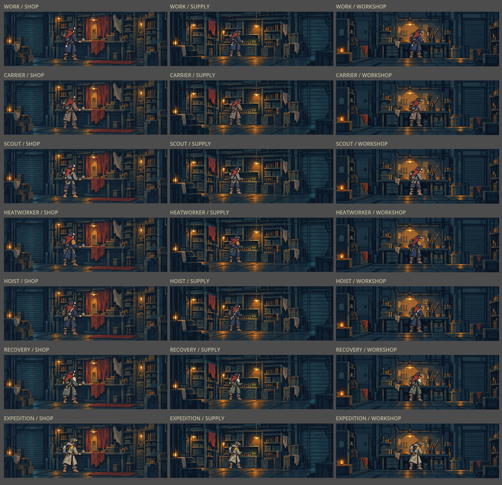
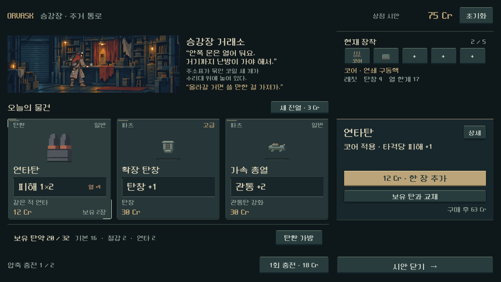

# 실내 배경 묘사 밀도 완화

2026-10-25. 사용자 요청: 캐릭터에 비해 지나치게 세밀한 실내 배경을 조금 뭉개고, 기존 고품질 원본은 별도로 보존한다.

## 변경과 보존

- 상점·보급·작업대 3장에 적용. 작은 흠집·리벳·금속 반짝임·잔선을 줄이고 벽/선반/바닥을 큰 도트 색면으로 묶었다. 광학 블러 대신 이미지 생성 도구의 스타일 편집을 사용했다.
- 기존 차가운 청록 금속과 따뜻한 조명, 가구 배치·카메라·손과 바닥 접점은 유지하는 방향으로 제작했다. 생성 결과의 세부 소품 형태는 일부 달라졌다.
- 기존 `assets/art/service_layers_20261011/*_background.png`는 수정하지 않았다. 사용자 요청에 따라 `docs/art/source-backups/service-backgrounds-20261025/`에도 3장을 복사하고 해시 일치를 확인했다. `manifest.json`에 원본 해시·크기를 기록했다.
- 새 원본은 `assets/art/service_background_grouped_20261025/{shop,supply,workshop}.png`. 생성 PNG 그대로 저장했다. 파일 해상도를 낮춘 것이 아니라 그림의 묘사 밀도를 낮췄다.
- 본편 장소 3장면/기본 장소, 복장 작업실, 별도 상점 UI 시안과 시안 생성 도구를 새 배경으로 연결했다. 캐릭터 원화·자세·UI 배치·전투·게임 규칙은 이번 작업에서 변경하지 않았다.

## 비교

위는 기존 배경, 아래는 새 배경이다. 캐릭터는 양쪽 모두 현행 실내 자세로 동일하다.

## 검증과 한계

- 격리 Godot 4.7 임포트 exit 0. 기존 Android build-tools 경로 경고 외 새 오류 없음.
- `tests/service_cohesion_capture.gd`를 `QA_COMPARE_BACKGROUNDS=1`로 실행: 본편 장소의 배경/인물 계층 그대로 7복장×3장소 렌더와 같은 배우의 배경 전후 비교를 생성. 전체 모음에서 발·가구 접점과 형태 보존을 시각 검수했다. 캡처 완료는 자동 미감 평가를 뜻하지 않는다.
- `tools/run_shop_preview.ps1 -Capture`: 1600×900, 1280×800, 1280×576의 구매/상세/터치/배치 **924검사 실패0**. 대표 큰 화면과 가로 모바일 비율을 직접 확인했다.
- 사용자 미감·실제 Galaxy는 후속이다. 새 상점 UI는 독립 시안이며 이번 배경 수정은 본편 장소에도 적용했다.
- APK·커밋·푸시·외부 게시 없음.

도구는 내장 `image_gen`을 사용했다. 전체 프롬프트·참조 역할/경로·참조와 결과 해시·생성 원본·출력 크기는 [provenance.json](../../../새-게임-프로젝트/assets/art/service_background_grouped_20261025/provenance.json)에 기록했다. 원본 복구 시 소비 경로를 `service_layers_20261011/{place}_background.png`로 되돌릴 수 있다.
