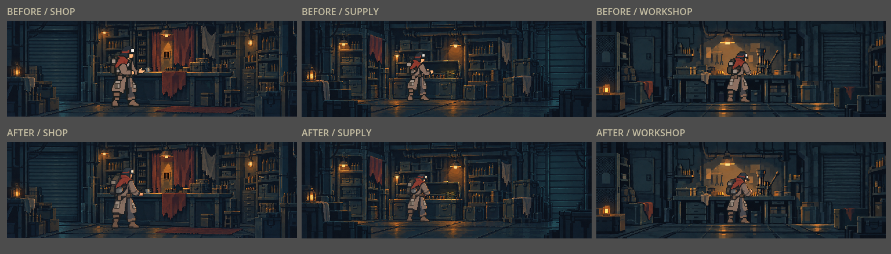
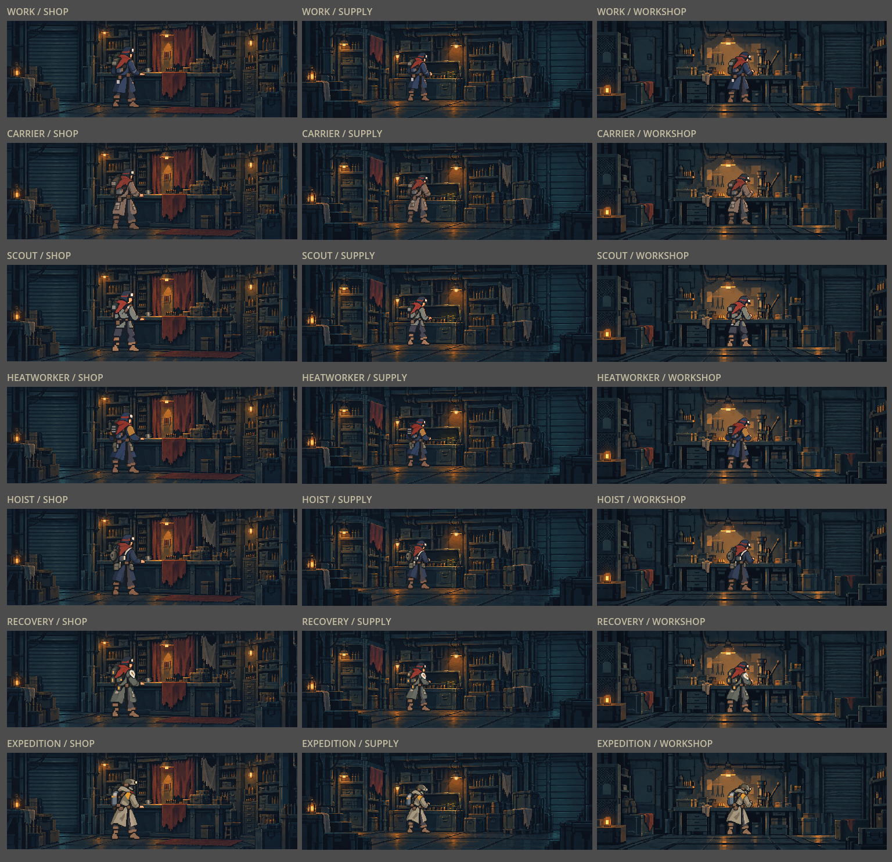
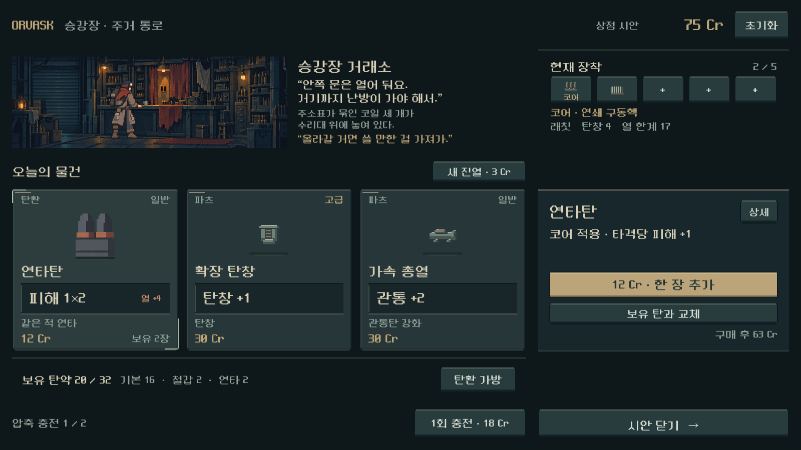

# 실내 캐릭터 자세 복원·배경과 도트 조화

2026-10-25. 사용자 요청: 상점의 무기 파지처럼 보이는 자세를 교체하고 캐릭터와 상점/다른 장소의 화풍 차이를 교정한다.

## 원인과 변경

실제 무기 레이어가 상점에 남은 결함은 아니었다. 최근 복장 통합에서 생성한 `outfits_unified_20261025/*_service.png`의 상점 자세가 옆모습/들어 올린 양손에 가까워졌고, 강한 외곽 경계와 넓고 밝은 색면이 세밀한 실내 배경과 분리되어 보였다. 카탈로그의 상점 셀 선택은 정상이다.

- 7복장 × 상점/보급/작업대 3자세 = 21자세를 새 투명 아틀라스 7장으로 제작했다. 원래 복장 디자인, 가방과 장치의 차이는 유지했다.
- 상점: 등을 비스듬히 보이고 카운터 위에 손을 낮춰 놓은 대화 자세. 보급: 보관함 안의 물건을 다루는 자세. 작업대: 고개를 숙이고 두 손으로 작업하는 자세.
- 실내 전용 그림에서 어두운 윤곽과 그림자 덩어리, 밝은 면의 비율을 정리하고 작은 도트 묶음으로 형태를 나눴다. 배경을 흐리는 방식은 사용하지 않았다.
- 원본 파일을 수정하지 않고 새 폴더 `assets/art/service_cohesion_20261025/`에 생성 PNG를 그대로 복사했다. 이전 자료는 비교용으로 보존한다.
- 각 포즈의 실제 알파 영역·발 좌표를 측정했다. 손이 명목상 512px 셀을 넘는 복장은 실제 투명 간격에서 나눠 잘림과 이웃 포즈 혼입을 막았다.
- 본편 `service_actor_catalog.gd`, 장소 장면의 초기 리소스, 별도 상점 UI 시안에 연결했다. 전투/장비 선택 캐릭터, 배경, UI 배치, 게임 규칙과 저장 데이터는 이번 작업에서 바꾸지 않았다.
- 이전 복장 등록 도구를 재실행해도 새 실내 자세를 예전 자세로 되돌리지 않도록 현행 프로필을 우선한다.

## 실제 렌더

위가 이전, 아래가 이번 교체 결과다. 동일한 배경·크기·실내 렌더 경로로 비교했다.

## 검증

기능 검증과 시각 판단은 구분한다.

- 격리 Godot 4.7 실행. 본편 통합 러너 **1,368검사 실패0**: 35복장/무기 조합의 장비 선택·전투 동일 그림, 동작 접점, 7복장 × 3장소 × 3비율의 정확한 복장·잘림·공통 알파 처리, 구형 ID fallback. `integration/stdout.log`에 결과 기록.
- 본편 비율: 1280×900, 1008×630, 1440×630. 전체 21실내 조합을 네이티브 렌더 모음으로 검수하고 대표 본편 화면 6장도 따로 열어 손/발과 가구 접점, 복장 구분을 확인했다.
- 별도 상점 시안: **924검사 실패0**, 1600×900 / 1280×800 / 1280×576. 구매·교체·상세·터치와 동일 높이 카드 배치 유지. `preview/`에 로그와 화면을 보존한다.
- 에디터 임포트 exit 0. 기존 Android build-tools 경로 경고만 남았으며 이번 작업은 APK를 만들지 않았다. 실제 렌더 실행에는 새 오류 없음.
- 사용자 미감과 실제 Galaxy 체감은 미검증. 본편 캐릭터 아트 교체는 적용했지만, 새 상점 UI 레이아웃 자체는 여전히 독립 시안이다.

## 재현·원본

- 등록: `python tools/register_service_cohesion.py` — PNG 편집 없이 경계/발과 프로필 등록.
- 본편 검증: `powershell -NoProfile -ExecutionPolicy Bypass -File tools/run_unified_outfit_checks.ps1 -Suite integration -OutputDirectory docs/qa/reports/assets/service_cohesion_2026-10-25/integration`.
- 이미지 모음: `tests/service_cohesion_capture.gd`. 격리 `qa_runtime/service_cohesion/` 아래 APPDATA/LOCALAPPDATA와 `QA_OUTPUT_DIR` 필요. 본편 장소 장면의 배경·배우 계층을 그대로 렌더한다.
- 상점 시안: `SHOP_UI_PREVIEW.cmd`. 캡처 검증은 `tools/run_shop_preview.ps1 -Capture`.
- 전체 프롬프트·실제 참조/생성 경로: `assets/art/service_cohesion_20261025/provenance.json`.
- PNG 해시·실제 분할/경계/발 좌표: 같은 폴더 `registration.json`.

APK·커밋·푸시·외부 업로드는 수행하지 않았다.
