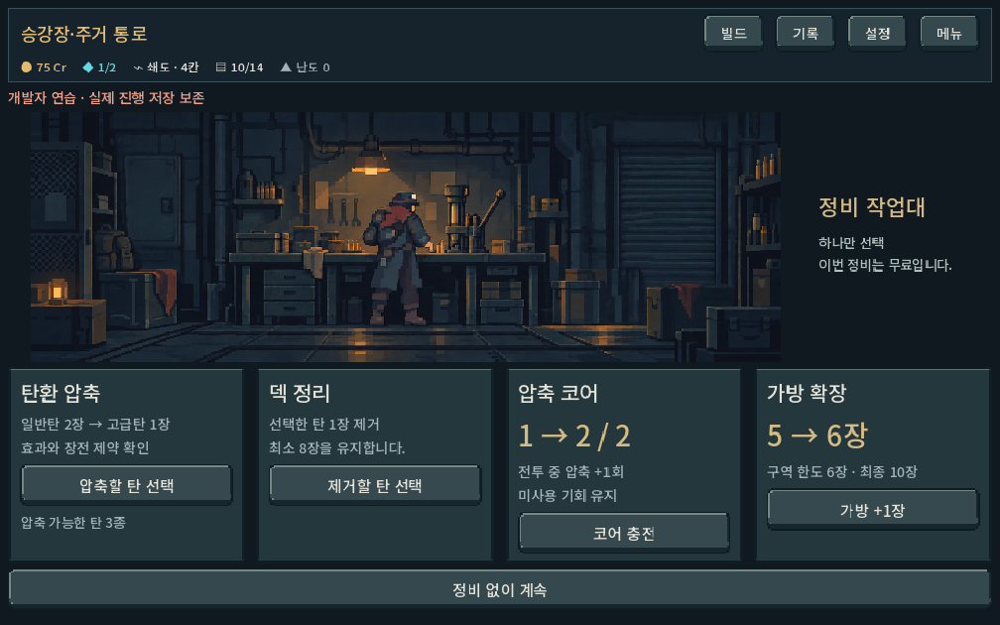
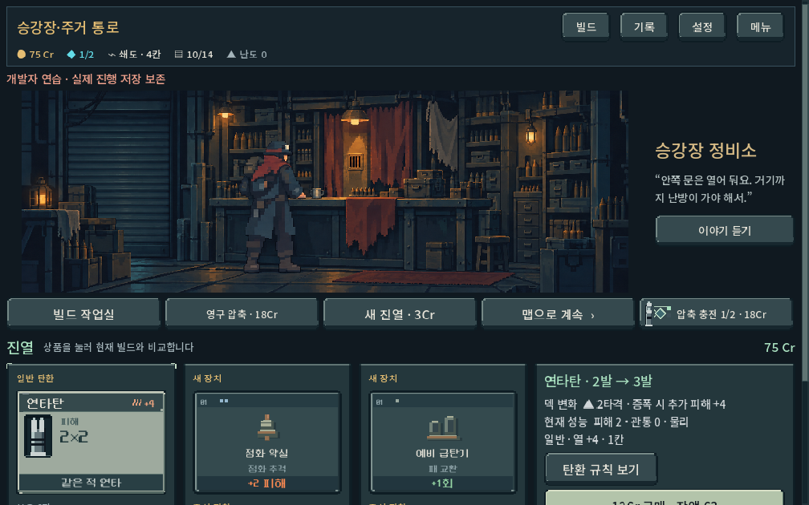
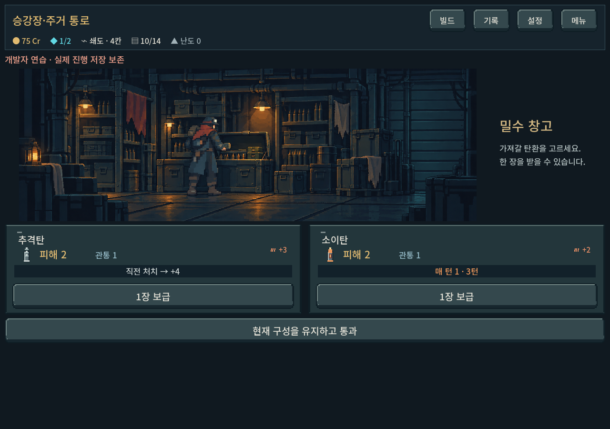

# 공통 실내 v2 및 복장 가능성 확인

사용자 요청: 공통 장소에서 외부 탑이 보이지 않도록 수정, 복장별 캐릭터 표시 가능 여부 검토.

- 상점·정비·보급소의 창밖 탑/하늘을 불투명 철문·셔터·벽으로 교체. v1은 원본 기록으로 보존하고 Godot 장면은 v2 PNG 참조.
- 기존 인물과 설비 구도·크기 유지 여부를 생성 원본 및 실제 화면에서 육안 확인. 바뀐 실내는 모든 지역에서 공통 사용하며 지역별 배경 리소스를 요구하지 않음.
- 제작은 image_gen.imagegen 편집, 실제 v1 원본을 입력. 전체 프롬프트/해시/원본 위치는 assets/art/service_locations_20261011/indoor_v2_provenance.json. 후처리 없는 PNG 복사.
- 기존 `tools/run_service_location_checks.ps1` 재검증 **343/0**, 1280×900·1008×630·1440×630, 격리 저장. 에디터 import/게임 실행 오류 없음. 상점 구매/대화/압축/수령/무료정비/취소/복귀 및 그림 위 터치 이벤트 스크롤 유지.
- 사람 선호·모바일 실기기 확인은 별도. 자동 기능 통과가 화풍 선호를 뜻하지 않음.

## 복장 판단
가능하나 현재 미연결. work/carrier/scout 복장 선택·규칙·저장은 구현됨. 장소는 인물이 포함된 단일 그림, 전투는 권총/장총 기본 몸체만 있음. 인물 없는 공통 배경 + 복장별 장소 자세 + 손/설비 가림 레이어로 분리하면 배경 재제작 없이 교체 가능. 장소 세 자세의 등록과 복장 아트, 전투의 전 동작 아트가 별도로 필요. 이번에는 이 검토를 appearance.md에 기록했으며 레이어 분리나 복장별 전체 제작을 완료하지 않았다.

