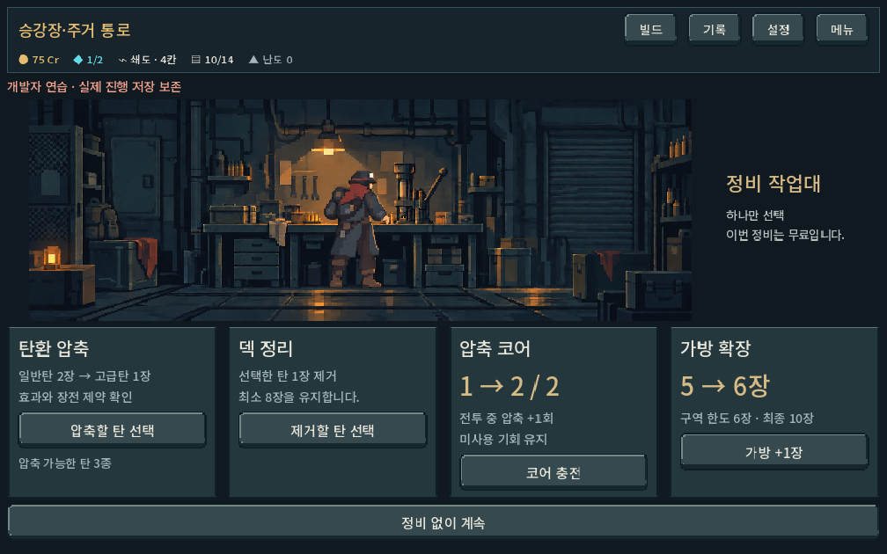
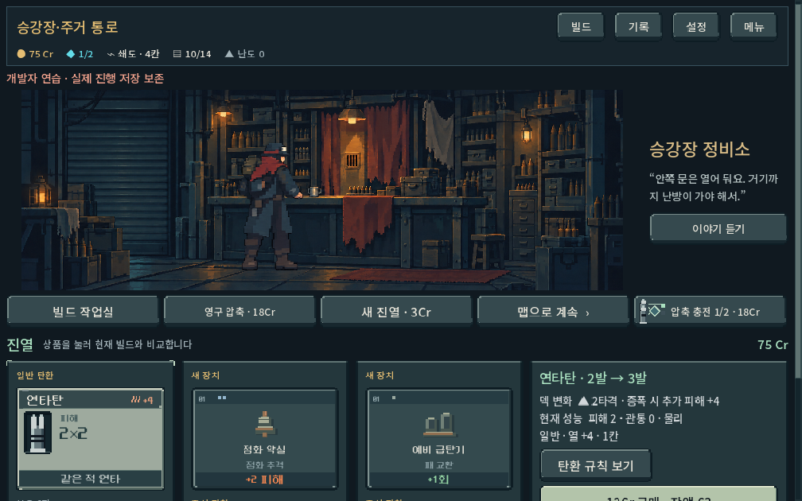
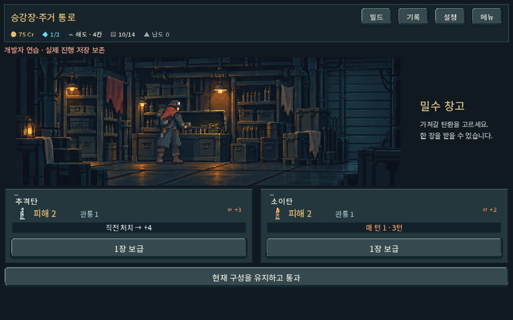

# 장소 배경·인물 레이어 분리

## 적용
- 상점/정비/보급소 공통 실내 배경 3장, 투명 기본 작업복 인물 3자세를 제작. 승인된 구도와 인물 크기·접점을 기준으로 재합성했다. 이미지 도구의 분리 결과는 기계적 원본 마스크 추출과 달리 세부 픽셀이 일부 달라지므로 픽셀 동일 복원이라고 보지 않는다.
- 압축 작업대의 초기 빈 배경에 남은 손은 추가 편집으로 제거했다. 외부 풍경은 계속 없고 주인은 가림막 뒤에 남는다.
- `location_*.tscn`의 PlaceArt는 빈 배경, 그 자식 PlaceActor는 별도의 투명 인물. 현재 자세는 몸/손이 모두 설비 앞에 있어 추가 앞쪽 가림 그림은 필요하지 않다. 미래 복장이 설비 뒤로 손을 넣는 자세라면 가림 레이어를 추가 검수해야 한다.
- `service_actor_profile.gd` 및 자세별 `.tres`에 투명 PNG·실제 소스 영역·발 기준점을 등록. `service_actor_layer.gd`가 배경의 contain 여백과 같은 좌표 변환으로 균일 배율 합성. 생성 이미지 전체 크기를 인물 크기로 오인하지 않는다.
- `campaign_ui._service_place`가 실행 중 campaign의 outfit ID 전달. `service_actor_catalog.gd`에서 복장/장소에 맞는 자세를 선택한다. 그림이 없는 carrier/scout/알 수 없는 ID는 work 자세로 안전하게 대체하며 requested/displayed/fallback을 구분한다. 준비 메뉴의 미확정 선택으로 진행 중 복장을 덮어쓰지 않음.
- 이 변경은 **기본 복장 인물 분리와 복장 선택 연결점 구현**이다. 운반복·정찰복 신규 장소 그림, 전투의 복장별 몸체, 헬멧 교체, 작업 애니메이션은 제작하지 않았다.

## 자산/제작
`assets/art/service_layers_20261011`에 최종 6 PNG 및 provenance.json 저장. built-in image_gen으로 기존 v2 원본을 편집했고 실제 참조 이미지·전체 프롬프트·입출력 해시를 기록. 원본 픽셀 후처리는 하지 않았다. 투명 이미지의 낮은 알파 잡음은 인물 밖에 있어 등록된 소스 영역으로 제외하며 비트맵을 고치지 않음.

## 검증
`tools/run_service_location_checks.ps1` → **517 checks / 0 failures**.
Godot4.7 Compatibility GPU, 1280×900 / 1008×630 / 1440×630. APPDATA/LOCALAPPDATA 및 저장은 qa_runtime/service_locations 격리. 실제 Galaxy 미시험.
- 기존 상점 구매/대화·유료/무료 압축·보급·취소·맵 복귀·제약·터치 스크롤 유지.
- 모든 장소의 실제 RGBA, 배경 범위 내 인물, 발 등록, 복장 미제작/누락 시 fallback, 외형 조회가 캠페인/전투 상태를 변경하지 않음.
- 인물 숨김/표시 캡처: 인물 영역 바깥 좌우 픽셀이 바이트 단위 일치하고 실제 인물 영역은 달라짐. 빈 배경에서 손/의상 잔존 없는지 육안 확인.
- 시작 검사에서는 뷰포트 최종 배율을 빠뜨려 좌표 불일치, 이후 진입 색상 전환 중 촬영으로 미세 색차가 검출됐다. 최종 화면 좌표를 사용하고 진입 효과 종료 후 비교하도록 수정해 통과. 실제 레이어 위치 오류를 숨긴 허용오차 비교가 아님.
- live campaign outfit work/carrier/scout이 상점 및 압축창까지 전달되는 것을 확인. 세 장소의 기본 아트/프로필은 ready 이전에도 직렬화.
- 엔진 import 및 runtime 오류 없음. 프로젝트 AGENTS가 허용한 기존 로컬 엔진 실행/캡처 경로 사용, MCP 실행은 사용하지 않음.

## 제작자 시각 검수
인물만 껐을 때 배경의 벽·가구·바닥이 자연스럽게 남고 합성 시 발·손이 기존 접점에 맞음. 밝은 사각 배경이나 이중 인물 없음. 세부 복장 선/주름은 원본과 소폭 차이가 있으며 사람의 선호는 후속 확인.

## 새 복장 추가 절차
세 장소의 새 투명 자세 제작 → 기본 자세와 동일 조명/도트 밀도 검수 → source_rect와 foot_in_source 등록한 프로필 리소스 생성 → catalog.POSES[복장ID][장소]에 등록. 장소 배경/기능/저장은 교체하지 않는다. 발/손/모자/가방 가림과 실제 3해상도를 재검수한다.
