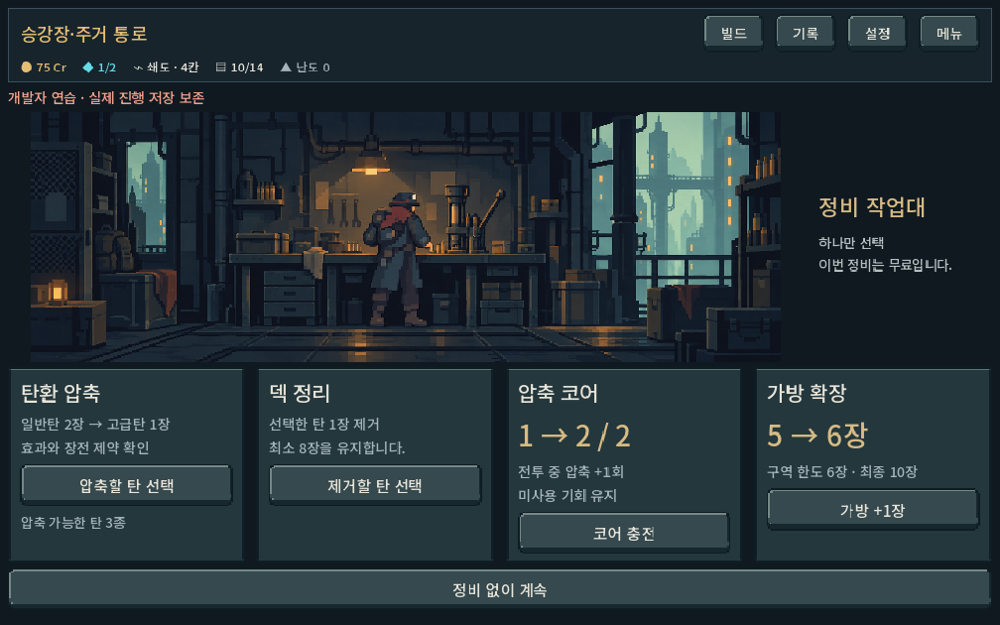
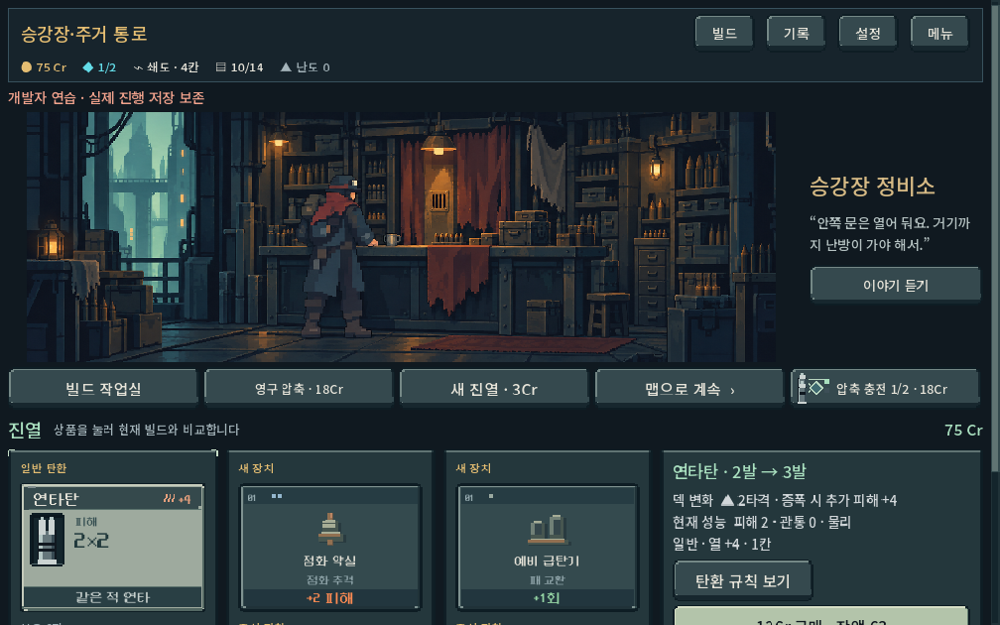
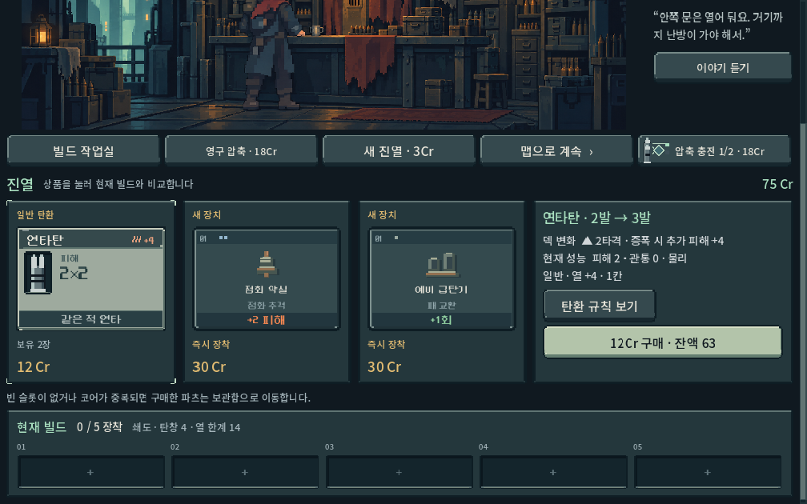
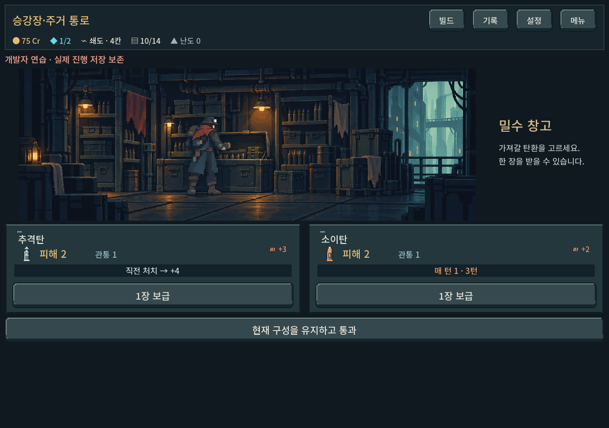
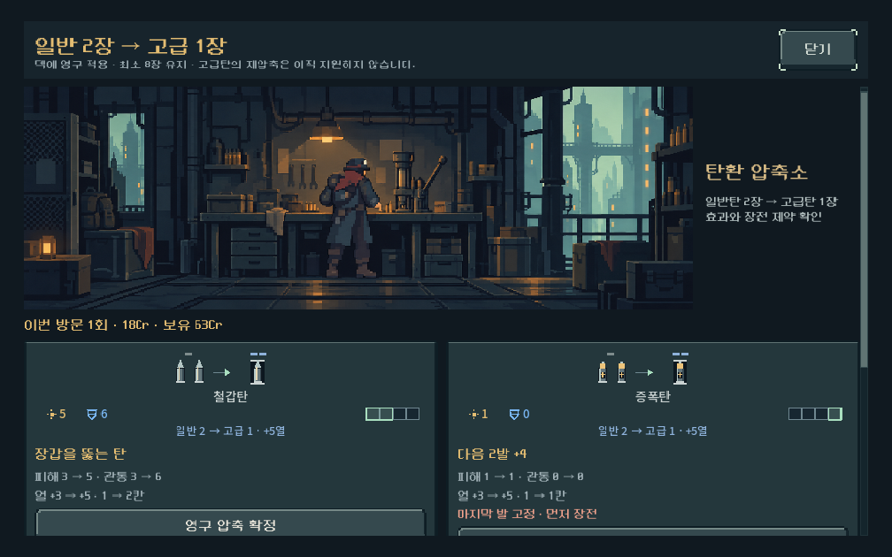

# 장소 실내 아트와 조작 연결 — 2026-10-11

## 요청과 구현
- 사용자 지정: 압축은 등을 보이며 작업대에서 작업하는 주인공, 상점은 내부 가판대 너머 주인과 대화하되 주인 외형은 가려도 됨. 보급 보관소도 장소 아트 적용.
- 디렉터 선택: 압축 프레스/가림막 있는 판매대/열린 보급 보관함의 세 장면. 승인 주인공 및 주거 통로 원본을 실제 이미지 입력으로 제공하여 built-in image_gen으로 제작. 주인은 커튼·진열장 안쪽에 감춰 새 NPC 캐릭터 없이 기존 대사 연결.
- 적용: 상점·보급·정비 진입, 압축 선택 작업실, 정비/보급 완료. 설명은 그림 옆, 기능 카드와 확정은 아래. 그림은 KEEP_ASPECT_CENTERED로 전체를 보존하며 넓은 화면에서는 여백을 허용한다. 기능 텍스트/가격은 Godot 렌더.
- `service_location.tscn` 공통 장면 + `location_shop/supply/workshop.tscn` 개별 편집 가능 인스턴스. 정적 대표 아트·제목·설명이 ready 전에도 존재. 기존 상품/작업의 동적 UI 연결은 campaign_ui에 유지.
- 상점 도구줄은 HFlowContainer로 좁은 폭에 대응. 터치 입력은 장식 그림이 가로채지 않음. 기존 소비/덱/압축/보상 계산 변경 없음.
- 주거 구역 아트에서 시작한 공통 실내이며 다섯 지역의 고유 실내 변형은 제작하지 않았다. 주인공은 기본 복장의 정적 일러스트로, 손 동작 애니메이션·실시간 복장 교체는 이번 범위 밖이다.

## 검증
`tools/run_service_location_checks.ps1` → **343 checks / 0 failures**.
Godot 4.7 Compatibility 실제 GPU 렌더, 1280×900 / 1008×630 / 1440×630. QA APPDATA/LOCALAPPDATA는 `qa_runtime/service_locations`에 격리하고 save_enabled=false 사용.
- 상점 구매 가격·매진, 이야기 열기/닫기, 유료 압축 취소 무소비·확정 2→1·가격 차감, 맵 복귀.
- 보급 1장 수령·완료 장소 유지·맵 복귀, 덱 14장 수령 금지·통과 가능.
- 무료 정비 압축 확정·완료 장소 유지·맵 복귀, 크레딧 부족 압축 확정 비활성.
- 터치 이벤트를 실제 Godot 입력 경로에 전달: 상점 그림에서 손가락 스와이프 → 스크롤, 구매 오작동 없음. 압축 창 그림에서도 스크롤.
- 화면 가로 넘침 없음, 원본 전체 표시, 이미지와 문구가 스크립트 실행 전 직렬화되어 있음.
- MCP 경유 검사는 이번에 사용하지 않음. 프로젝트 AGENTS의 기존 로컬 실행·캡처 허용 기준에 따라 엔진 실행 경로 사용.
- 첫 에디터 import는 기본 사용자 폴더 쓰기 제한 경고 발생; 실행 QA는 처음부터 격리했고 에디터 import도 격리 경로로 재실행. 게임 런타임 stderr는 비어 있음.

## 화면 검수와 한계
제작자 검수: 세 장면의 주인공/설비/바닥 전체가 보이고 기존 청회색·녹슨 천·작은 온기와 연결됨. 상점 630px 높이에서는 상품과 구매 영역까지 세로 스크롤 필요. 휴대폰 실기기 테스트 및 사람의 선호 평가는 미수행.

## 확인 경로
`PLAY.cmd` → 개발 → 크레딧 무기고 / 탄환 보급 / 정비 작업대. 상점의 영구 압축 버튼에서도 작업 장면을 확인. 실제 저장은 개발자 연습에서 보존.
제작 원본·전체 프롬프트·참조·해시: `새-게임-프로젝트/assets/art/service_locations_20261011/provenance.json`.
