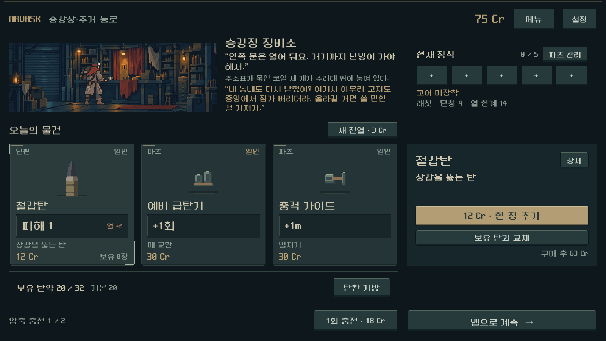
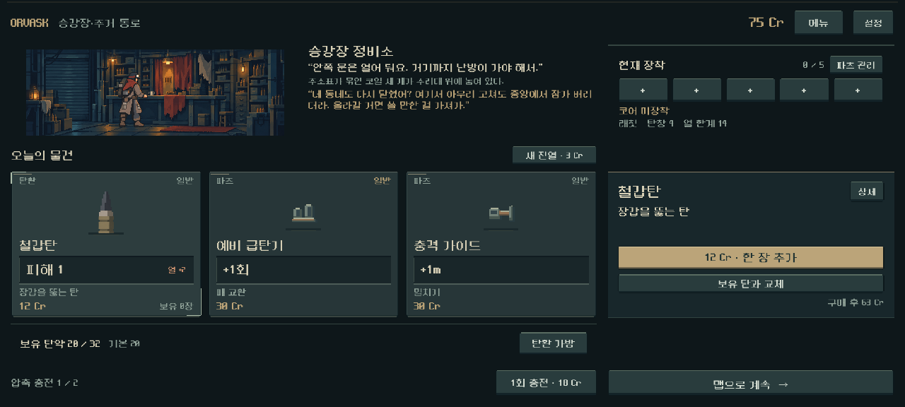
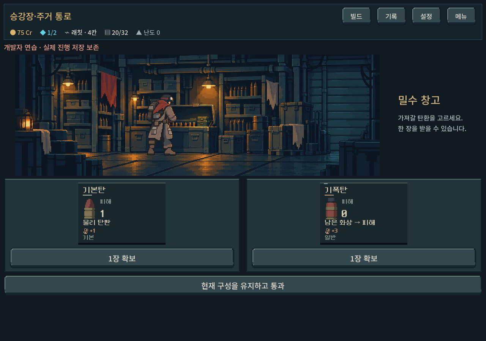
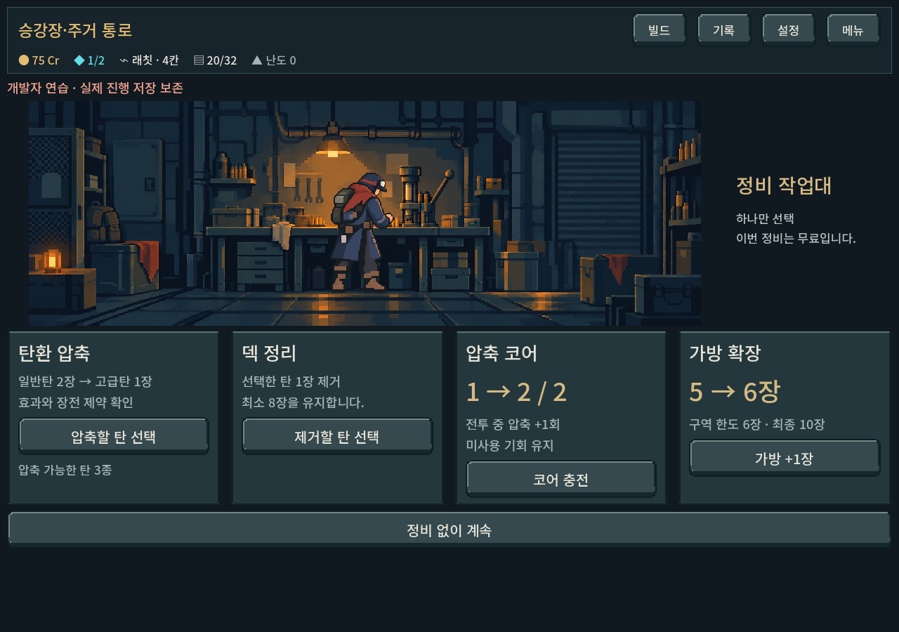

# 승인 상점 UI·실내 아트 본편 통합

사용자 요청: “좋아 전부 인게임 반영해 줘.” 승인된 상점 화면과 실내 아트를 실제 등반 경로에 연결했다. `PLAY.cmd`로 실행하는 본편의 상점 노드에서 새 화면을 사용한다. 별도 `SHOP_UI_PREVIEW.cmd`는 비교용 시안으로 남는다.

## 적용 범위

- 상점은 편집기에서 확인 가능한 `redesign/shop_screen.tscn`으로 전환했다. 상품 카드와 상세 패널은 같은 행을 공유하며 상하 끝선을 유지한다.
- 진열/추가 구매/기본탄 교체/파츠 보관·관리/압축 충전/맵 복귀가 기존 Campaign 행동과 자동 저장을 사용한다. 별도 시안의 임시 덱이나 가짜 코어 보너스를 만들지 않는다.
- 보유 탄 수·효과·열·파츠·총기·재화·구역별 이야기·복장은 현재 등반 데이터를 사용한다. 이야기는 입장부터 보이며 큰 글씨로 넘치는 경우 손가락으로 스크롤한다.
- 기본탄 교체 제한, 재진열 가격 상승, 충전 방문당 구매 제한, 코어 포함 파츠 5칸, 중복 파츠 구매 금지, 장착 불가 파츠 보관 규칙을 유지했다. 구형 장소 저장의 영구 압축/개조 진입점도 별도로 유지한다.
- 상점·보급·작업대의 큰 도트 색면 배경과 7복장×3장소 자세를 본편에서 재검증했다. 전투·장비 선택도 같은 승인 복장 원화를 계속 사용한다.

## 검증

Godot 4.7 Compatibility GPU, `qa_runtime/shop_live` 및 `qa_runtime/outfits_unified_20261025/unified`의 격리 저장. 사용자 실제 저장을 사용하지 않았다.

| 검증 | 결과 |
|---|---|
| 실제 맵 노드 진입 → 상품 터치 → 구매 → 자동 저장 → 복원 | 통과 |
| 교체/파츠 자동 장착·보관/진열 갱신/충전/돈 부족/탄약 가득 참 | 통과 |
| 상세 Escape 닫기/파츠 작업실/맵 복귀 및 복원 | 통과 |
| 1600×900, 1280×800, 1008×630, 1280×576, 1440×630 정렬·영역 | 통과 |
| 5구역 상점 이야기·7복장·모든 파츠 상세 | 통과 |
| 큰 글씨 1.1배의 대표 두 비율/실제 터치 이야기 스크롤 | 통과 |
| 상점 전용 검사 | **1,295 검사, 실패 0** |
| 복장 통합: 전투/장비 선택 동일 원화·파지/실내 3비율 | **1,368 검사, 실패 0** |
| 고해상도 원본 3장 ↔ 백업 ↔ 해시 명세 | 모두 일치 |

최초 저장 복원 검증 실패는 테스트가 맵 중간으로 이동하면서 이전 방문 경로를 만들지 않아 발생했다. 합법 연결 경로를 가진 테스트 상태로 교정했으며 저장 검증 규칙은 완화하지 않았다. 구형 서비스 버튼의 추가 행 때문에 화면 높이가 밀리던 실제 UI 문제는 기존 우측 하단 공간에 배치해 해결했다.

대표 5비율·큰 글씨·지역 이야기·구형 서비스·보급/작업대 렌더를 눈으로 확인했다. Galaxy 실기 터치 정확도와 사용자 미감은 별도 후속 확인이 필요하다. 이번 작업은 전투 규칙이나 구역 밸런스를 변경하지 않는다. APK/커밋/푸시/외부 게시 없음.

## 실제 본편 화면

## 유지보수와 재현

- 본편 장면: `새-게임-프로젝트/redesign/shop_screen.tscn`; 데이터 연결: 같은 폴더 `shop_screen.gd`.
- 레이아웃 저작 도구: `python tools/build_shop_screen_scene.py`. 승인 시안 TSCN을 기준으로 본편용 직렬화 장면을 생성하며 플레이 도중 시안 코드를 실행하지 않는다.
- `powershell -NoProfile -ExecutionPolicy Bypass -File tools/run_shop_live_checks.ps1`
- `powershell -NoProfile -ExecutionPolicy Bypass -File tools/run_unified_outfit_checks.ps1 -Suite integration -OutputDirectory docs/qa/reports/assets/shop_live_2026-10-25/outfits`
- [배경 원본 보존·제작 기록](service_background_grouped_2026-10-25.md), [실내 자세 제작 기록](service_cohesion_2026-10-25.md).

로그와 캡처: `docs/qa/reports/assets/shop_live_2026-10-25/`.
