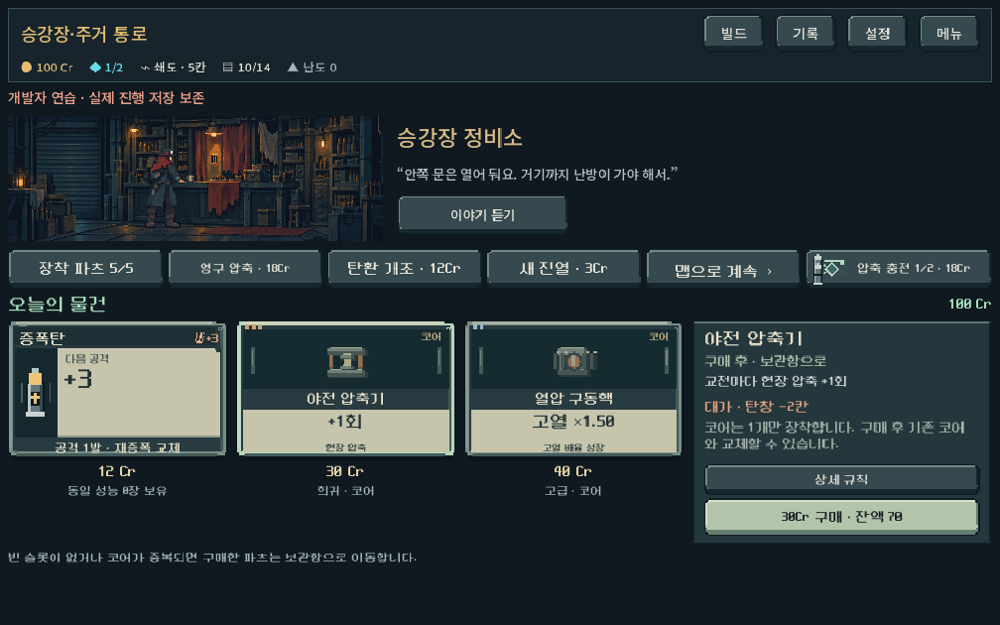
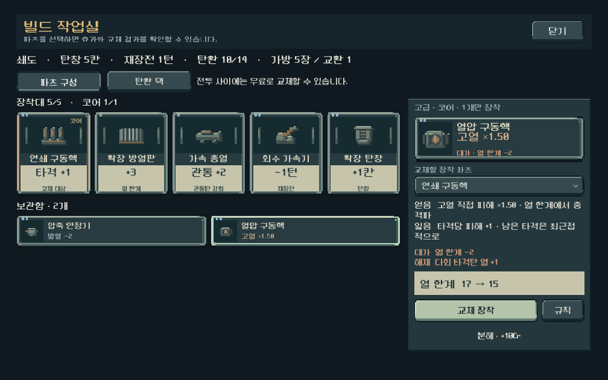

# 상점·파츠 UI와 외부 디자인 원칙 선별 적용 — 2026-10-17

## 결정과 구현 범위

사용자는 [블로그](https://leevigong.tistory.com/50)의 활용 가능성 검토 후 진행을 승인했다. [taste-skill 공식 저장소](https://github.com/Leonxlnx/taste-skill)의 세계와 연결한 디자인, 현재 화면 조사, 통합 화면 비교 관점을 기존 Godot 작업에 반영했다. 웹용 레이아웃·글꼴·대칭 회피·색상 제한을 통째로 가져오지 않았고 외부 플러그인을 추가 설치하지 않았다. 현행 기준은 [아트·UX 문서](../../direction/art-and-ux.md#세계관을-연결하는-ui-제작-기준), 발견 경로는 기존 `08-art-resource-manager` 스킬이다. 활성/외부 작업 루트의 스킬을 동일하게 갱신했다.

이 화면은 디렉터의 구현안이다. 기능 통과와 별개로 사람의 미감·직관성 평가는 아직 받지 않았다.

- 상점 실내 그림의 전체 구도를 유지하며 높이를 줄여, 작은 가로 화면에서 상품과 구매 버튼을 스크롤 없이 확인한다. 다른 실내에는 기존 높이 규칙을 유지했다. 승인된 배경·주인공 레이어를 다시 그리지 않았다.
- 상품 카드를 같은 크기로 맞추고 가격을 아래로 분리했다. 오른쪽에서 효과, 비용/패널티, 구매 후 장착 또는 보관 여부, 잔액을 비교한다. 상세 규칙은 별도 버튼으로 연다. 보유 코어와 새 코어의 중복은 ‘구매 후 보관, 이후 교체’로 설명한다.
- 파츠 카드는 탄환 카드와 금속 테두리/밝은 성능표를 공유하면서 장착 레일과 기존 파츠 실루엣을 사용한다. 효과 수치를 크게, 이름과 보조 문구를 일정한 위치에 둔다. 코어·등급·포커스·눌림·선택 상태를 유지한다.
- 파츠 관리의 겹겹 패널을 줄이고 장착 5칸/보관함/교체 상세를 나눴다. 선택한 파츠와 빠지는 파츠를 구분하고, 얻음·잃음과 대가·해제되는 패널티를 분리했다. 실제 모델의 탄창·재장전·열 한계 등 변화는 밝은 성능표에 모았다. 분해는 보조 행동이며 기존 확인 절차를 유지한다.
- 상점 탄환 교체 완료 문구가 실제 구매 로그의 `removed`를 읽도록 교정했다. ‘한 장 추가’와 ‘기본탄 교체’를 정확히 구별한다.

`shop_offer.tscn`과 `part_inspector.tscn`으로 반복 상품/상세를 직렬화했다. `shop_workbench.tscn`, `deck_loadout.tscn`에 대표 상품·장착/보관 상태를 넣어 런타임 바인딩 전에도 구성이 보이게 했다. 실제 데이터 적용 시 미리보기만 제거한다. 새 프레임은 기존 원본 Godot 드로잉을 확장했으며 외부 사이트의 이미지·코드를 게임 자산으로 복사하지 않았다.

## 실제 화면

[이전 상점](shop_parts_design_2026-10-17/before_shop_1008.png) · [이전 파츠](shop_parts_design_2026-10-17/before_parts_1008.png)

[긴 가로 상점](shop_parts_design_2026-10-17/shop_core_1440.png) · [빈 장착대](shop_parts_design_2026-10-17/empty_parts.png) · [전투 중 열람](shop_parts_design_2026-10-17/readonly_parts.png)

초기 실행 화면에서 발견한 안내 줄 잘림·압축 충전 아이콘/문구 겹침을 정리한 뒤 최종 화면을 확인했다. 카드/그림의 개별 미리보기만으로 판정하지 않았다. 넓은 화면의 실내 그림 오른쪽 여백은 현재 유지했고, 장식이나 무관한 지표를 추가해 채우지 않았다.

## 검증

Godot MCP에서 실제 엔진 4.7과 프로젝트 연결 확인. 기존 씬/코드 편집 및 CLI 실행·캡처 경로로 검증했다. 모든 테스트는 `qa_runtime`의 격리 저장에서 실행했다.

| 명령 | 결과 | 확인 범위 |
|---|---:|---|
| `tools/run_shop_parts_checks.ps1` | 229검사 / 실패0 | 1008×630,1280×900,1440×630. 구매 버튼 첫 화면 노출, 실제 가격 차감, 보관, 코어 교체, 해제/재장착, 품절, 재화 부족, 14장 교체/문구, 빈 장착대, 전투 중 열람 |
| `tools/run_director_ui_checks.ps1 -Mode navigation` | 467검사 / 실패0 | 3해상도 상점 비교 크기 유지, 장착 교체/저장 복원, 전체 보관함 끝 항목, 탭, Escape 포커스 복구, 분해 취소·확정, 장비 선택 왕복 |
| `tools/run_earned_ammo_checks.ps1 -Mode ui` | 322검사 / 실패0 | 첫 코어/특수탄 보상, 기본탄 교체/추가/취소, 상점 14장 교체, 개조 사본 보존 |
| `tools/run_modal_touch_checks.ps1` | 79검사 / 실패0 | 파츠 카드에서 손가락 드래그·내부 보관함만 스크롤, 분해 터치 확인, 뒤로/포커스 경계, 모달·지도·전투 입력 회귀 |

합계 **1,097검사 / 실패0**. 이는 자동 입력·기능 판정 수이며 사람의 이해도를 뜻하지 않는다. 실제 Galaxy의 터치/성능/미감은 미확인이다. Godot 에디터 import 종료0, 파싱·스크립트 오류 없음. 환경의 Android build-tools 경고가 있었으나 이번 작업은 APK 빌드가 아니다.

현재 규칙과 맞지 않는 과거 검사도 별도로 식별했다. `interaction_flow`는 이전 전투 순서/회수 전제에서 반복되어 중지했고, `service_location`은 이전 서비스 버튼/획득 규칙 및 상점이 반드시 스크롤된다는 전제에서 실패했다. 이 둘을 통과 목록에 넣지 않았다. [초기 시도 로그](shop_parts_design_2026-10-17/legacy_attempts/)를 보존했다. 현행 경로는 위 네 검사로 확인했으며, 과거 두 러너 전체의 갱신은 후속 유지보수다. `navigation`의 고정된 옛 특수탄 시작 목록과 동적 노드 부재 검사는 실제 시작 덱·열람 전용 버튼 비노출 기준으로 갱신했다. 효과/패널티가 분리된 새 노드에 맞춰 `interaction_flow`의 해당 단일 비교 assertion도 수정했으나 전체 러너 통과로 간주하지 않는다.

외부 스킬 검증기의 PyYAML 의존성이 두 Python 런타임에 없어 `quick_validate.py` 실행은 불가했다. 기존 frontmatter의 name/description과 연결 문서 존재, 두 스킬 사본 동일성은 직접 확인했다. 새 의존성은 설치하지 않았다.

## 보존 범위와 실행

작업 전 스냅샷과 SHA256 비교로 `content.gd`, `campaign.gd`, `model.gd`, `ammo_acquisition.gd`, `deck_loadout.gd`가 동일함을 확인했다. 가격·탄환 효과·파츠 판정·소유물 규칙은 변경하지 않았다. [보존 확인](shop_parts_design_2026-10-17/rules_unchanged.json) · [수정 소스 해시](shop_parts_design_2026-10-17/source_hashes.json).

기존 작업 트리를 보존했다. APK/Drive/커밋/푸시 없음. 실제 실행은 저장소 `PLAY.cmd`, 빠른 확인은 메인 개발자 연습의 상점/파츠 관리로 진입한다.
