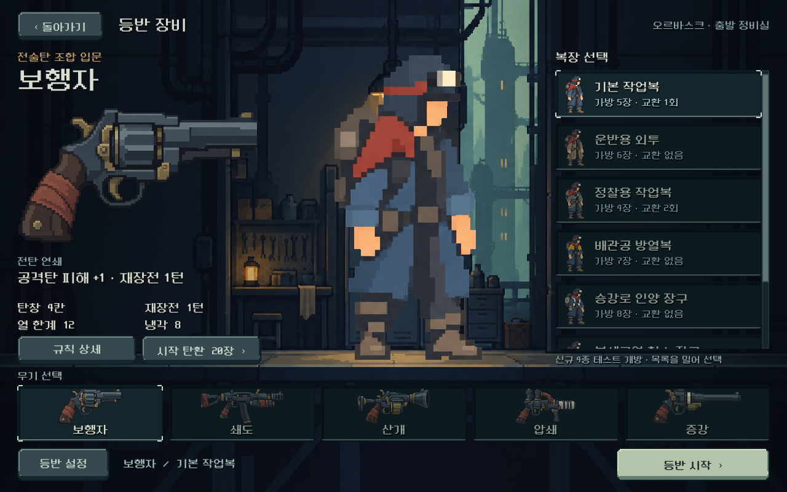
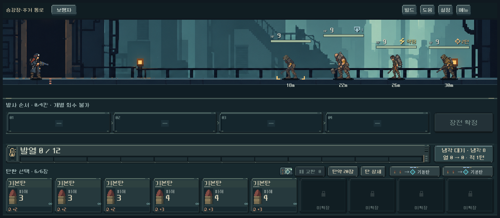
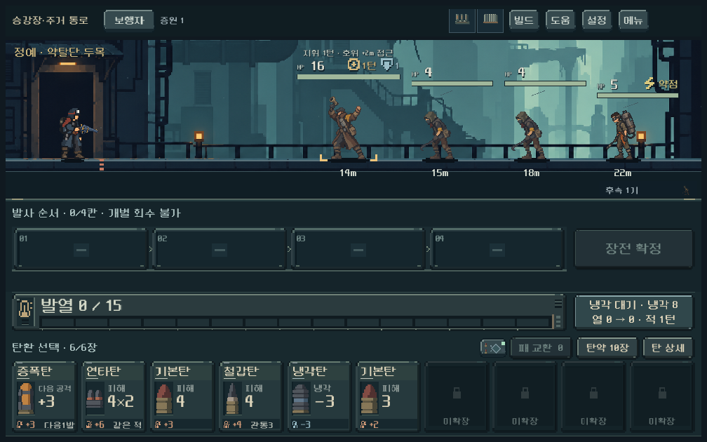
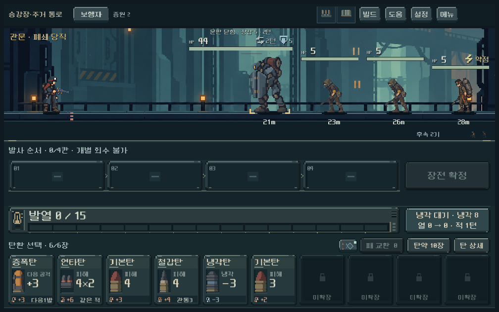
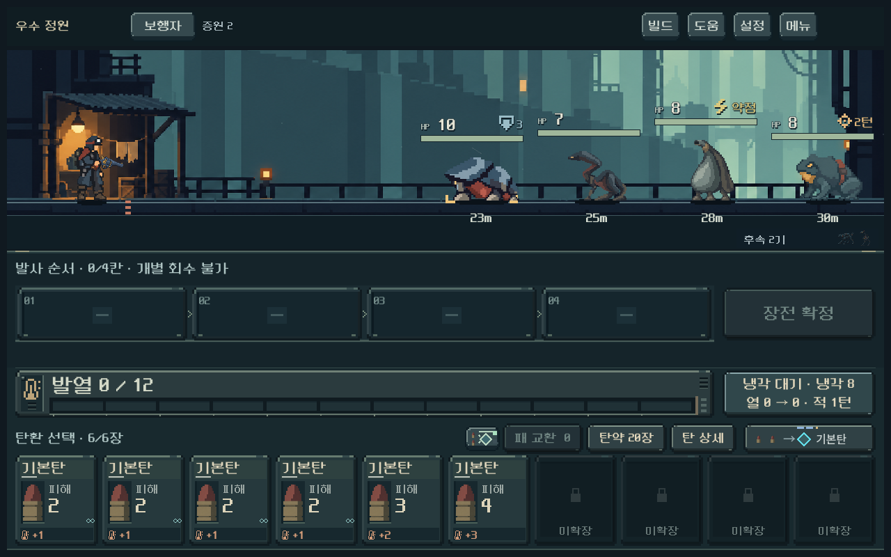

# 복장 윤곽과 인간 약탈단 적용

2026-10-21. 사용자 승인 범위: 선택 복장 윤곽 완화,1구역 도둑·약탈자, 기존 생물 이관. 커밋·푸시·APK는 요청하지 않아 실행하지 않았다. 작업 완료 후 PC 종료 요청을 받았다.

## 구현

- 선택 전용7복장 v4: 검은 선 대비 축소, 재질색 경계·공통 자세 유지. 선택 복장이 목록 밖에 남지 않도록 자동 스크롤.
- 인간 일반4종+정예1종, 각3키포즈. 현재 계산에 연결한 이동/조준/발사/지휘와 기존 피격·소멸 연출. 폐쇄 당직 유지.
- 실제 전장 실루엣, 터치 상세, 이름/설명, 행동 예고, 개발자 정예 바로가기, 후속 아이콘 연결.
- 편성7로 새 등반만 전환. 기존 저장1~6 유지.2구역과4~5구역 계산·편성 유지.
- 생물4종과 공명 정예를3구역에 연결. 일반6~7기·정예6기·관문7기의 유한 편성으로 조정.

## 검증

Godot4.7, Windows, 격리된 `qa_runtime` 저장. 일반 플레이 저장/프로필을 사용하지 않았다.

| 확인 | 결과 |
| --- | --- |
| 새/기존 저장·지역 편성·동일 전투 수치·실제 지휘/압력탄·예측 | `run_slum_checks.ps1 -Mode rules`: 2,007검사 실패0 |
| 2구역 규칙 회귀 | `run_foundry_checks.ps1 -Mode rules -RunTag _slum_v7`: 1,875검사 실패0 |
| 실제1→2구역 연속 진행 | 5총기, 시드731042,6,711검사 실패0. 다섯 등반 모두2구역 관문 통과 후3구역 지도 진입 |
| 3구역 진입 저장/전투 가능성 | 실제2구역 통과 덱,5총기×초반/후반/정예/관문20편성. 741검사 실패0 |
| 실제 UI·아트 | 1008×630,1280×800,1440×630. 1,250검사 실패0 |
| 정예·보스 기존 UI 회귀 | 본체/HP/거리·압력탄·피니시 확대. 1,916검사 실패0 |

3구역 대표 편성은 도착 덱을 복제해 개별 전투를 확인한 것이며, 전체 경로를 플레이한 결과는 아니다. 탐색기는 미래 손패/RNG를 아는 제한 탐색을 사용한다. 성공 경로가 있다는 증거이며 사람의 승률·재미·난도 균형을 보장하지 않는다.2구역 압쇄는 해당 경로에서 관문 잔탄1발로 여전히 빠듯하다.

## 시각 검수와 수정

- 중앙 전신7종·작은 목록·첫 지역 일반/정예/관문과 정원 생물 화면을 실제 GPU 캡처로 확인했다.
- 원화 아틀라스의 도둑 이동 칸에 다른 자세 팔 조각이 들어오는 문제를 폴리곤 경계로 교정했다. 이동 쇠지레는 보존했다.
- 후속 적 미니어처가 이전 생물인 문제를 종별 인간 원화로 교체했다.
- 기존 정예 UI 회귀에서 신호 도구를 올릴 때 체력 정보와 겹치는 문제를 발견했다. 최대 자세 여유와 고정 상태 영역 폭을 조정했다.
- 정원 검증의 최초 실패는 가상 노드로 경로를 건너뛴 테스트 상태를 정식 캠페인 저장으로 검사한 오류였다. 실제 지도 노드를 사용하고 실제 진입 저장/개별 전투 저장 검사를 분리해 수정했다. 전투 난도를 낮춰 실패를 숨기지 않았다.

## 실제 화면

## 남은 확인

- 새 원화의 사용자 미감과 Galaxy 실제 화면·동작.
- 3구역 전체 경로·경제·난도, 전용 배경/관문 아트. 현재 배경과 집수 조정기는 기존 임시 리소스를 사용한다.
- 실제 플레이 테스트는 기존 `PLAY.cmd` → 새 등반. 이어하기는 기존 편성을 보존한다. 정예/폐쇄 당직은 개발자 메뉴에서 바로 확인할 수 있다.

아트 원본·프롬프트·참조: [provenance.json](../../../새-게임-프로젝트/assets/art/slum_20261021/provenance.json).

최종 실행 로그: [규칙](assets/slum_outfits_2026-10-21/rules.log), [UI](assets/slum_outfits_2026-10-21/ui.log), [정예·보스 회귀](assets/slum_outfits_2026-10-21/challenge_ui.log), [2구역 회귀](assets/slum_outfits_2026-10-21/foundry_rules.log), [연속 진행](assets/slum_outfits_2026-10-21/campaign.json), [정원 대표 편성](assets/slum_outfits_2026-10-21/garden.json). 합계14,500검사 실패0.
