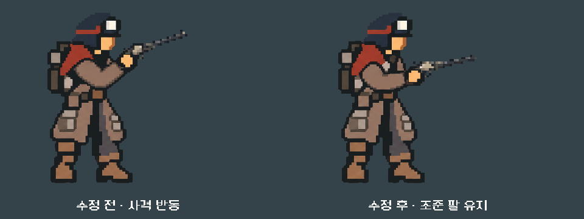

# 스파이크 사격 팔 — 1차 교정

2026-11-06. 작업44개 중34번의 첫 구현이다. 원래 제보의 복장/장면은 아직 특정되지 않았으므로 **확인한 팔 들림의 교정**과 **사용자가 본 결함의 최종 해결**을 구분한다. 다른 아트/VFX·리벳 양손형까지 완료한 기록이 아니다.

## 확인한 현상과 변경

7복장의 대기·조준·반동·재장전·냉각을 본편 `weapon_actor.tscn`으로 렌더하고 실제 첫 전투의 사격 입력도 관찰했다. 스파이크는 권총 공용 반동 몸체를 사용해 조준에서 반동으로 넘어갈 때 손목/팔이 크게 올라갔다. 작업복 등록값 기준 손 접점은 조준 대비 `(11, -43)` 소스 단위로 이동했다. PNG에서 손이 떨어져 있는 별도 섬이나 스파이크 총 원화에 팔이 구워진 현상은 확인하지 못했다.

`weapon_actor.gd`의 스파이크 반동 몸체/접점만 조준 프레임을 사용하게 했다. 사격 상태와 총구 반동은 유지하고 총은 그 손 접점을 중심으로 회전한다. 몸체·앞손·무기의 등록값이 같은 프레임을 따르며 효과 총구도 실제 무기 변환을 따른다. 대기/장전/냉각·다른4총기의 선택 경로와 원화는 바꾸지 않았다.

아래는 동일 복장·동일 최대 반동의 Godot 원본 뷰포트를 같은 크기로 표시한 비교다. 왼쪽이 변경 전, 오른쪽이 변경 후다.

[실제 전투 전](battle_before.png) · [실제 전투 후](battle_after.png) · [7복장 전](before/) · [7복장 후](after/)

## 검증

Godot4.7 / Compatibility / NVIDIA4060Ti, 일반 저장과 분리한 APPDATA/LOCALAPPDATA에서 실행했다.

| 요구/위험 | 실행과 결과 |
|---|---|
| 반동 중 손 접점·크기 유지, 실제 총구 추종/복귀, 장전 개방 | `tools/run_spike_motion.ps1 -Mode rules -Label rules_after`: 7복장×21반동 구간을 포함한 기하 검사623, 실패0 |
| 실제 입력과 저장 재개에서도 같은 복장/동작 | `-Mode live -Label live_after`: 7복장에 사격→재장전→냉각→실제 파일 저장/복원→동작 축소 사격. 공개 터치 입력28회, 검사119 실패0, 고유 상태77개 캡처 |
| 상태별 팔/총과 다른 총기의 잘림 | `-Mode poses -Label after`: 7복장×8샘플 렌더. `run_unified_outfit_checks.ps1 -Suite catalog`: 5총기×7복장×6자세210검사 실패0 |
| 장비 선택/전투 합성·손/총구·실내 복장 회귀 | 같은 런처 `-Suite integration`: 1,368검사 실패0 |
| 기존 전투 HUD 입력/표시 | `tools/run_prototype_hud.ps1 -Mode ui -Fast`: 11,558검사 실패0 |

전후 매트릭스7종과 수정 후 실제 전투/재장전/냉각 화면을 확인했다. 기능 통과와 사람의 자연스러움 평가는 같지 않으며 Android 실기기·원래 제보 장면의 재확인은 남는다. 기존 사격/장전/냉각의 타이밍·화면 구성·전투 수치는 이번에 변경하지 않았다.

## 재현 자료와 코드 상태

- [이번 단계의 실제 소스 차이](weapon_actor_this_step.diff), [변경 전후 SHA256](source_audit.json). 단계 시작에 보존한 소스와 비교하면 `weapon_actor.gd`만 다르고 `model/campaign/content/campaign_content/forecast/weapon_art/outfit_art.gd`는 동일하다. Git 전체 diff에는 이전 미커밋 작업도 있으므로 이번 수정으로 간주하지 않는다.
- [기하 검사 원문](rules_after/stdout.log), [실제 전투 원문](live_after/stdout.log), [관찰 상태77개](live_after/live.json), [전체 합성 검사](integration_after/stdout.log), [HUD 검사](hud_after/stdout.log), [증거 해시](evidence_sha256.json).
- 원본 사격 캡처·중간 프레임/격리 저장은 `qa_runtime/spike_motion_20261106/`에 보존했다. 네이티브 전후 비교는 `tools/run_spike_motion.ps1 -Mode compare -Label compare`로 다시 렌더한다.
- 다음 아트 단계는33번의 선/색/픽셀 밀도 대표 샘플 비교다. 리벳 양손형42번은 이 합성 경로와 연결하되 새 접점/양손/7복장을 따로 검수한다.

APK·커밋·푸시·외부 게시 없음.
