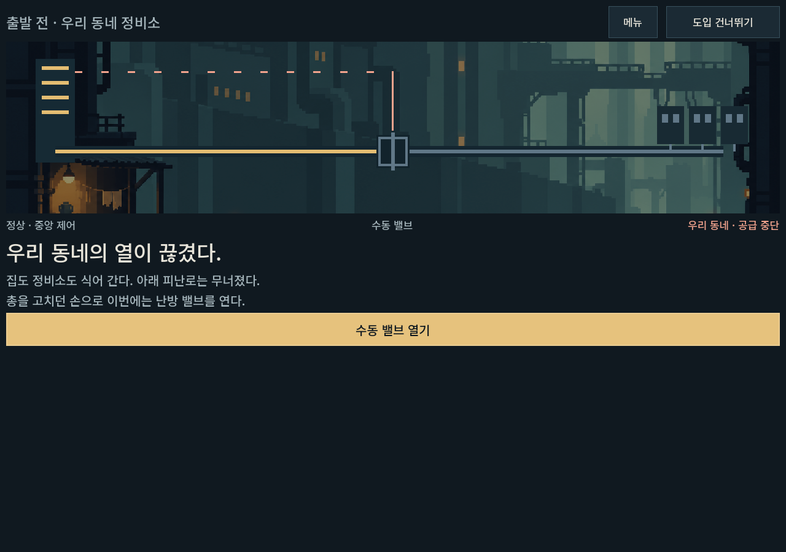
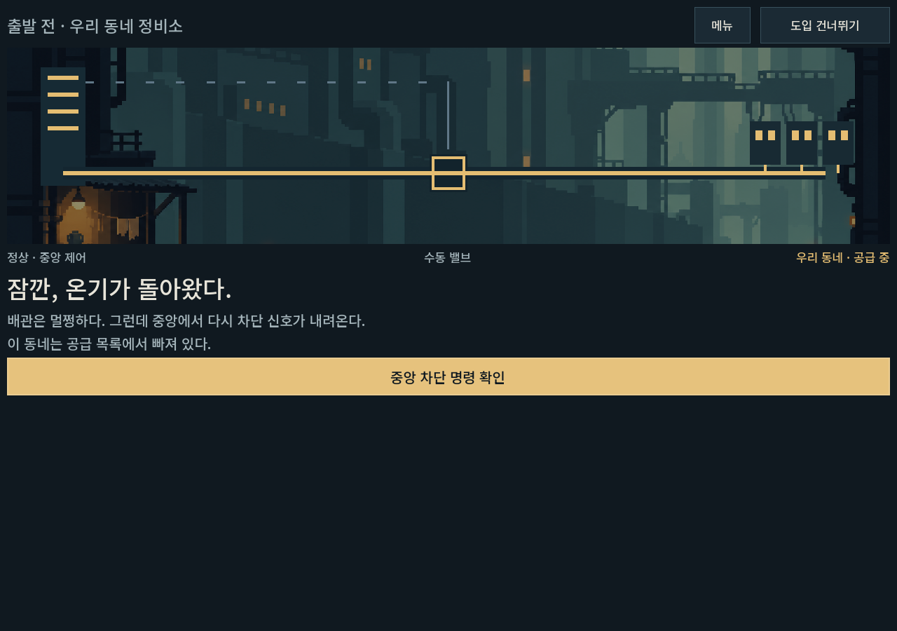
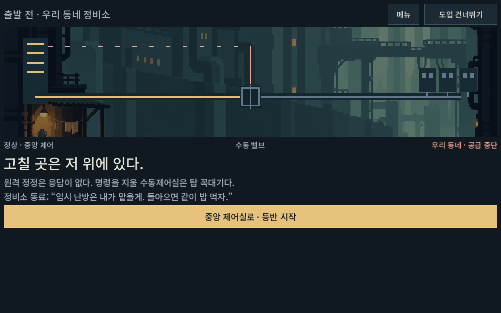
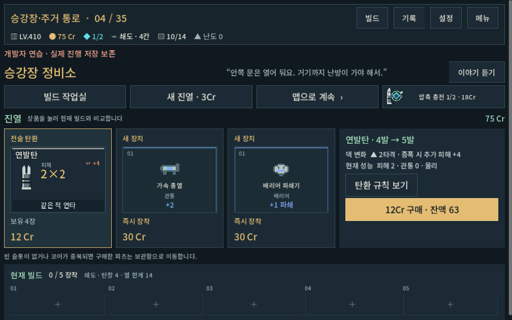
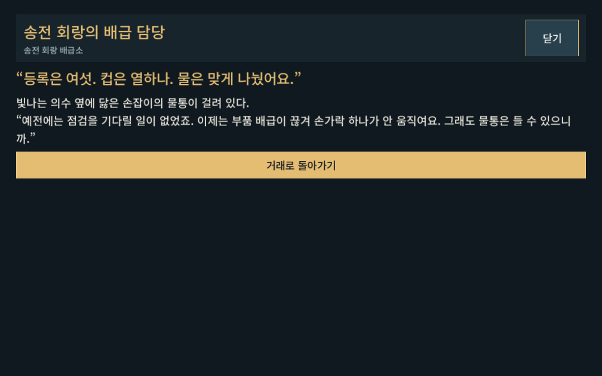
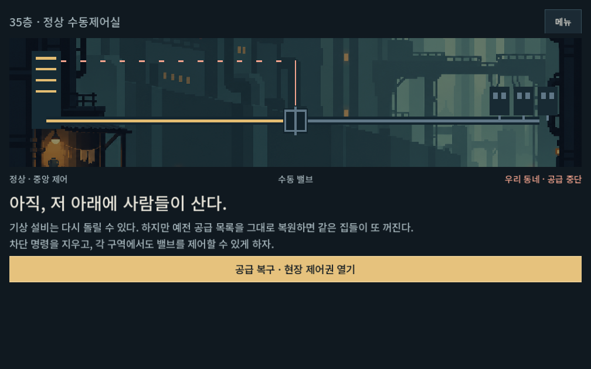
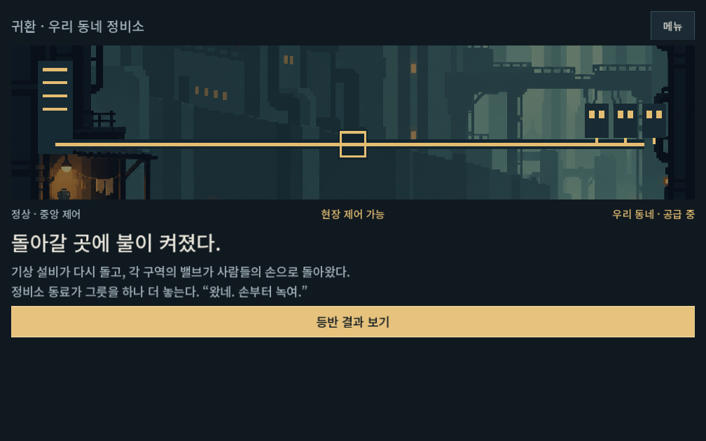
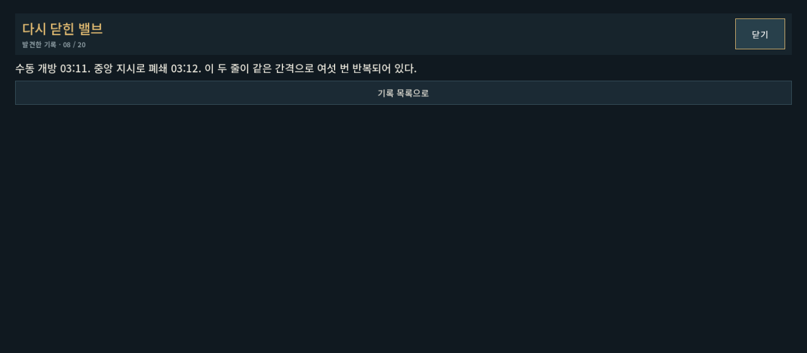

# 등반 동기 · 기록 · 복구 흐름 적용

2026-10-09 · Godot 4.7 · `prototype/core-redesign`의 기존 작업 트리에 추가. APK/커밋/푸시는 이번 범위가 아니다.

## 바뀐 플레이

주인공은 집과 정비소가 있는 거주구의 공급 차단을 해제하러 정상으로 간다. 새 등반에서 수동 밸브를 열면 배관과 창의 불이 들어오고, 중앙 명령 확인 뒤 다시 닫힌다. 동료는 아래에서 임시 공급을 유지한다. 개인적인 출발 목적이 지역 주민들과의 만남을 거쳐 각 구역의 현장 제어권 복구로 넓어진다.

- 도입은 3단계이며 즉시 건너뛸 수 있다. 메인/지도에도 목표가 남는다. 도입 중 메뉴로 나갔다 이어하면 같은 단계부터 재개한다.
- 지역 표시를 승강장·주거 통로 / 축열 주조장 / 우수 정원 / 송전 회랑 / 관측대·제어실로 맞췄다. 경로 ID/방 수/편성/가격은 보존했다.
- 상점5곳에는 한 줄 인사와 선택 대화를 넣었다. 배관공의 자재 격차, 부품 배급이 끊긴 개조 주민 등으로 계급 소재를 간접 전달한다. 이야기는 구매 조건이나 가격을 바꾸지 않는다.
- 기록20개를 현행 원고로 교체했다. 기존 발견 ID와 획득 조건을 유지하며 기록실/본문은 전체 화면 작업실에서 읽고 돌아간다.
- 마지막 관문 승리 뒤 직접 `공급 복구 · 현장 제어권 열기`를 누른다. 귀환 화면에는 다시 열린 밸브와 창의 불빛, 동료와의 식사가 이어진다. 결과 보기는 별도 버튼이다.
- `departure_step`(0~3)과 `restoration_done`만 캠페인 저장에 추가했다. 이전 저장에는 도입을 끼워 넣지 않으며 과거 완료 런은 완료를 유지한다. 복구 직전은 승리 보상 정산 후에도 메인에서 이어볼 수 있다. 복구를 반복해 보상받을 수 없다.

## 실제 확인

| 검사 | 결과 | 범위 |
| --- | ---: | --- |
| 서사/저장/화면 | 647 / 실패0 | 1280×900, 1008×630, 1440×630. 작은 비율은 글자1.1배. 실제 터치 입력으로 도입/이어하기/상점/복구/기록 복귀, 구 저장 발견 ID 보존, 잘못된 서사 필드 거부, 개발 미리보기 저장 보존 |
| 기존 진행 규칙 | 4,949 / 실패0 | 시작 보급·파츠·경제·저장 규칙 |
| 메인/총기 준비 | 33 / 실패0 | 새 등반 준비·무기 선택·훈련 진입 |
| 내비게이션 UI | 418 / 실패0 | 주요 화면 조작·작은 화면·선택/작업실 복귀·기존 진행 교체 취소 |
| 기존 전투 탄창 화면 | 947 / 실패0 | 최신 v12 캠페인 기록에서 실제 명령으로 성장 탄창에 도달한 뒤 예측/배치 확인. 전체35층 UI 재생 검사는 아님 |

서사 검사에서 마지막 전투의 승리는 fixture로 만든다. 이 검사를 전투 밸런스/새로운 전체35층 승률 검증으로 해석하지 않는다. 기존 전투 화면 검사에는 `campaign_synergy_final` 기록을 명시했다. 기본 경로의 과거 기록으로는 재생 실패가 났고, 현재 산개의 비동기 예측을 기다리지 않던 검사도 갱신한 뒤 통과했다. 초반 서사 검사에서는 JSON 정수/실수 배열 비교와 상점 테스트의 지역/노드 불일치를 수정했다. 제작 코드에서는 좁아진 보조 버튼 폭을 보정했다.

원본 [서사 결과](story_flow_2026-10-09_assets/story_report.json), [서사 로그](story_flow_2026-10-09_assets/stdout.log), [진행 규칙](story_flow_2026-10-09_assets/progression_rules.log), [내비게이션](story_flow_2026-10-09_assets/navigation.log), [전투 배치](story_flow_2026-10-09_assets/city_layout.log). 알려진 시스템 인증서 읽기 경고 외 스크립트 오류는 없다.

실행:

```powershell
powershell -NoProfile -ExecutionPolicy Bypass -File tools/run_story_checks.ps1 -Label current
powershell -NoProfile -ExecutionPolicy Bypass -File tools/run_progression_checks.ps1 -Mode rules -Label story
powershell -NoProfile -ExecutionPolicy Bypass -File tools/run_director_ui_checks.ps1 -Mode frontend
powershell -NoProfile -ExecutionPolicy Bypass -File tools/run_director_ui_checks.ps1 -Mode navigation
powershell -NoProfile -ExecutionPolicy Bypass -File tools/run_director_ui_checks.ps1 -Mode city -CampaignSource qa_runtime/progression/campaign_synergy_final/city_campaign_report.json
```

모든 자동 검사는 `qa_runtime/` 아래 APPDATA/LOCALAPPDATA를 사용했다. 플레이어 실제 저장에는 쓰지 않았다.

## 화면 확인

실제 Godot 캡처로 도입의 공급 전/후, 작은 화면의 출발/복구/귀환 버튼, 상점의 거래와 대화 위계, 기록 본문의 가독성을 확인했다.










## 플레이 경로와 남은 범위

[PLAY.cmd](../../../PLAY.cmd) → 새 등반 준비 → 총기 선택/시작. 진행을 교체하지 않고 확인하려면 메인 `개발 → 출발 장면 · 밸브` 또는 `개발 → 정상 복구 · 귀환`을 사용한다. 개발 세션은 실제 진행 저장을 보존한다.

이번 이미지는 승인된 주거 배경 위에 그린 공급 도식이다. 새 NPC 원화, 동료와의 생활 애니메이션, 지역별 최종 배경/컷신, 아이템의 접힌 흔적 상세, 새 몬스터 자산은 후속이다. 사람의 실제 이해도/감정 전달과 Galaxy 실기 조작은 아직 확인하지 않았다. 임시 난방을 실제 제한 시간이나 재시도 패널티로 바꾸지 않았다.
