# 이야기 장면·확인 창·파츠 상세 — 승인된 장면 구성으로

2026-11-08. 사용자 요청: "1~3까지 진행해 줘"(3번: 아직 이전 화면인 것). 새 시안을 만들지 않았다. 조우·탄약고 장면(11-08 승인)의 구성을 그대로 가져와 본편에 적용했다. APK·커밋·푸시는 하지 않았다.

## 무엇이 바뀌었나

| 이전 | 이후 |
| --- | --- |
| 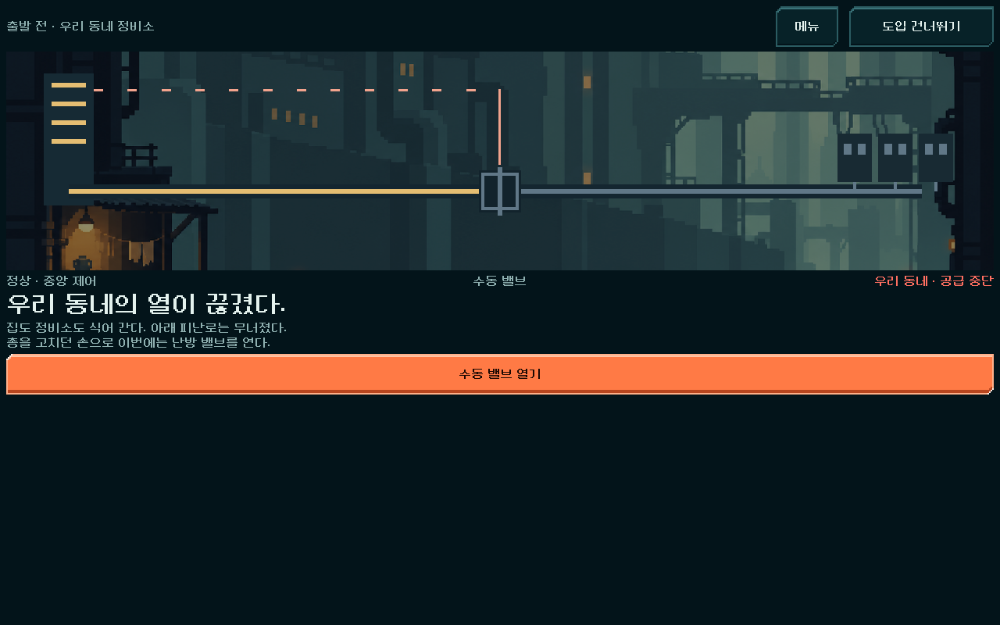 | 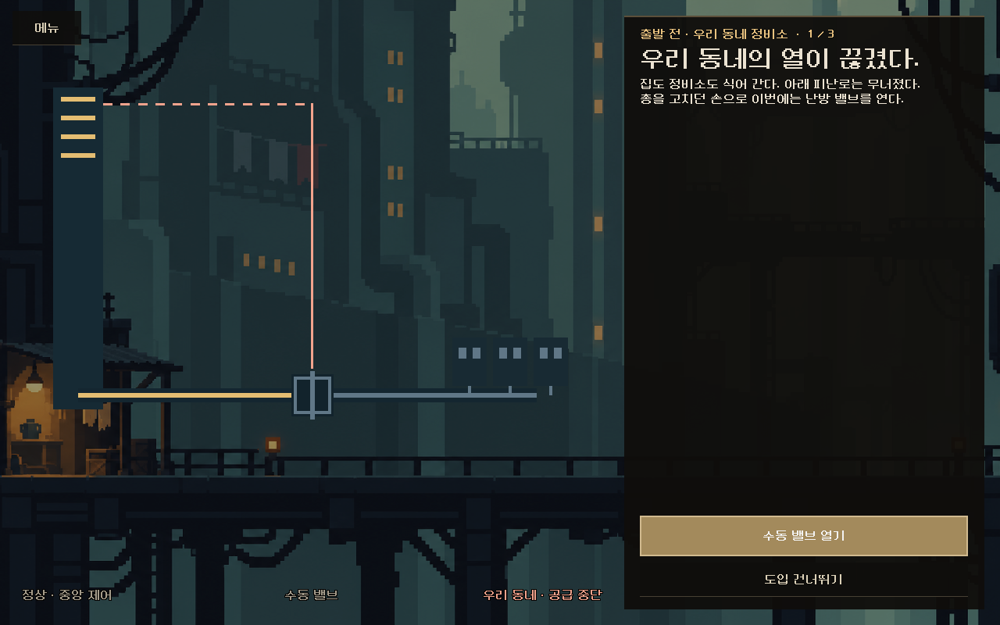 |
| 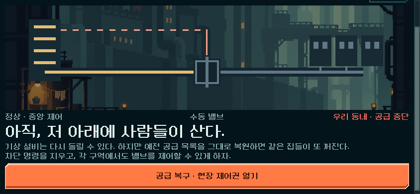 | 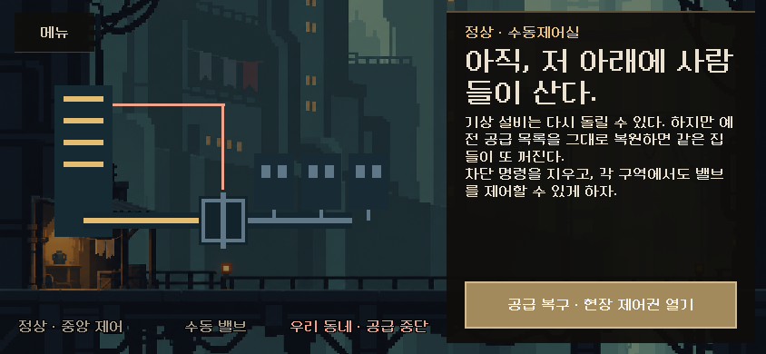 |
| 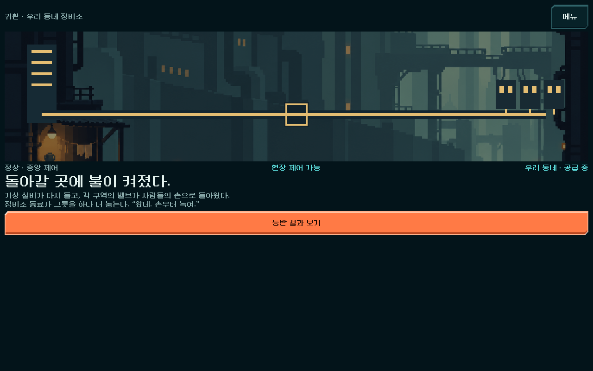 | 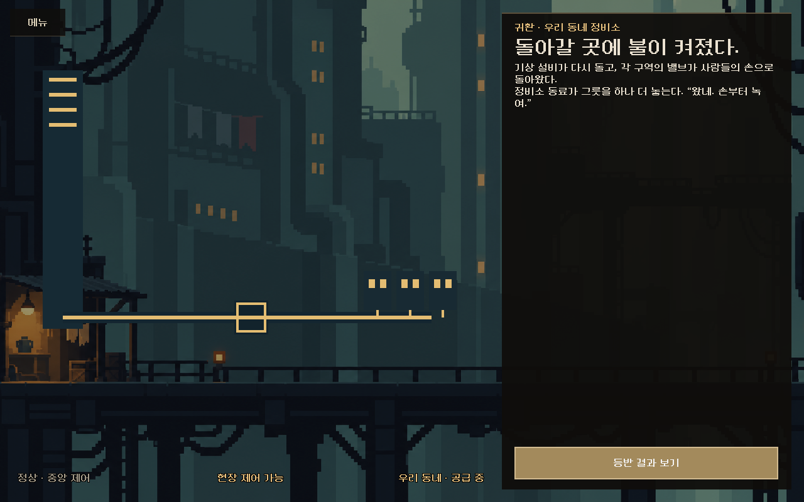 |

**출발 3장면·공급 복구·귀환** (`story/scene_view.gd`)
- 거주 구역 그림(`residential_tower.png`, 기존 승인 그림)을 화면 전체에 깔았다. 그 위에 기존 공급 도식(중앙 탑·밸브·배관·집 세 채)을 그대로 얹었다. 이전에는 위쪽 띠 안에만 있었다.
- 오른쪽 이야기 판은 조우 장면과 같다. 장소·단계(`1 / 3`), 제목, 본문, 아래 행동 버튼으로 구성된다. 출발 장면에는 `도입 건너뛰기`도 판 안에 둔다.
- 도식 아래의 상태 줄(정상 · 중앙 제어 / 수동 밸브·현장 제어 가능 / 우리 동네 · 공급 중단·공급 중)은 금색·적색으로 표시한다.
- 왼쪽 위에 `메뉴`(타이틀로)를 둔다.
- 문장은 바꾸지 않았다. 버튼 이름(`story_next`·`story_skip`·`story_restore`·`story_results`·`menu`)과 도식 이름(`SupplyScene`)도 그대로다.
- 화면 여백 0으로 장면이 화면을 채운다(`screen.gd`, 탄약고·조우와 같은 규칙).

| 장면 | |
| --- | --- |
| 출발 2/3(온기가 돌아옴) | 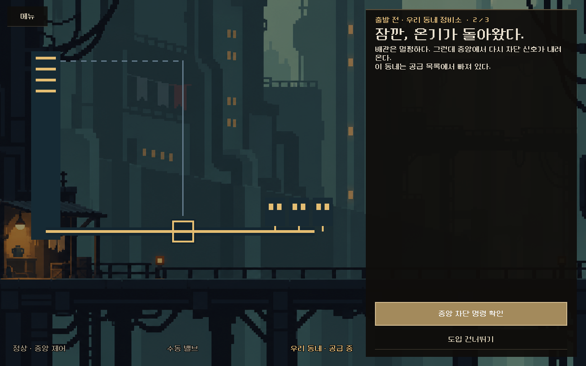 |
| 출발 3/3 | 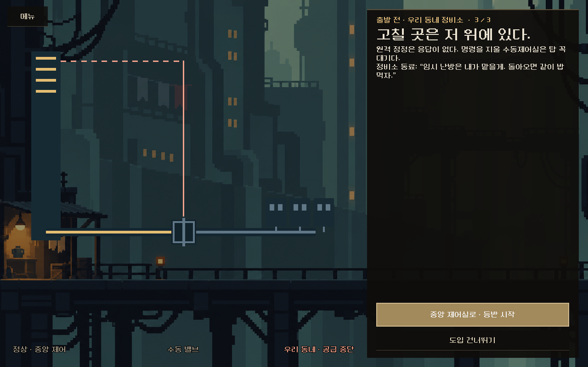 |
| 844×390 출발 | 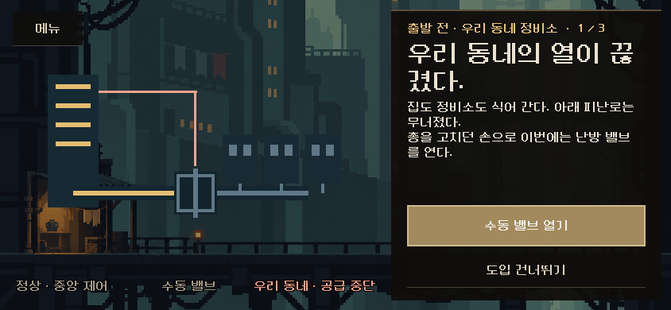 |
| 844×390 귀환 | 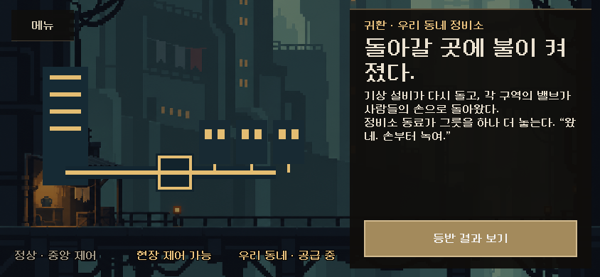 |

[1008×454 출발](departure1_1008x454.png) · [1280×800 공급 복구](restoration_1280x800.png)

**확인 창** (`common/windows.gd::confirm`)

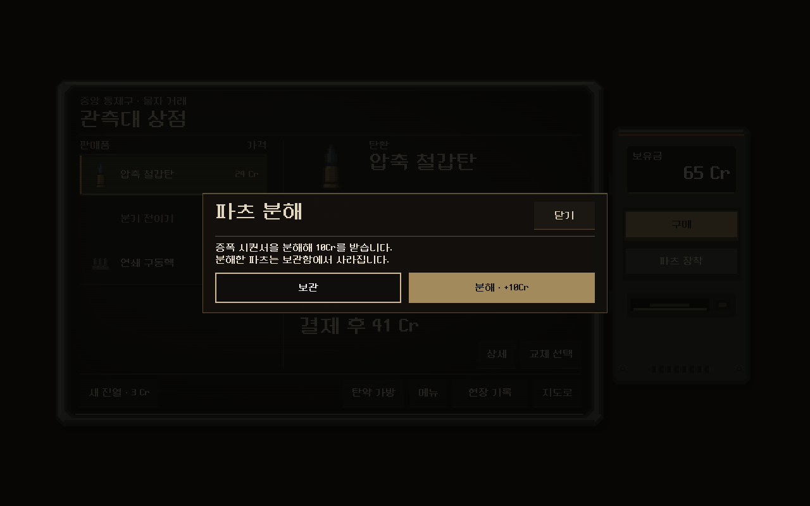

- 파츠 분해 확인이 공통 창 틀로 열린다. 메시지, `보관`, 금색 `분해 · +10Cr` 버튼이다. 높이는 내용에 맞춘다(이전 대화창은 330 고정이라 아래가 비었다).
- 장비 선택 화면에서 여는 '진행 중인 등반 교체' 확인은 11-06에 승인한 장비 대화창 재질을 그대로 쓴다.

**파츠 상세** (`campaign_ui.gd::part_details`)

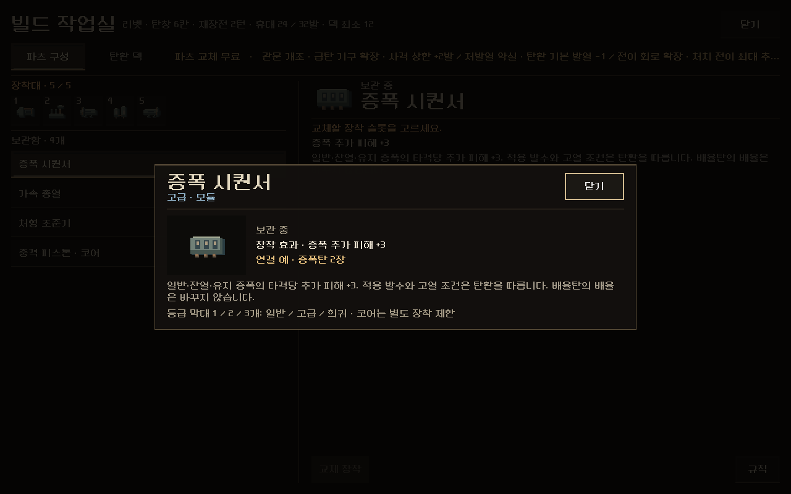

- 빌드 작업실 `규칙`, 보상, 상점 단말에서 여는 파츠 상세가 공통 창으로 열린다.
- 이전의 청록 파츠 카드 대신 장착대와 같은 픽셀 아이콘을 쓴다. 옆에 보유 상태·장착 효과·연결, 아래에 전체 규칙과 등급 막대 설명을 둔다. 등급은 부제에 등급 색으로 나온다.

## 검증

`tests/story_scenes_ui.gd`(새 파일): **90검사, 실패0, 스크립트 오류 없음.** 세 해상도(1280×800, 844×390, 1008×454)에서 실제로 터치했다.

- 출발(새 등반): 새 장면이 열리고 판·버튼·메뉴가 화면 안, 도식과 판이 겹치지 않음. `1 / 3` → `2 / 3`(온기 표시) → `3 / 3` → 지도. 단계마다 자동 저장. `도입 건너뛰기`는 지도로 가고 저장.
- 엔딩: 11-06 자동 등반의 실제 승리 상태(`won_single_17.json`, 공급 복구 대기). 공급 복구 → 저장 → 귀환(밸브 개방 표시) → `등반 결과 보기` → 결과 화면.
- `메뉴`는 타이틀로.
- 파츠 상세: 빌드 작업실에서 보관 파츠 → `규칙` → 공통 창, Esc로 닫으면 작업실 유지.
- 확인 창: 5구역 상점 상태에서 분해 확인 → `보관`은 파츠 유지 → 다시 열어 `분해` → 파츠 제거, +10Cr, 자동 저장.

## 남은 것과 주의

- 기존 공급 도식은 고정 좌표 그림이라, 큰 화면에서는 장면 그림에 비해 작게 보인다. 장면 전용 그림을 새로 만들 때 함께 다룬다.
- 탄환 상세(보상·탄약 가방에서 여는 창)와 전투 정보 등 다른 대화창은 아직 이전 청록 틀이다.
- 실기기·사람의 이해도 미확인.

## 변경 파일

[changes.patch](changes.patch) — 이 작업의 변경분만.

| 파일 | 변경 |
| --- | --- |
| `redesign/story/scene_view.gd` | 새 이야기 장면(전체 그림·도식·이야기 판) |
| `redesign/story_ui.gd` | 출발·공급 복구·귀환이 새 장면을 연다(`open_scene`) |
| `redesign/story_scene.gd` | 도식이 배경 없이 그려지는 `backdrop` 플래그 |
| `redesign/screen.gd` | 이야기 장면 여백 0, `_confirmation`이 공통 확인 창을 연다(장비 화면 제외) |
| `redesign/common/windows.gd` | `confirm()` 추가 |
| `redesign/common/window.gd` | 확인 창 고정 높이 대신 내용 높이 |
| `redesign/campaign_ui.gd` | 파츠 상세를 공통 창·픽셀 아이콘으로 |
| `tests/story_scenes_ui.gd`, `tests/story_scenes_capture.gd` | 새 검사·비교 캡처 |
