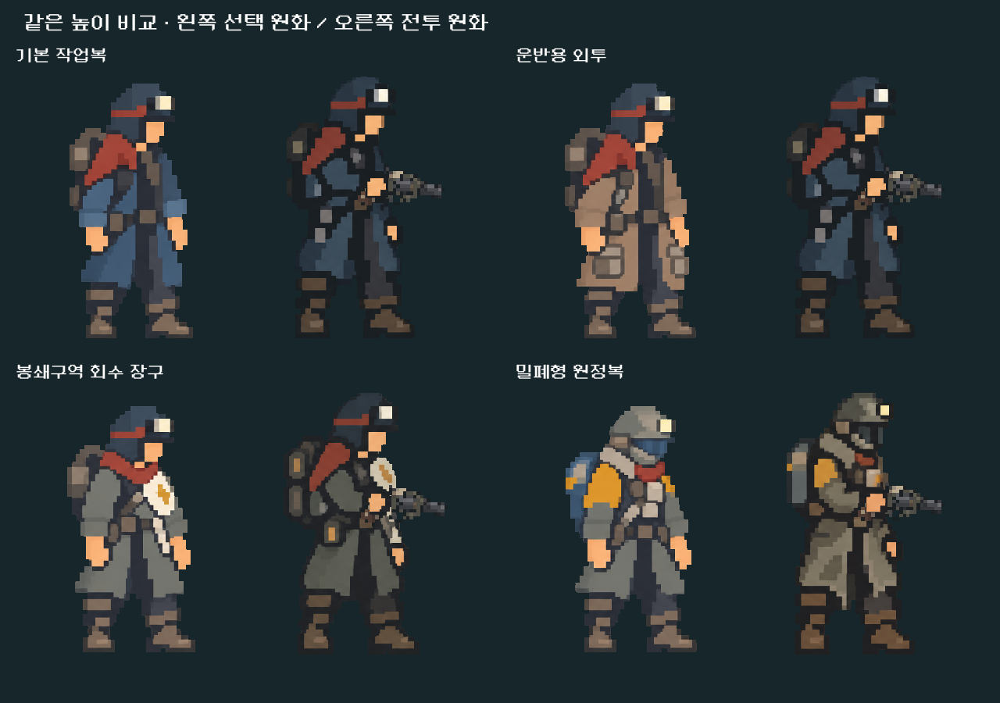
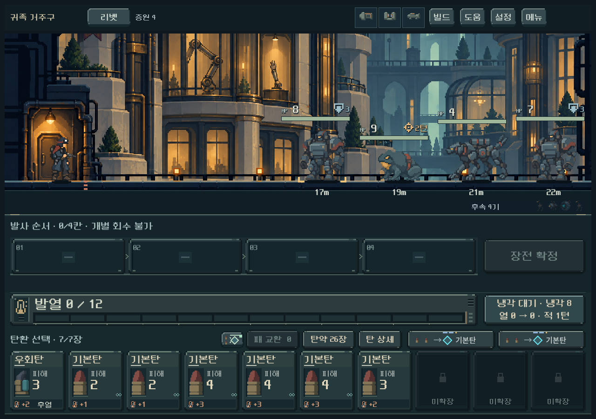
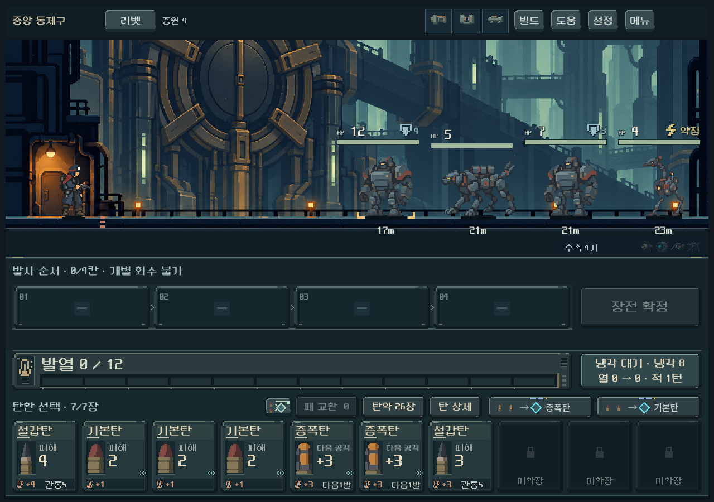

# 캐릭터 화면 간 화풍·상층 배경 전경 점검

2026-10-25 · 사용자 요청은 차이와 원인 확인. 이번에는 본편 코드·원화·규칙을 변경하지 않았다. 이전 작업 트리와 사용자 저장을 보존했다.

## 결론

캐릭터의 차이는 단순 확대 착시가 아니다. 선택 화면과 전투가 서로 다른 원화·색면·윤곽 처리를 사용한다. 같은 높이에서 비교해도 전투 쪽은 어두운 겹침선과 장구 대비가 강하며, 일부 복장은 복장 자체가 일치하지 않는다. 귀족 거주구·중앙 통제구는 원경의 분위기는 이어지지만 가까운 건축물의 가는 연속 하이라이트와 마모 묘사가 기존 배경보다 조밀하다. 전경 전체 흐림보다 해당 선·명암·묘사 밀도를 정리하는 것이 적합하다.

## 캐릭터: 관찰과 근거

비교판은 Godot에서 실제 선택용 AtlasTexture와 동일 재질, 실제 전투용 배우 렌더를 표시했다. 배경·표시 높이를 맞춘 원화 비교이며, 약93px인 본편 전투 인물을 크게 보여주는 진단 화면이다. 선택 대기 자세와 무장 자세가 다른 것은 의도된 기능 차이이며 동일 자세로 강제할 이유는 없다.

| 항목 | 선택 화면 | 전투 화면 | 판단 |
|---|---|---|---|
| 원본 | 10월20일 제작, 수정본 `outfits_v4.png` | 10월11일 몸체 v2 및 10월13일 복장별 동작 시트 | 제작 계열이 분리되어 있음 |
| 색면·윤곽 | 큰 면, 재질색 경계, 비교적 밝고 평평한 인상 | 손목·허리·장비 사이의 검은 겹침, 작은 밝은 장구가 강조됨 | 같은 높이에서도 차이 확인 |
| 복장 일치 | 7종 각각 별도 초상화 | work/carrier/scout은 기본 몸체로 대체, 나머지4종만 전용 몸체 | 운반용 외투·정찰용 작업복은 외형 연결 미완성 |
| 신규 복장 | 공통 대기 비례와 색상 | 기존 개별 복장 원화의 비례·재질색 | 원정복 헬멧/가방/황색 어깨색, 회수 장구의 명도 차이 확인 |
| 표시 보정 | 알파 잘라내기, `shadow_lift=0` | 알파 잘라내기, `shadow_lift=0.65` | 설정도 다르지만 이것만 같게 해서는 원화 차이를 해결할 수 없음 |
| 크기 | 1280×900에서 인물 약580~594px | 같은 화면에서 약93~94px | 크기 차이가 표현 차이를 더 크게 느끼게 함 |

두 화면 모두 nearest 필터이며 선명화 필터의 유무 차이는 아니다. 최신 전투 총기의 격자 처리도 몸체 원화를 통일한 작업이 아니었다. 지난 통합에서 동작·등록·표시 보정은 확인했으나 선택용 원화와 전투용 복장 디자인의 일치를 충분히 맞추지 못했다.

관련 구현: `equipment_screen.gd:12,182`(초상화), `equipment_screen.tscn:224`(표시), `outfit_art.gd:3`(전용 몸체4종), `weapon_actor.gd:53,128`(윤곽 보정·fallback), `samples/tower_battle_view.gd:94`(전투 축소 표시).

## 배경: 관찰과 근거

- **귀족 거주구:** 승강문과 난간의 황동 가장자리, 저택 창틀/처마의 가는 밝은 선, 외벽의 작은 마모 얼룩이 가까운 면에 반복된다. 상층 문 장식도 길고 가는 선으로 분리되어 기존 주거 구역의 넓은 색면보다 촘촘하다. 부유한 건축의 정체성은 유지할 수 있지만 잔묘사까지 많을 필요는 없다.
- **중앙 통제구:** 차단문 고정대·원형 잠금장치·파이프 이음의 가는 황동 반사선이 검은 홈과 바로 맞닿는다. 특히 상층 큰 원형 장치의 여러 겹 테두리가 칼같이 보인다. 큰 기계 덩어리와 저대비 면으로 묶을 여지가 크다.
- **가장 앞 발판·기둥:** 검은 면과 밝은 바닥 경계가 끊김 없이 이어져 원경보다 단단하게 보인다. 가까운 층이 또렷한 것은 정상이나, 작은 인물보다 가는 경계선이 더 눈에 띄는 부분은 줄이는 편이 좋다. 공통 코드의 2px 바닥 접지선도 명료함을 더하지만 모든 구역에 동일하므로 두 구역만의 차이를 설명하는 주원인은 아니다.
- **원경:** 탁한 청록색, 낮아지는 대비, 거대한 구조물의 깊이는 현재 방향에 어울린다. 원경과 구도 전체를 다시 그려야 하는 문제로 보지 않는다.

기존 주거 배경과 신규6장 모두1672×941이고 lossless import/nearest/no mipmap 경로다. 별도 전경 확대나 샤프닝 재질이 없다. 현재1280×900 전투에서 원본 가로1672를1260px로 줄이고 세로를 잘라 표시한다(약0.754배). 작은 선을 촘촘하게 그린 원본이 이 축척에서 화면1~2px의 날카로운 선으로 남는 것이 주된 시각 원인이다. 정확한 기여율은 측정하지 않았으며, 미감 판단과 확인된 설정을 구분한다.

## 권장 수정 순서 — 아직 적용하지 않음

1. 복장별 기준 외형을 정해 선택/전투의 옷 색·헬멧·가방·비례를 일치시킨다. 운반용/정찰용 전투 몸체 누락도 함께 해결한다. 대기·조준·재장전 자세와 현재 손·총구 등록은 유지한다.
2. 전투 장면과 배경을 기준으로 캐릭터의 그림자를 큰 면으로 묶고 선택 초상화도 같은 재질·색상으로 맞춘다. 기본복과 밀폐형 원정복으로 먼저 두 화면을 나란히 검수한 뒤 나머지로 확장한다.
3. 두 구역 전경의 연속 반사선을 끊고 수를 줄이며, 작은 마모와 이음새를 큰 도트 면으로 합친다. 바닥 경계와 플레이어 주변의 최소 대비는 보존한다. 일괄 블러나 한 번의 전체 저해상도화로 대체하지 않는다.
4. 원본 확대, 실제 전투 크기, 장비 선택 크기를 각각 확인한다. 기능 통과와 화풍 일치는 별도로 판정한다.

## 검토 범위

- 격리 `qa_runtime/style_audit_20261025`에서 Godot4.7 Compatibility 실제 렌더15장, 실행 오류0. 게임 저장 비활성.
- 4복장 선택/전투 각1장, 두 구역 높이별6장, 동일 높이 비교판1장. 비교판 최초 배치 넘침을 검수 도구에서 수정한 뒤 다시 렌더했다.
- 새 비교판과 상층6전투 화면, 원본 배경6장/기준 주거 배경/초상화/기본 몸체를 직접 확인했다. 새 기능 테스트나 밸런스 통과 수를 추가 집계하지 않았다. 모바일 실기·사용자 선호는 별도.
- [표시 경로·크기 실측](assets/style_audit_2026-10-25/evidence.json) · [재현용 캡처 스크립트](assets/style_audit_2026-10-25/audit_capture.gd).
- 새 이미지 생성·본편 수정·APK·Drive 업로드·커밋/푸시·PC 종료는 이번 요청 범위에서 수행하지 않았다.
