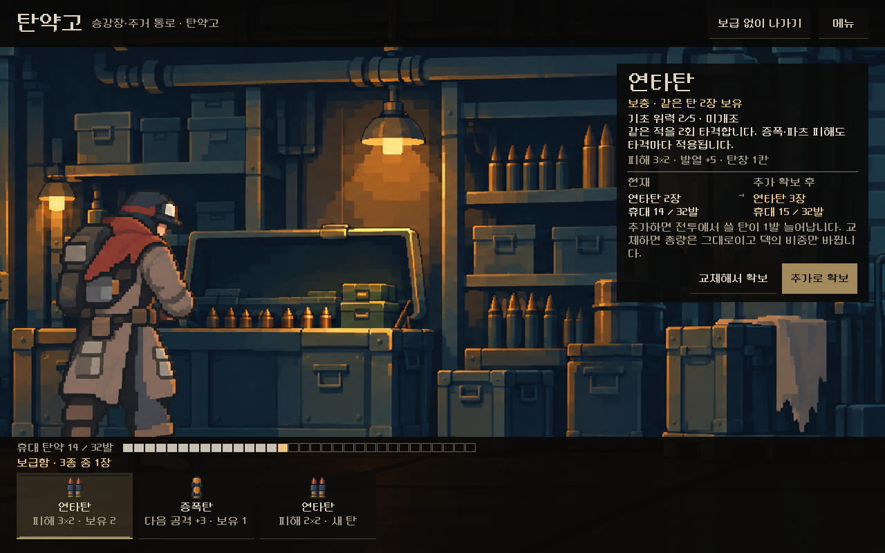
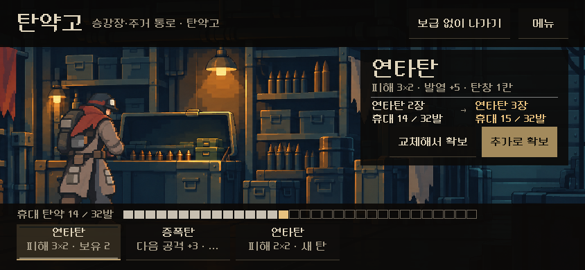
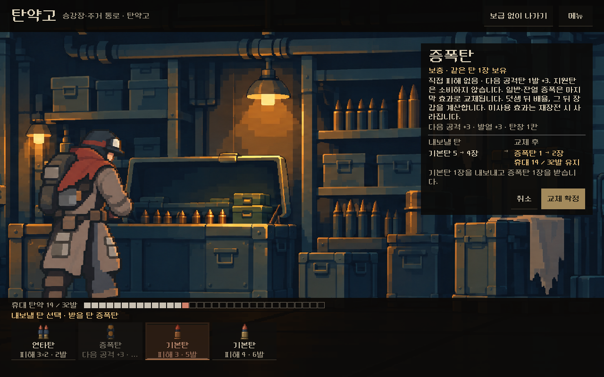
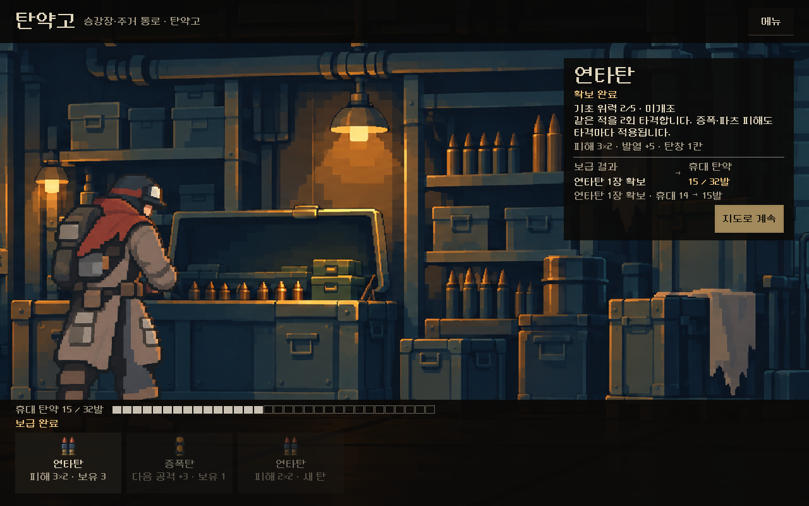
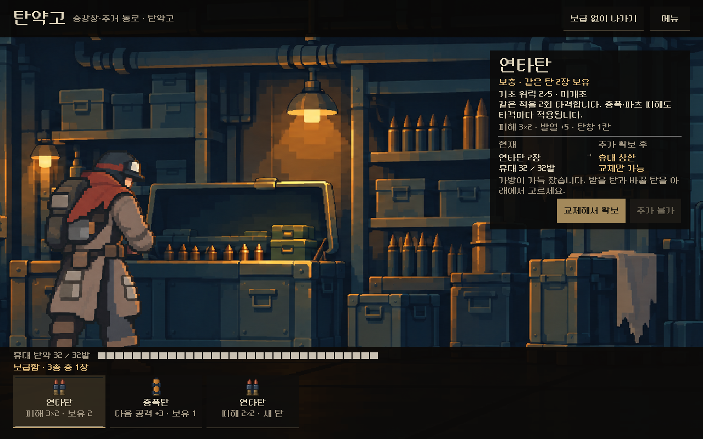

# 탄약고(보급소) — 3차 시안 본편 연결

2026-11-08. 사용자 요청: "다음 사항도 진행해 줘." 앞서 보고한 [보급소 3차 시안](../supply_review_2026-11-07/README.md)(아래 선반 구조)을 본편에 연결했다. APK·커밋·푸시는 하지 않았다.

## 무엇이 바뀌었나

`PLAY.cmd`에서 지도의 **탄약고**에 들어가면 이전의 장소 그림 + 탄 카드 3장 화면 대신 시안의 장면이 열린다. 정비 공방은 그대로 정비소 화면이다.

- 받을 탄 3장은 아래 선반, `교체해서 확보`를 누르면 같은 선반이 내 탄 묶음으로 바뀐다. 휴대 칸 게이지는 선반 위.
- 확보·교체·`보급 없이 나가기`는 본편 처리기(`_campaign_action("resolve", …)`)로 **바로 자동 저장**된다. `지도로 계속`은 지도로 돌아가며 저장된다.
- 확보 뒤 종료하고 이어하면 결과 화면(`지도로 계속`)부터 열린다.
- 머리줄 `메뉴`: 내 빌드 · 기록 · 설정 · 타이틀로(정비소·관문과 같음).
- 캐릭터는 등반의 복장을 따른다(복장별 보급 자세).
- 확보 직후 보급 칸의 '보유 N'도 갱신하도록 고쳤다(시안에서는 갱신되지 않던 부분).
- 장소 개편 이전 저장(지도 1·2판)은 기존 `service()` 화면을 쓴다.

| 화면 | |
| --- | --- |
| 고르기 1280×800 |  |
| 844×390 |  |
| 교체 — 내보낼 탄 |  |
| 확보 완료 |  |
| 가방 가득 |  |

[1008×454](pick_1008x454.png) · [메뉴](menu_1280x800.png)

## 검증

`tests/supply_live_ui.gd`(새 파일): **85검사, 실패0.** 새 등반을 시작해 1구역 첫 탄약고까지 실제로 이동한다. 가는 길의 전투는 자동 탐색기로 실제로 이기고, 보상은 실제로 받는다. 그래서 탄약고 상태가 저장 검증을 통과한다. 그 상태에서 세 해상도로 다음을 확인했다.

- 이전 화면 머리줄 제거, 실제 후보 표시, 고르기만으로는 덱 불변
- 확보 시 1장 증가와 자동 저장, 보급 칸 보유 수 갱신, `지도로 계속` 뒤 지도와 저장
- 교체 시 선반 전환·총량 유지·고른 탄 1장 감소
- 확보 뒤 이어하기 → 결과 화면, 건너뛰기 시 덱 유지
- 메뉴 → 내 빌드 열고 닫기, 가방 가득 시 교체만 가능

시안 회귀(`OPEN_SUPPLY_REVIEW.cmd -Capture`)도 146검사 통과.

## 남은 것과 주의

- **이전 탄약고 화면을 누르던 오래된 검사는 이제 실패하는 것이 맞다**: `city_ui_runner`, `earned_ammo_ui_runner`, `line_theme_capture`, `line_world_ui`, `place_clarity_ui_runner`, `place_layout_ui_runner`, `place_revision_ui_runner`, `service_location_ui_runner`(`city_supply_*`, `city_service_*`). 일부는 사건 화면 버튼도 함께 누른다.
- 장면 파일은 `redesign/samples/supply_review/`에 있다(시안 실행 도구와 공유).
- 작은 화면에서 선반 칸 위력 문구 일부 말줄임. 실기기·사람의 이해도 미확인.

## 변경 파일

[changes.patch](changes.patch) — 이 작업의 변경분만.

| 파일 | 변경 |
| --- | --- |
| `redesign/campaign_ui.gd` | `render()`에서 탄약고(공방 제외)면 `modern_depot()`. `DepotScreen` 상수 |
| `redesign/screen.gd` | 탄약고 장면 여백 0 (한 줄) |
| `redesign/samples/supply_review/preview.gd` | `configure()`·`enter_live()`·`add_live_menu()`·`command()`, 확보 후 보급 칸 갱신 |
| `tests/supply_live_ui.gd` | 새 본편 탄약고 검사 |
