# 탄약고(보급소) 시안

2026-11-07. 사용자 요청: "다음 보급소의 목업 작업 진행해 줘." **검토용 시안이며 본편은 바꾸지 않았다.** 사용자 확인 뒤 관문처럼 본편에 연결한다.

## 3차 — 정비소·관문과 같은 아래 선반 구조(같은 날, 현재 기본)

2차를 본 사용자가 "이게 제일 나은 거 같아?"라고 물었다. 디렉터 판단: 2차는 캐릭터 가림을 해결했지만 ① 고르는 칸이 상세 창 아래에 있어 읽는 순서가 거꾸로이고, ② 오른쪽 열에 모든 정보가 몰려 작은 화면에서 설명을 숨겨야 했고, ③ 승인된 정비소·관문(아래 선반에서 고르고 오른쪽에서 확인·실행)과 구조가 달랐다. 사용자 승인("좋아 진행해")으로 3차를 만들었다.

- **아래 선반 = 받을 탄 3장**(`보급함 · 3종 중 1장`). `교체해서 확보`를 누르면 같은 선반이 **내 탄 묶음**(`내보낼 탄 선택 · 받을 탄 ○○`)으로 바뀐다. 관문의 '개조 → 견본 → 기본탄 고르기'와 같은 전환이다.
- **휴대 칸 게이지**는 선반 위 한 줄로 항상 보인다(받을 칸 금색, 내보낼 칸 붉은색).
- 오른쪽 창은 상세·'현재 → 확보 후'·버튼만 맡는다(폭 364, 1000 미만 300). 캐릭터와 열린 보급함은 가리지 않는다.
- 잃는 것: 고르는 중에는 내 탄 묶음 전체가 보이지 않는다. 고른 탄의 보유 장수는 오른쪽 창에, 남은 칸은 게이지에 나온다.
- 2차는 같은 시안에서 **F3**으로 바꿔 볼 수 있다(`OPEN_SUPPLY_REVIEW.cmd -Layout column`으로 바로 열기도 가능).
- 검사: 3차 146검사·2차 167검사, 모두 실패0. 3차에 '탄 칸이 선반 안', '상세 창과 탄 칸이 캐릭터의 보이는 부분을 가리지 않음' 검사를 추가했다.

| 2차(왼쪽) / 3차(오른쪽) | |
| --- | --- |
| 1280×800 | 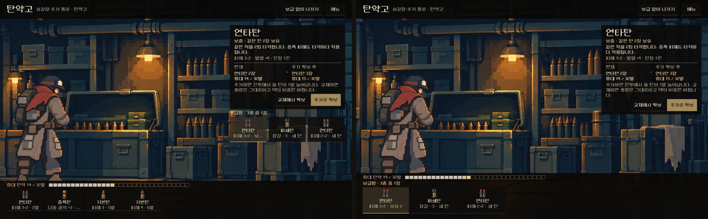 |
| 844×390 | 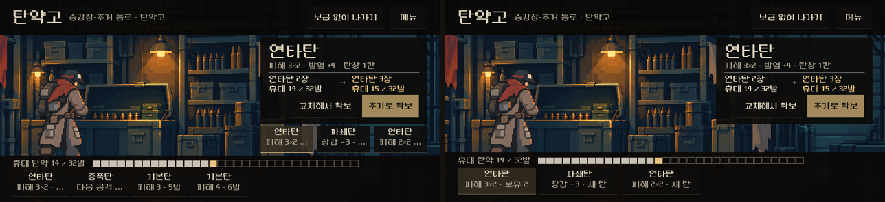 |

아래 상태 표의 화면은 3차다. 2차 화면은 `v2_` 접두사로 남겼다.

## 2차 수정 — 받을 탄을 상세 창 아래로(같은 날)

사용자 피드백: "탄을 띄우는 방식에서 캐릭터 쪽에 있어서 캐릭터가 가려져 다른 위치로 다시 잡으면 좋겠어 탄환 상세 정보 아래쪽이던가."

- 받을 탄 3장을 보급함 위에서 **오른쪽 상세 창 바로 아래**로 옮겼다. 상세 창 + `보급함 · 3종 중 1장` + 탄 3칸이 오른쪽 한 열이 되고, 왼쪽 장면(캐릭터·열린 보급함)은 가리지 않는다.
- 오른쪽 열 폭은 420px(폭 1000 미만은 320px). 탄 칸은 열 폭을 3등분한다.
- 높이 500 미만에서는 상세 창의 보충 줄·설명·`현재/추가 확보 후` 제목을 숨기고, 보급함 칸과 아래 선반 칸의 탄 그림을 숨겨 이름·위력만 남긴다.
- 검사 추가: 탄 칸이 상세 창 아래에 있음, 탄 칸이 캐릭터와 겹치지 않음. **155검사, 실패0.**
- 1차 배치: [1차 1280×800](v1_pick_1280x800.png). 레퍼런스 중 'RE4 — 장면 속 물건' 원리는 이 수정으로 약해졌다. 보급함은 배경 그림으로만 남는다.

## 실행

- `OPEN_SUPPLY_REVIEW.cmd`: 시안 창을 연다. **F1** 보통 재고, **F2** 가방이 가득 찬 상태. Esc는 교체 선택 취소.
- `OPEN_SUPPLY_REVIEW.cmd -Capture`: 세 해상도 캡처와 검사(출력은 `qa_runtime/supply_review_20261107/`, 문서 폴더에 덮어쓰지 않음).
- 장면: `redesign/samples/supply_review/preview.tscn`. 실제 등반을 시작해 1구역 탄약고에 세우고, 받기·교체·건너뛰기는 실제 규칙(`Campaign.resolve("ammo", 받을 탄, 내보낼 탄)`)으로 처리한다. 첫 후보 탄을 덱에 1장 넣어 '보충' 상태가 보이게 한 시안 전용 준비다.

## 구성

[레퍼런스 4개와 가져온 원리](../../art/references/2026-11-07-supply/README.md) — Darkest Dungeon 보급, Dredge 화물칸, Resident Evil 4 가방, SIGNALIS 보관실.

| 영역 | 내용 |
| --- | --- |
| 장면 | 기존 탄약고 배경(`service_background_grouped_20261025/supply.png`)을 화면 전체에 깔고, 열린 보급함이 비교창 왼쪽 빈 공간 가운데 오도록 자른다. 복장별 보급 자세 캐릭터가 보급함 앞에 선다. 새 그림은 만들지 않았다. |
| 보급함 | 받을 탄 3장이 오른쪽 상세 창 아래에 한 줄로 놓인다(2차 수정). 각 칸은 이름 · 위력 · '보유 N' 또는 '새 탄'. 같은 계열의 다른 위력(예: 연타탄 피해 3×2 / 2×2)이 위력으로 구분된다. |
| 아래 선반 | **휴대 탄약 N / 상한**과 칸 게이지(빈칸 포함, 받을 탄은 금색, 내보낼 탄은 붉은색). 그 아래 보유 탄 묶음(이름 · 위력 · 장수). 교체할 때 이 묶음에서 내보낼 탄을 고른다. |
| 비교창 | 탄 이름, 보충/새 탄, 한 문단 설명, 위력·발열·칸. '현재 → 추가 확보 후'(같은 탄 장수, 휴대 수). `추가로 확보`(주 행동) / `교체해서 확보`. |
| 가방 가득 | 추가 버튼은 '추가 불가'로 꺼지고 `교체해서 확보`가 주 행동이 된다. |
| 완료 | 보급 결과와 휴대 수, `지도로 계속`. 받지 않은 후보는 흐려진다. |
| 머리줄 | 탄약고 · 구역/장소, `보급 없이 나가기`, `메뉴`(시안에서는 동작 없음, 본편에서는 정비소·관문과 같은 메뉴). |
| 작은 화면 | 높이 500 미만에서는 설명 문단과 보충 줄을 숨기고 비교·행동만 남긴다. |

| 상태 | 1280×800 | 1008×454 | 844×390 |
| --- | --- | --- | --- |
| 고르기 | 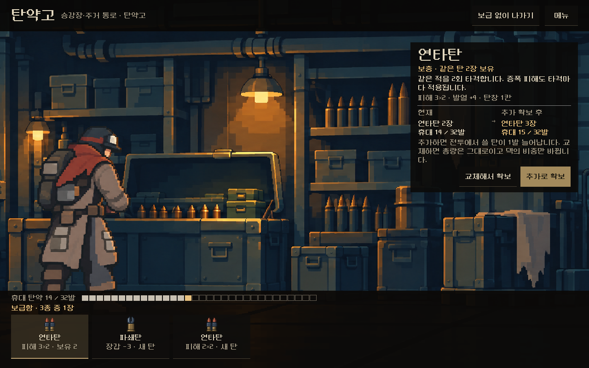 | 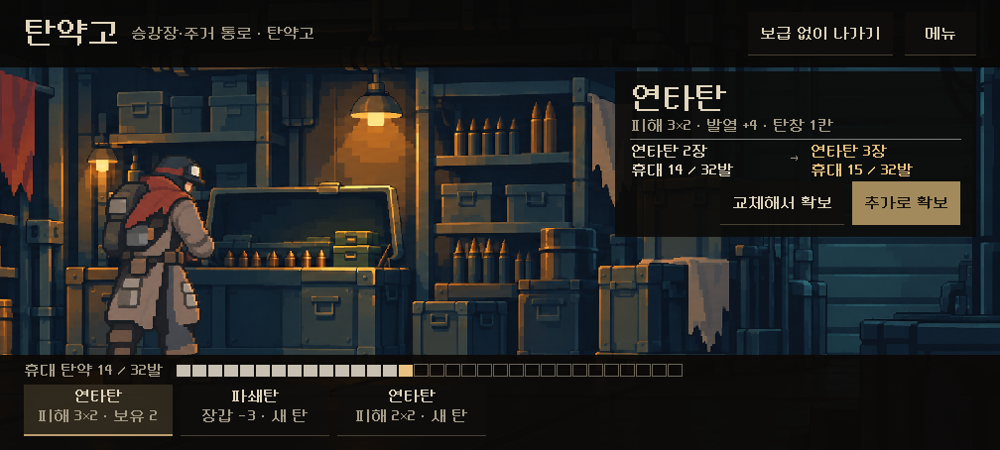 | 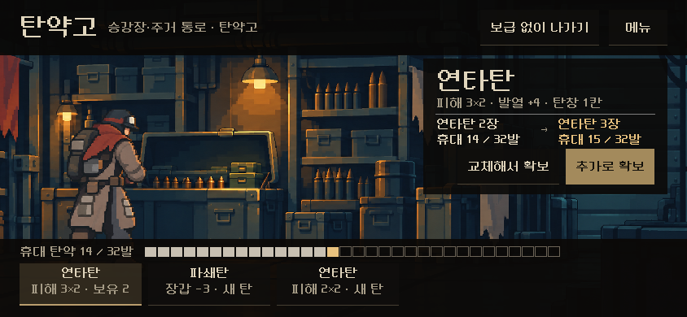 |
| 교체 — 내보낼 탄 선택 | 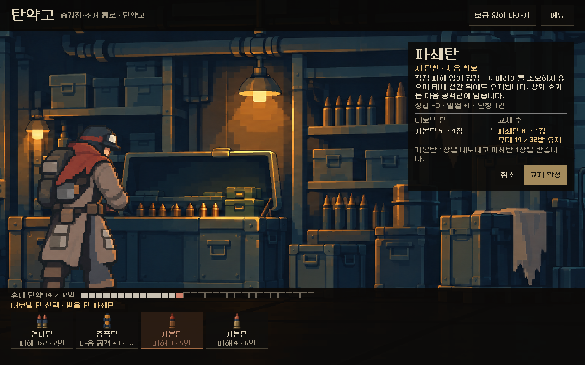 | 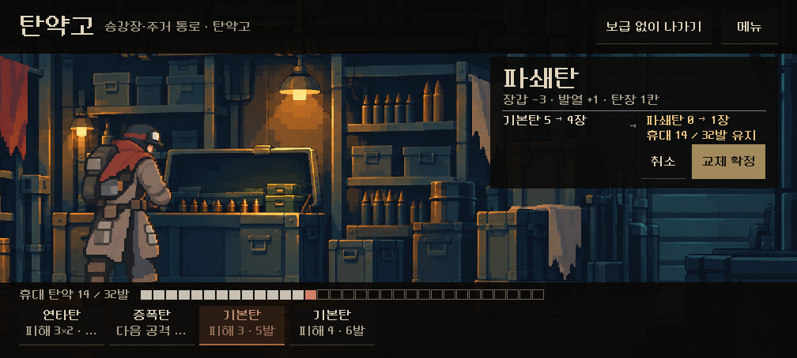 | 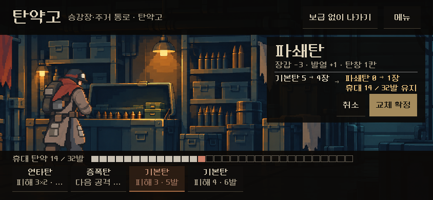 |
| 완료 | 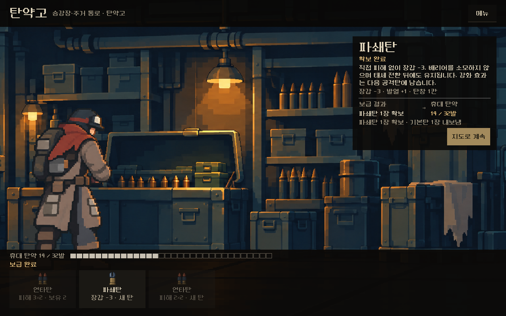 | 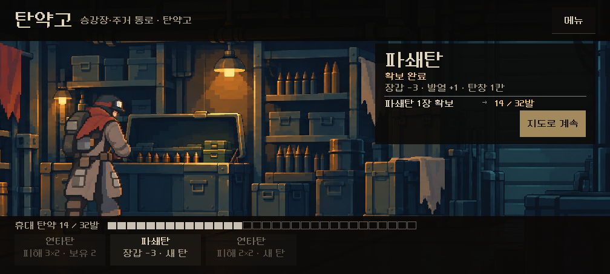 | 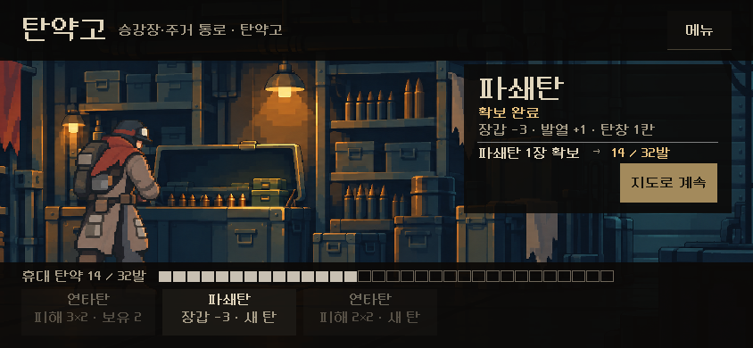 |
| 가방 가득 | 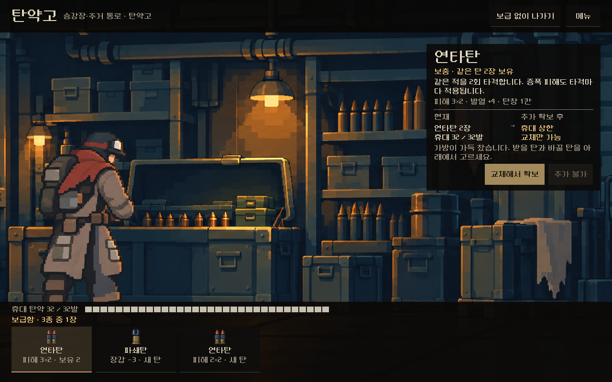 | 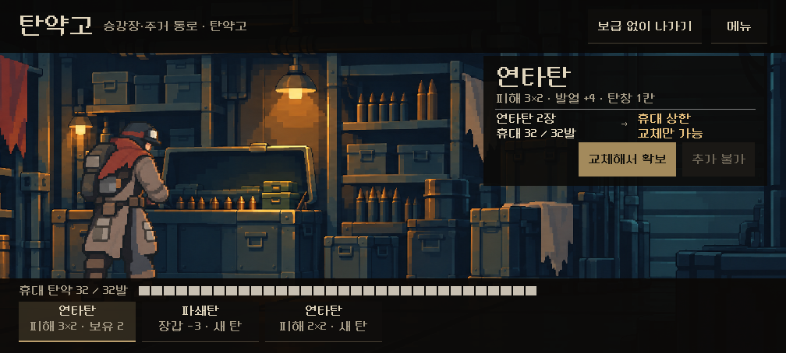 | 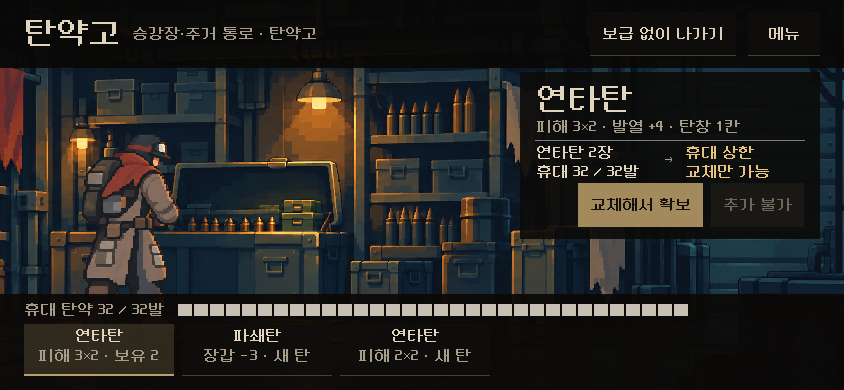 |

## 검증

Godot 4.7 격리 실행, 화면 터치로 진행. **155검사, 실패0**(2차 수정 기준, 1차는 131). 세 해상도의 네 상태에서 화면 안 배치, 보급함·비교창·선반이 서로 겹치지 않음, 고르기만으로는 덱 불변, 교체는 내보낼 탄을 고르기 전 확정 불가, 교체 뒤 총량 유지, 가방 가득 시 교체만 가능, 추가 시 1장 증가, '보급 없이 나가기' 시 덱 유지를 확인했다.

## 판단할 것과 한계

- 사용자 확인: 3차(아래 선반) 구조와 2차 비교, 아래 휴대 칸 게이지가 '가방이 얼마나 찼는지'로 읽히는지, 추가/교체 두 버튼의 위계.
- 작은 화면(1008×454 이하)에서 보급함·선반 칸의 위력 문구가 일부 말줄임된다. 칸의 탄 그림과 이름은 보인다.
- 시안의 `메뉴`는 동작하지 않는다. 본편 연결 시 관문과 같은 메뉴를 붙인다.
- 기존 탄 확보 대화상자(`ammo_acquisition_view`)를 쓰지 않고 비교창과 선반에서 교체를 끝내는 구조다. 본편 연결 때 상점 등 다른 확보 경로와 맞출지 정한다.
- 실기기·사람의 이해도 미확인.
