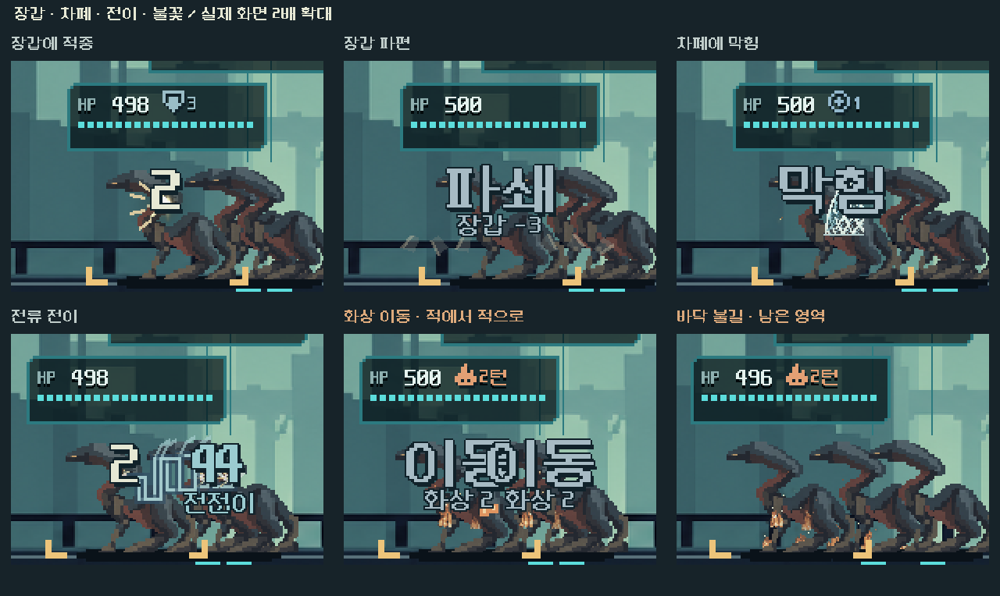

# 장갑·차폐 타격과 전이·불꽃 1차 적용

**리소스 수 범위 정정:** 아래365개는 공유 HUD의 별도5전투 연구판을 추적한 정적 목록이다. 본편 전체 수/패키지 포함 검사와 구분한다. 본편 효과 연결의 근거는 실제 main.tscn/캠페인 장면과 공개 입력 검사다. [후속 본편 진입 기준 검수](../interaction_fx_2026-11-06/README.md).

2026-11-06. 승인된 다음 단계36~37번을 본편에1차 적용했다. 계산·저장·입력·카드/패널 배치를 유지하고 실제 결과의 시각 반응을 구분한다. 세부 재질 확장·사람 체감·Galaxy S26 지속 성능은 후속이다.

실제 Godot 전투 캡처를 같은 크기로 잘라 정수2배 확대했다. 큰 비교 장면의 재생만2배 느리게 했고 작은 창/획득 저장 검사는 보통 속도다. 게임의 기본 시간은 바꾸지 않았다.

| 실제 사건 | 표현 |
|---|---|
| 장갑에 맞은 피해 | 접점의 짧은 불꽃과 바깥으로 튀는 금속 반사광 |
| 실제 장갑 감소 | 회전하며 흩어지는 밝은 금속 조각. HP 피해0이어도 장갑 감소가 있으면 표시 |
| 차폐가 막음/깨짐 | 총탄이 오는 쪽으로 향한 격자 방어막/분리되는 균열. 실제 HP 피해가 함께 있으면 접촉 반응도 함께 표시 |
| 전이 | 대상 사이의 꺾이는 전류와 짧은 가지/접점 |
| 화상 이동 | 불붙은 적의 몸통에서 다른 적의 몸통으로 넘어가는 최대3개의 불씨. 이동 자체를 HP 피해처럼 폭발시키지 않음 |
| 화상/바닥 불길 | 몸에 붙은 작은 화염, 실제 남은 구간에 놓인 바닥 화염/잔불, 실제 피해 틱의 짧은 반응 |

실제 배율 적중의 연보라 타격/숫자와 파츠 효과색은 유지했다. 장갑 없는 일반 접촉은 작게 처리한다. 지원 준비·막힌 공격에 가짜 HP 타격/배율 폭발을 만들지 않는다. 유기체/돌/목재 등 모든 표적 재질을 새로 분류한 작업은 아니다.

## 연결·겹침·비용

- `surface_feedback.gd`가 실제 영수증의 피해/장갑 감소·차폐 감소/남은 차폐·화상/이동을 읽는다. 인벤토리나 예상 피해로 발동을 추정하지 않는다.
- 기존 숫자 레이어의 앞부분에 효과를 그려 지역별 별도 적 그림 위에서 보이게 하고, 피해 숫자/HP 카드는 그 뒤에 그려 판독성을 유지한다. UI 배치/글자 크기를 바꾸지 않았다.
- 금속 접점은 기존 `damage_anchors`에 고정해 적의 반동/넉백을 따라 흔들리지 않는다. 화상 이동은 기존 총구 출발을 바꾸어 실제 적의 불붙은 몸통에서 시작한다. 짧은 전류/금속 파편도 큰 글자 바깥으로 드러나도록 범위와 대비를 조정했다.
- 몸의 화상은 살아 있는 실제 대상을, 바닥 불길은 실제 구간/남은 상태를 따른다. 바닥 화염은 보이는 구간에 최대14묶음, 붙은 화염은 대상당 최대2개다. 활성 화염이 있을 때만 별도의12Hz 시각 갱신을 요청하며 기다리는 동안 턴/HP/저장이 변하지 않는다. 무제한 런타임 입자나 난수는 없다.
- 동작 축소/즉시 설정에서는 방어막 시트·금속 파편/불꽃 애니메이션을 생략하고 작은 정적 방어 표시·전이 선·화염 윤곽을 남긴다.

## 제작 자산

고정 pixelfx0.3.0의 `impacts/shield-block`, `impacts/bullet-impact`, `fire/torch`를 렌더/검토했다. 방어막/금속 접촉은 절제한 팔레트로 굽고, 불은 공용 `fire/_lib.js burn`만 재구성해 횃불 받침/손잡이 없이 제작했다. 외부 원본은 수정하지 않았다.

| 시트 | 규격/등록 |
|---|---|
| shield | 740×520 / 셀148×104 /23프레임. 바닥 피벗과 별개인 실제 타격점(65.719707,66.905276)을 등록하고 게임에서는 좌우 반전 |
| metal | 760×600 / 셀152×100 /29프레임. 바닥(116,84)에서 제작 높이24를 뺀 실제 접점(116,60) |
| fire | 256×192 / 셀64×64 /12프레임 반복. 피벗(32,56), 소품 없이 화염/작은 불씨만 |

[재생성 도구](../../../../tools/build_surface_fx.mjs) · [출처/옵션·고정 커밋/해시](../../../../새-게임-프로젝트/assets/art/surface_fx_20261106/provenance.json). 같은 자산 폴더에 MIT 라이선스/고지를 보존한다. 캐시 시트3개를 사용하고 전류·불씨 이동/파편은 Godot의 제한된 도형이다. 본편 여정365참조에 새 시트3/스크립트1이 포함되며 제작 JS/후보는 본편 참조에 없다.

## 검증과 한계

격리 저장의 PC 네이티브 Godot4.7 Compatibility에서 검증했다. [최종 검사/해시](validation.json)에 실행 로그·구성 수를 연결한다. 원본 단계별 캡처/좌표·영수증과5구역 저장은 `qa_runtime/surface_fx_20261106/`에 보존한다.

- 신규 규칙/영수증 검사:210검사 실패0. 장갑/차폐·혼합 타격/지원·배율/실제 화상 이동과 틱, 전이 출발/도착, 화염 구간/그리기 상한·시트 투명 종료를 확인했다.
- 신규 네이티브:531검사 실패0/26구성·160단계 캡처. 공개 Fire마다 전체 모델/RNG가 오라클과 같고 넉백 중 접점/효과 정리·숫자와 금속 반사광/불씨의 실제 픽셀을 확인했다. 작은 창1008×454·동작 축소, 열이 없어도 남아 있는 화상과 기다리는 동안 모델 불변을 포함한다.
- 기존 획득 경로의5구역 저장을 불러 실제 사격/격리 저장/복원 결과가 정확히 일치했다. 구역별 배경과 적 그림/숫자 레이어를 함께 확인했다.
- 기존 파츠 적중 판정172/네이티브291, 소이탄 규칙1,705, `run_prototype_hud.ps1 -Mode ui -Fast`11,558검사 실패0.
- 모델/캠페인/예측/탄환·파츠 계산/배율 기준·숫자 분류/총구·탄두/무기 배우·프로필11파일 해시와 기존 비행 함수를 유지했다. 사격·충돌/화상/적 행동에 추가 대기 시간을 넣지 않았다.

초안의 화상 이동은 큰 피해 문구에 가려지는 실제 픽셀 검사3개가 실패했다. 출발점을 불붙은 몸통으로 옮겨 수정했고 원본 실패/캡처는 `v1_occluded/`에 보존했다. 금속 파편의 대비도 실제 크기에서 보완했다. 기능 통과는 사람의 재미/피로도·화풍 선호를 확정하지 않는다. S26 장시간 성능/발열은 미측정이다. APK/커밋/푸시/외부 게시는 수행하지 않았다.
