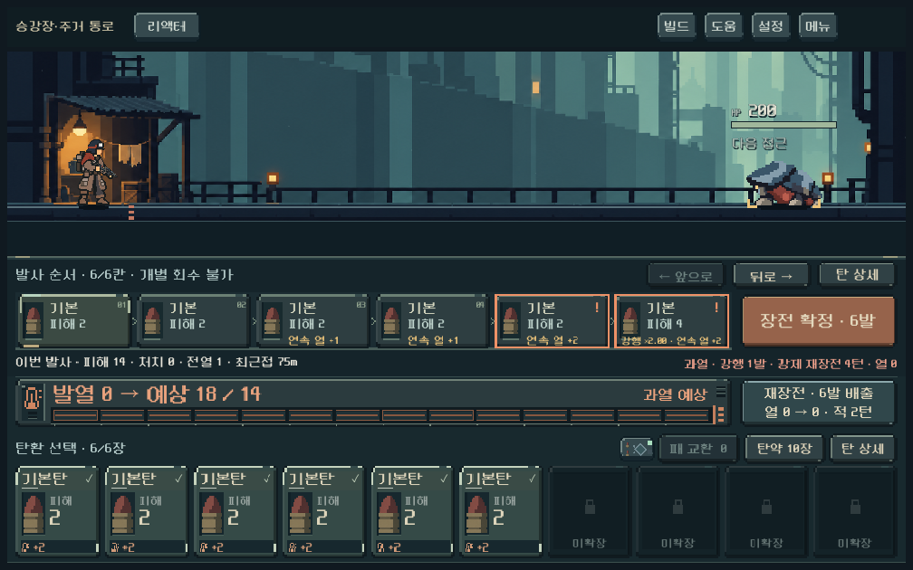
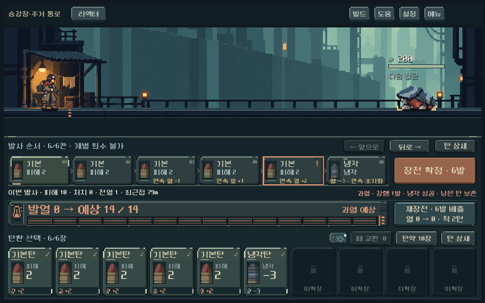
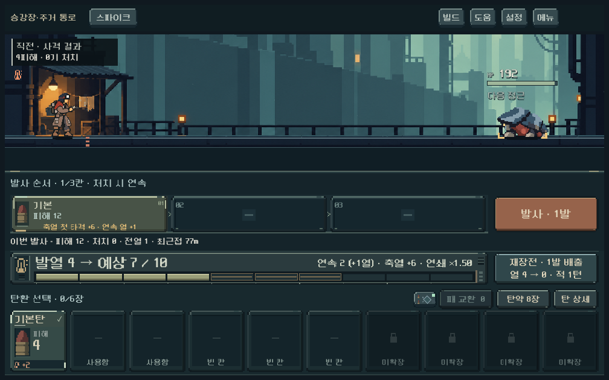
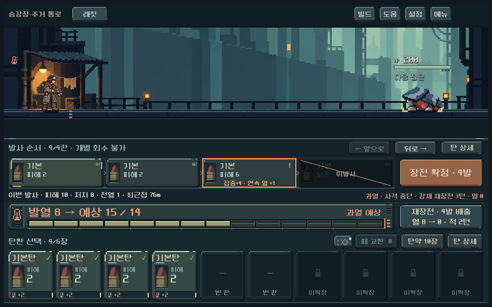
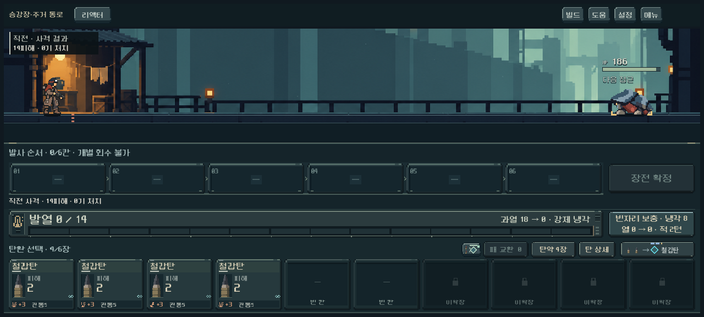
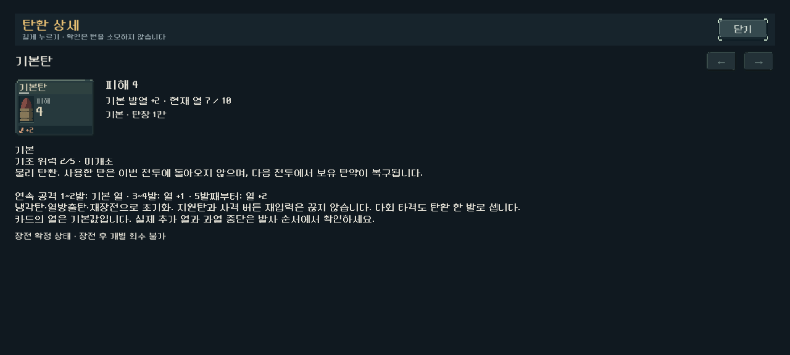
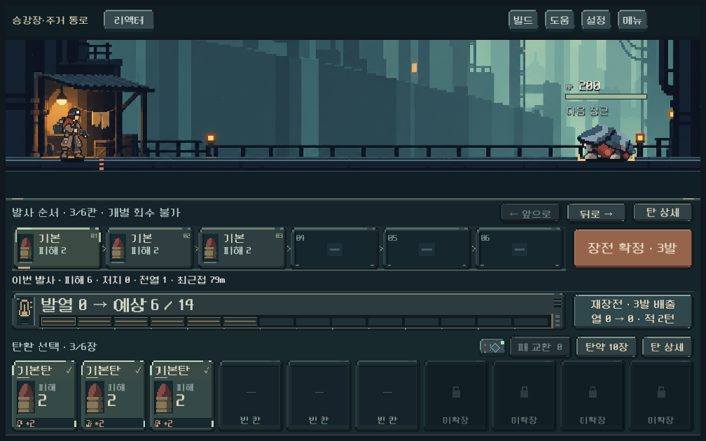

# 연속 공격 발열 B1 본편 적용·검증

2026-10-29. 사용자의 후속 실행 요청으로 [비교에서 선택한 B1](heat_comparison_2026-10-29.md)을 새 등반에 적용했다. 개별 수치는 디렉터 구현값이며 사용자 직접 확정 수치로 기록하지 않는다. [현행 규칙](../../direction/heat-and-sustained-fire.md).

**결과:** 실제 모델·저장·확정/산개 예측·화면 연결 완료. 최종 기능 검사 9,810개 실패0. 운반 복장·다섯 무기·두 시드의 실제 새 등반 10경로, 첫 구역45전투 모두 보스까지 돌파 경로를 찾았다. 사람의 재미·위험 이해도, 전체 등반 균형, 모바일 지속 FPS·기기 발열 검증은 남는다.

## 적용 내용

- 새 등반 `sustained_version=1`. 첫 두 공격은 기존 열, 3~4번째 공격은 추가 열1, 5번째부터는 추가 열2다. 카드 기본 열·무기 한계·기본 냉각량은 바꾸지 않았다.
- 실제 발사한 공격탄을 센다. 같은 탄의 다회 타격·전이는 한 발, 지원탄은 증가/초기화 없음. 스파이크는 사격 버튼을 다시 눌러도 이어진다. 미발사 탄은 세지 않는다.
- 냉각탄·열방출탄·일반/강제/비상 재장전·교전 종료/시작에서 초기화한다. 처치 냉각과 세 번째 탄 냉각 같은 수동 입력 없는 파츠 효과는 온도만 내린다.
- 실제 사격과 예측은 같은 모델 함수를 사용한다. 산개 예측 캐시/분기 합치기에 누적 수를 포함했고, 별도 예측 작업의 전체 상태 키도 누적 수를 보존한다. QA 탐색기의 상태 중복 제거에도 포함했다.
- 저장은 표식과 누적 수의 정수/범위/발사 수/현재 단계를 검사한다. 기존 표식 없는 저장에는 새 비활성 항목을 추가하지 않고 원래 열 규칙을 유지한다. 캠페인/전투 표식 불일치는 복원을 거부한다.
- 발사 순서에 `연속 열 +1/+2`, 냉각·열방출에 `연속 초기화`를 표시한다. 기존 과열 중단·강행·강제 재장전 비용 예고와 미발사 표시를 실제 결과에 맞췄다. 열 게이지에 누적 수/다음 추가 열을 표시하며 관문 축열·연쇄 수치도 함께 보존한다.
- 상세에서 카드 기본 열과 연속 추가 열을 구분한다. 검수 중 발견한 기본탄의 잘못된 ‘덱이 비면 재섞기’ 안내도 유한 탄약 여부에 맞췄다.

확률 고장은 추가하지 않았다. 일반 `Model.start()`의 독립/구형 fixture는 기본적으로 이전 규칙을 유지하고, 실제 새 등반 `Campaign.start()`가 새 규칙을 선택한다.

## 대표 결과

리액터, 냉간, 충분한 체력의 단일 표적, 위력2 기본탄 기준. 첫 행은 표식 없는 이전 규칙, 나머지는 B1이다. 사격 종료와 다음 장전 준비 시점을 구별한다.

| 구성 | 발생 열 | 직접 피해 | 사격 및 자동 처리 턴 | 다음 장전 준비까지 |
| --- | --- | ---: | ---: | ---: |
| 이전 규칙 기본탄6발 | 2/2/2/2/2/2 | 12 | 1 | 3 |
| B1 기본탄6발 | 2/2/3/3/4/4, 최고18 | 14, 마지막 강행×2 | 5, 강제 재장전4 포함 | 5 |
| B1 기본탄5발+냉각탄 | 최고14에서 냉각 후11 | 10 | 1 | 3 |

냉각 선택은 추가 턴을 줄이고 강행 공격은 즉시 피해를 높인다. 이 사례만으로 어느 선택이 항상 유리하다고 결론 내리지 않는다. 스파이크의 위력2 기본탄3발을 별도 입력으로 발사하면 온도2→4→7, 연속 수1→2→3이며 두 번째 입력 뒤 저장/복원해도 같다.

## 기능 검증

Godot 4.7 stable, 격리된 `APPDATA`/`LOCALAPPDATA`에서 실행했다. 숫자는 내부 assertion 수이며 독립 플레이 횟수가 아니다.

| 검사 | 통과 수 | 범위 |
| --- | ---: | --- |
| B1 집중 규칙 | 1,087 | 5무기×코어 없음/3종×2잔열×2누적 수=80조건, 냉각/열방출/지원/압축/다회 타격/처치 냉각/증원/비상 보급, 실제/예측/복원, 잘못된 저장 거부 |
| 실제 렌더·터치 | 625 | 1008×630,1280×576,1280×800. 리액터 강행/냉각, 스파이크 누적, 래칫 중단, 산개 예측 작업, 관문 수치, 기본탄 상세, 구버전 표시 |
| 실제 새 등반 초반 | 5,016 | 10경로45전투의 합법 명령·저장/복원, 첫 구역 보스 돌파 |
| 비상 보급 회귀 | 1,716 | 비용·발사·고갈·보관된 실제 저장 동일성 |
| 기존 발열 회귀 | 917 | 이전 열/냉각/과열/예측 경계 |
| 기존 전투/압력 회귀 | 449 | 장갑·강행·적 압력·예측·저장 |
| **합계** | **9,810** | **실패0** |

[각 실행 로그·원자료·소스 해시](assets/sustained_heat_2026-10-29/manifest.json). 규칙 수치는 [rules.json](assets/sustained_heat_2026-10-29/rules.json), 실제 진행 집계는 [early_summary.json](assets/sustained_heat_2026-10-29/early_summary.json), 전체 상태·명령·사격 기록은 [early_campaigns.json.gz](assets/sustained_heat_2026-10-29/early_campaigns.json.gz)에 보존했다.

초기 검사에서 발견한 기존 저장의 비활성 필드 추가를 수정하고 보관 상태 동일성 검사를 통과했다. QA fixture의 존재하지 않는 압축탄 ID, 복장 교환/손패 불일치, 보스 보상에서 금전 선택을 시도한 부분은 실제 허용 구성으로 수정했다. 초기 실패 실행을 최종 통과 수에 포함하지 않았다.

## 냉각탄 획득 전 실제 초반

새 등반·운반 복장·첫 지도 선택지로 진행했다. 실제 첫 코어를 획득/장착하고 다른 보상은 금전, 서비스는 건너뛰어 냉각탄/추가 특수탄을 얻지 않는 통제 조건이다. 보스 후에는 합법 보상 건너뛰기를 사용하거나 보상 화면에서 종료했다. 시작 탄약을 늘리거나 적 능력치를 낮추지 않았다.

| 무기 / 획득 코어 | 731042: 4전투 총턴 / 보스턴 | 17: 5전투 총턴 / 보스턴 |
| --- | ---: | ---: |
| 리벳 / 돌파 | 14 / 9 | 15 / 7 |
| 래칫 / 연쇄 | 25 / 13 | 30 / 14 |
| 스플린터 / 연쇄 | 28 / 18 | 30 / 15 |
| 리액터 / 열압 | 19 / 11 | 24 / 11 |
| 스파이크 / 돌파 | 14 / 8 | 20 / 9 |

45/45전투에서 경로를 찾았고 넓힌 재탐색은 없었다. 숨은 패/RNG를 읽는 제한 탐색이므로 승률·보통 플레이어의 난도·최적 전략을 의미하지 않는다. 무기마다 얻은 코어도 다르므로 위 표로 무기 우열을 결론 내리지 않는다. 원자료의 보상 단계 끝 상태는 저장 과정에서 탄약 더미를 정리하므로 그 잔탄을 전투 소모량으로 해석하지 않는다.

## 실제 화면 확인

24장 렌더를 생성했고 아래 대표7장의 줄바꿈·잘림·작은 화면 표시를 직접 확인했다. 합성 터치 입력은 실제 Godot 버튼과 연출을 통과했다. 모바일 실기기 터치/열 측정은 아니다.















## 재현과 남은 일

저장소 루트에서 실행:

```powershell
./tools/run_playtest_revision_checks.ps1 -Mode sustained -Tag verify_b1
./tools/run_playtest_revision_checks.ps1 -Mode sustained_ui -Tag verify_b1
./tools/run_playtest_revision_checks.ps1 -Mode sustained_probe -Tag verify_b1
./tools/run_playtest_revision_checks.ps1 -Mode emergency -Tag verify_b1
./tools/run_playtest_revision_checks.ps1 -Mode pressure -Tag verify_b1
./tools/run_heat_checks.ps1 -Mode rules
```

이번 차이의 수정 전 파일은 `qa_runtime/sustained_live_20261029/source_before/`, 최종 실행은 `qa_runtime/playtest_revision_20261026/`의 sustained/final_20261029, sustained_ui/release_20261029, sustained_probe/final_20261029 등에 있다. 기존의 큰 미커밋 작업 트리를 보존했으며 기준 HEAD만으로 이번 결과를 재현할 수 없으므로 소스 해시와 수정 전 사본을 함께 기록했다. 전체 작업 트리 `git diff --check`는 오류 없이 통과했다.

다음 독립 작업은 [통합 우선순위6번](../../direction/playtest-priorities.md)의 전체 등반 성장·탄약 경제 검증이다. 다른 복장/시드·2~5구역·관문 개조와 냉각/압축/비상 보급의 장기 부담, 특히 리액터 긴 탄창과 스플린터/래칫 초반 턴 편차를 추적한다. 사람의 과열 위험 이해·냉각 선택·사격 재미와 모바일 지속 성능/기기 발열은 별도 확인이 필요하다. APK 생성·커밋·푸시·외부 게시 없음.
