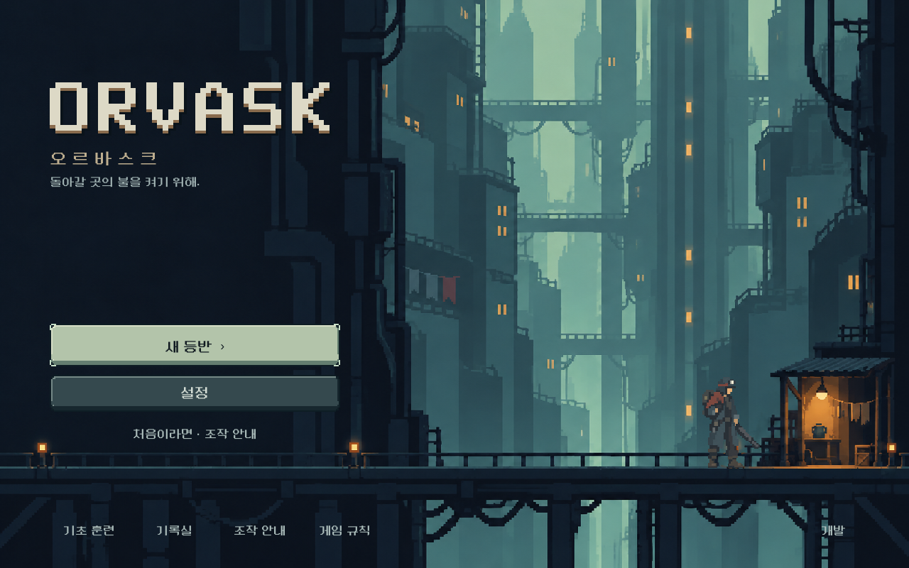
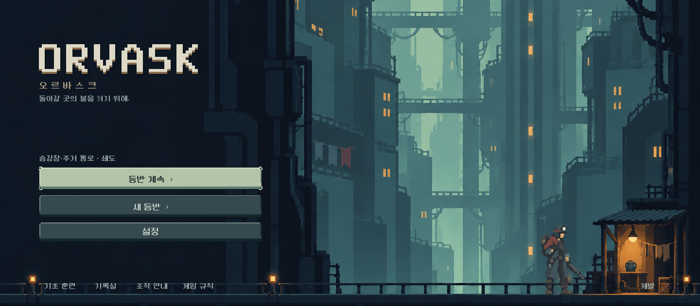

# ORVASK 타이틀 / 메인 화면 — 2026-10-11

## 결정과 적용
사용자가 UNDER 없이 **ORVASK / 오르바스크** 단일 이름을 채택하고 타이틀부터 제작하도록 승인했다. 게임과 탑/도시의 이름을 공유한다. 개별 구도·로고·미세 연출의 미감은 디렉터 첫 구현이며 사용자 확인 전이다.

- 새 배경: 큰 청회색 승강축과 생활 구역, 오른쪽의 작은 따뜻한 정비소. 왼쪽은 로고와 메뉴를 위한 어두운 여백.
- 직접 제작한 격자 SVG 로고/아이콘, 기존 한글 도트 글꼴과 공통 버튼 스킨. UI 글자를 배경 이미지에 굽지 않았다.
- 실제 승인 주인공을 배경 프레임에 배치해 크롭과 발 위치가 함께 움직인다.
- 유효한 진행 저장이 있으면 **등반 계속**, 없으면 **새 등반**이 주 행동. 현재 구역/총기만 한 줄 표시. 훈련·기록실·안내·규칙·개발은 하단.
- 별도 훈련 이어하기와 손상 저장 경고 유지. 마지막 복구 조작이 남은 완료 저장도 이어하기/교체 확인으로 보호.
- 따뜻한 조명만 약하게 움직이며 즉시 연출 옵션에서 정지한다.
- `redesign/title_screen.tscn`을 본편과 에디터 미리보기에서 동일하게 사용한다.

## 실제 화면

## 검증
- 타이틀 전용 실제 Godot/터치: **111검사, 0실패**. 1280×800 / 1008×630 / 1440×630, 110% 글자. 주 행동/보조 메뉴 경계, 페이지 스크롤 없음, 포커스 선택/복원, 설정 왕복, 총기 준비 왕복, 훈련 진입/복구, 실제 캠페인 복구, 손상 저장 보존, 새 등반 취소 후 원본 바이트 보존, 마지막 복구 저장 보호.
- 기존 프런트 흐름: **33검사, 0실패**.
- 기존 탐색 회귀: **418검사, 0실패**. 무기/상점/파츠/저장 보호 포함.
- 합계 **562검사 통과**. 생성 이미지만 본 것이 아니라 실제 게임 렌더를 직접 열어 로고 정렬, 글자 대비, 주인공 발 위치와 화면 비율별 크롭을 확인했다.
- 제목 변경 전/후 Windows `OS.get_user_data_dir()`가 모두 기존 `Godot/app_userdata/Last on Board - Core Redesign` 경로를 가리키는 것을 격리 환경에서 비교했다. 실제 사용자 저장을 쓰거나 삭제하지 않았다.
- 끝 상태 시험은 기존 서사 QA와 같은 합법 지도 경로 및 전투 종료 fixture로 구성했다. 전투 승률/밸런스 증거로 취급하지 않는다.

실행: `tools/run_title_checks.ps1`, `tools/run_director_ui_checks.ps1 -Mode frontend`, `-Mode navigation`.
격리 실행 결과: `qa_runtime/title/ui/`.

## 자산과 남은 확인
[전체 프롬프트·도구·입력 참조](../../art/title-20261011.json). 배경은 built-in image_gen으로 제작한 `assets/art/title_20261011/tower_threshold.png`; 로고는 `assets/ui/title/orvask_wordmark.svg`.

사람의 첫 화면 인상, Galaxy 실기기 조작은 후속. APK는 생성하지 않았다. 모바일 배포 표시명/기존 배포 파이프라인은 차기 APK 요청 때 함께 갱신하며 패키지 식별자는 유지한다. 기존 개발/저장 경로는 이름 변경 때문에 옮기지 않았다. 배경 음악/새 사운드 세트와 무기 준비 화면의 후속 아트 연결은 이번 완료 범위가 아니다.
