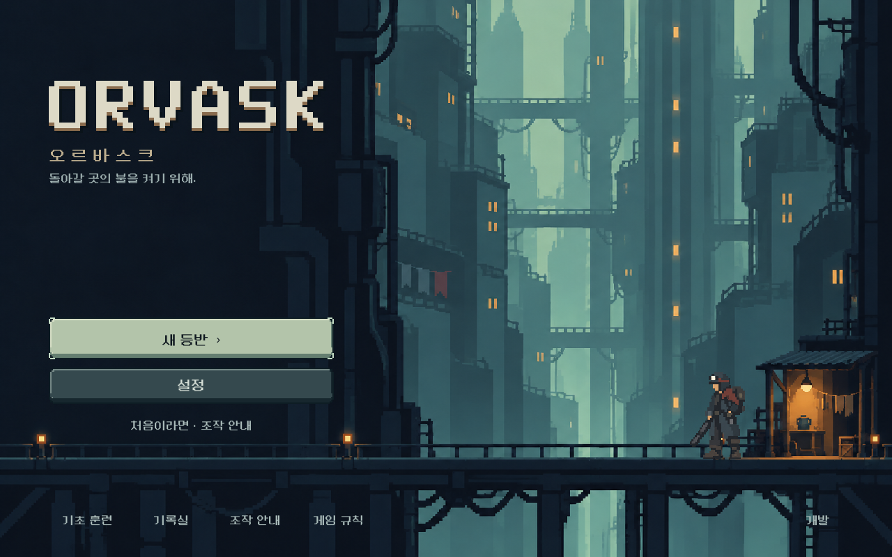
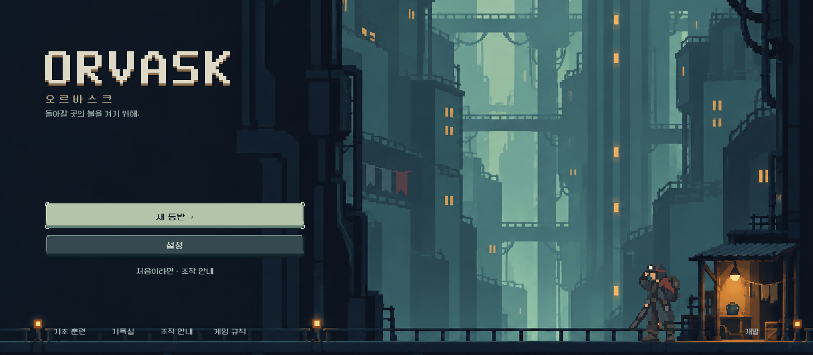

# 타이틀 주인공 대기 동작 — 2026-10-11

사용자가 타이틀 화면을 긍정 평가하고, 주인공이 반대 방향을 바라보며 타이틀 전용 동작을 갖도록 요청했다. 왼쪽 방향은 사용자 요청, 총을 낮추고 모자 챙을 짚는 조용한 대기는 디렉터 제작안이다.

## 적용
- 왼쪽을 바라보며 총을 내려 든 전용 자세. 기존 모자·배낭·녹슨 어깨색과 큰 청회색 도트 덩어리를 유지.
- 생성한 4개 포즈를 휴식→작은 호흡→휴식→손 이동→모자 챙→손 이동→휴식의 **6.9초 루프**로 연결했다.
- 모든 프레임을 동일한 발 기준점으로 등록. 배경 프레임과 함께 크롭되어 넓은 화면에서도 플랫폼 높이를 유지한다.
- 즉시 연출에서는 첫 휴식 자세로 정지. 전투 주인공의 기존 원본/동작에는 적용하지 않았다.
- 원본 RGBA는 그대로 보존. Godot AtlasTexture로 영역을 선택하고 기존 alpha cutout 셰이더로 가장자리만 표시 시 처리한다.
- 초기 생성에서 모자 포즈의 손이 하나 더 그려진 오류는 이미지 생성 도구로 교정한 후 사용했다.

## 확인
`tools/run_title_checks.ps1` **190검사, 실패0**.
- 1280×800 / 1008×630 / 1440×630 실제 렌더 검토.
- 실시간 재생이 7개의 타임라인 구간을 모두 통과함을 관찰.
- 4개 포즈의 아틀라스 범위·동일한 발 원점·플랫폼 높이 검증.
- 즉시 연출 정지/초기 자세 복귀와 기존 타이틀 터치·설정·이어하기·새 등반 저장 보호 회귀.
- 화면에서 얼굴/총구의 왼쪽 방향, 모자 손동작, 크기·색면·접지를 직접 확인했다. 사용자 모션 선호와 Galaxy 직접 검증은 후속이다.

## 제작 파일
- [원본 atlas](../../../새-게임-프로젝트/assets/art/title_20261011/reclaimer_idle_v1.png)
- `assets/art/title_20261011/reclaimer_idle_frames.tres`: 영역·포즈별 지속 시간
- `redesign/title_reclaimer.tscn/.gd`: 타이틀 전용 표시와 정지 설정
- [전체 프롬프트·참조·도구·등록 좌표](../../art/title-idle-20261011.json): built-in image_gen으로 생성/교정.
