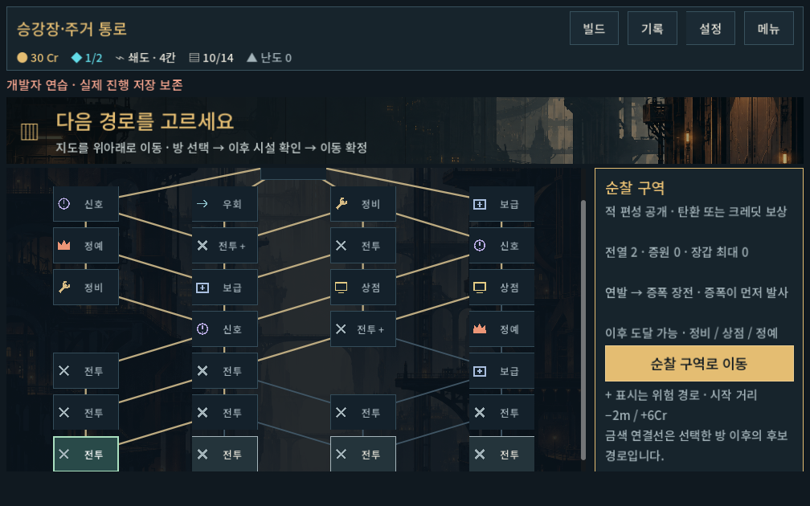
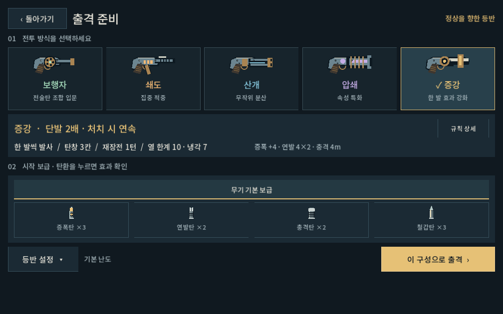
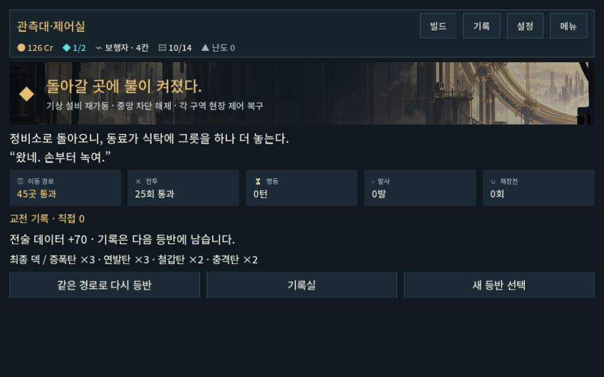

# 탑의 층수 표기 제거

2026-10-09 · 사용자 요청 반영. 작은1F 단위의 전투 맵이 탑의 물리적 규모를 정의하지 않도록 표시를 정리했다.

- 지도 눈금·수평 층 구분선·선택 장소 번호·시설F번호를 제거하고 빈 왼쪽 여백을 줄였다.
- HUD의전체 진행 분모와LV번호를 제거했다. 준비·이어하기·교체 확인·정상 화면은 구역/무기/목표로 표시한다.
- 관문 안내는 구역으로 통일하고 정산은 실제 방문 수인 `N곳 통과`를 사용한다.
- 내부 순서/시드/경로·전투·보상·저장 구조는 유지한다. 맵35/45개 장소를 탑의 총 층수로 표현하지 않는다.

격리 저장에서 기존 검사 실행: `run_map_checks.ps1 -Mode ui -Label no_floor_labels`310/0, `run_story_checks.ps1 -Label no_floor_labels`727/0, `run_director_ui_checks.ps1 -Mode frontend`33/0.1280×900·1008×630(글자1.1배)·1440×630 지도와 결말, 총기 준비 화면을 확인했다. 텍스트/레이아웃 변경이므로 전체 전투 시뮬레이션은 반복하지 않았다. 실제 플레이에서 느껴지는 규모감은 별도 확인 대상이다.

실제 캡처와 검사 로그는 같은 증거 폴더에 보존한다. APK·커밋·푸시는 수행하지 않았다.
