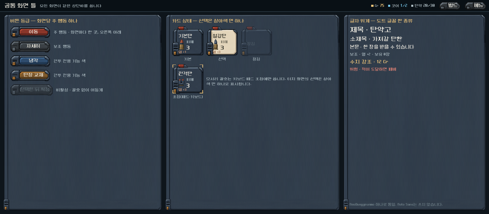
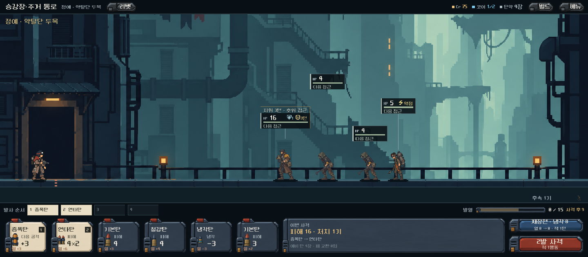
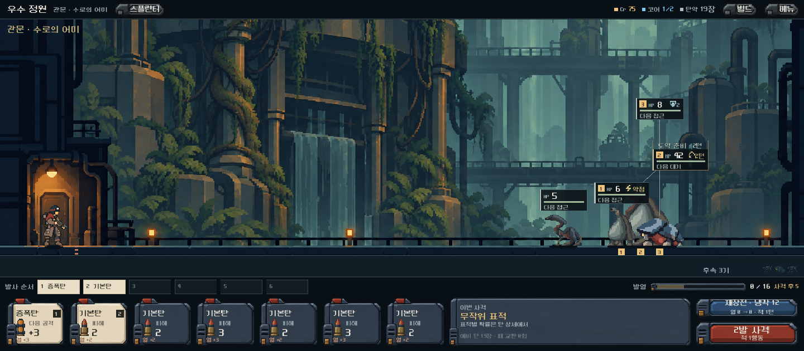
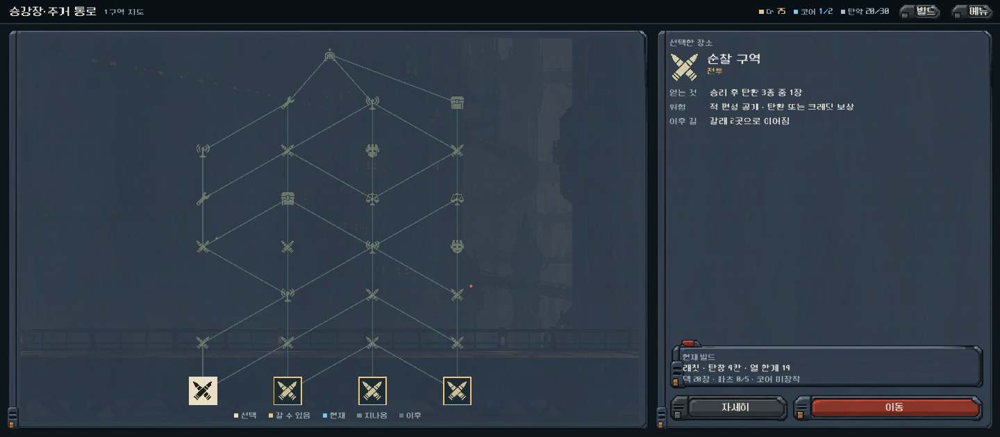
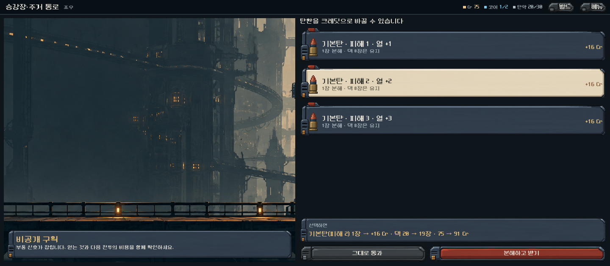
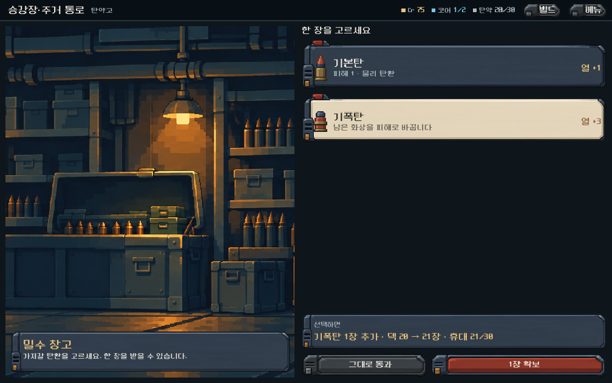
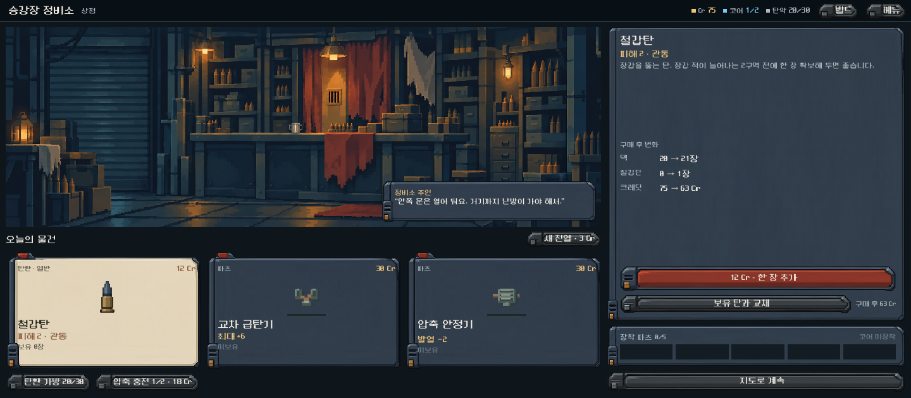

# 공통 화면 틀 목업 — 2026-10-31

[전체 UI 레이아웃 검토](ui_layout_review_2026-10-31.md)의 권고 순서에 따라 목업을 만들었다. 이 목업은 디렉터 제안이며, 사용자가 확정하지 않았다. 게임 화면·규칙·저장은 바꾸지 않았다. 기본 진입과 APK도 그대로다.

## 보는 방법

브라우저로 [HTML 비교 페이지](ui_frame_mockups_2026-10-31.html)를 연다. 화면 탭, 1440·1008 해상도 전환, 목업 / 현재 / 슬라이더 비교 / 위아래 비교 보기를 지원한다. 현재 게임 화면은 같은 날 레이아웃 검토 때 같은 해상도로 찍은 캡처다(`assets/before/`).

## 만든 방법

- 목업 보드: `새-게임-프로젝트/redesign/samples/mockups/ui_frame_mockup.gd`
  - 최신 급탄 장비 원화(`assets/art/combat_feedkit_20261031/`)를 공통 재질로 쓴다.
  - 글꼴은 도트 글꼴(NeoDunggeunmo) 하나다.
  - 보조 버튼은 같은 원화를 회색조로 바꿔 쓴다(셰이더). 새 원화는 만들지 않았다.
- 캡처 실행기: `새-게임-프로젝트/tests/ui_frame_mockup_runner.gd`
  - 실제 게임의 디버그 진입으로 상태를 만든다. 대상은 1구역 정예전, 3구역 관문, 지도, 상점이다.
  - 전투 목업은 실제 전장 뷰와 실제 장전 입력, 실제 예상 계산을 그대로 쓴다.
  - 격리 저장(`qa_runtime/ui_mockup`)에서만 실행된다. 목업이 전투 상태를 바꾸지 않는지 확인한다.
  - 결과: 94개 검사 통과, 실패 0개.
- 해상도: 1440×630, 1008×630. 프로젝트는 1280×800 기준 `canvas_items` 스트레치이므로 논리 높이는 800이다.
- 조우·탄약고·상점의 문구와 수치는 화면 구성을 보이기 위한 예시다. 상점은 인물 레이어 없이 배경만 쓴다.

## 1. 공통 틀

| 요소 | 제안 |
| --- | --- |
| 상단바 | 모든 화면에서 같다. 왼쪽은 장소·진행, 오른쪽은 Cr·코어·탄약과 `빌드`·`메뉴`. 전투에서만 총기 이름이 붙는다. |
| 주 행동 | 붉은 사격 버튼 재질 하나. 화면마다 한 곳, 오른쪽 아래(이동·사격·구매·확보). |
| 보조 행동 | 같은 버튼 틀의 회색판. |
| 전투 전용 | 냉각(청색)·탄창 교체(황토)는 전투 기능에만 쓴다. |
| 비활성 | 어둡게만 표시한다. 괄호를 두르지 않는다. |
| 선택 | 상아색 면 하나. 카드·지도 노드·상점 상품에 모두 같은 규칙을 쓴다. |
| 초점 | 모서리 괄호는 키보드·패드 초점에만 쓴다. |
| 글꼴 | 도트 글꼴 하나. Noto Sans는 쓰지 않는다. |

## 2. 본편 전투

- **하단을 3단에서 2단으로 줄였다.** 1440×630에서 전장 비율이 약 30%에서 약 70%로 늘었다.
  - 1단: 발사 순서를 얇은 칩 줄로 바꾸고, 같은 줄에 발열 게이지와 '사격 후 열'을 붙였다.
  - 2단: 손패 / 이번 사격 / 행동 버튼.
- **잠긴 손패 칸은 그리지 않는다.** 남는 자리에 '이번 사격' 칸을 두어 실제 예상 피해·처치 수·발사 순서를 보여 준다(정예전 예시: 피해 16, 처치 1기). 무작위 표적 총기는 '무작위 표적'으로 표시한다.
- **장전한 카드는 손패 자리에서 상아색 면과 발사 번호로 표시한다.** 마지막에 넣은 탄이 먼저 발사되는 규칙은 그대로다.
- **적 명찰**
  - 각 적의 머리 바로 위에 붙인다.
  - 이웃과 겹치면 위로 쌓고, 화면 안쪽으로 제한한다.
  - 폭은 HP·상태·행동 문구 길이에 맞춘다.
  - 겹친 적은 명찰과 발밑에 같은 번호(1·2·3)를 붙인다. '적 2기 겹침' 문구를 대신한다.
  - 정예·보스는 전장 뷰의 행동 문구(예: '지휘 3턴 · 호위 접근')를 명찰의 머리줄로 쓴다.
- 1008 폭에서는 카드가 100px로 줄어들고, 일부 보조 문구가 잘린다.

## 3. 지도

- 현재 구역 전체를 한 화면에 보여 준다. 첫 줄이 잘리는 스크롤이 없다.
- 노드 상태는 다섯 가지다: 선택(상아색 판), 갈 수 있음(금색 테두리), 현재(청색), 지나옴(옅은 녹회색), 이후(흐린 회색). 범례는 지도 아래에 둔다.
- 오른쪽 칸: 선택한 장소의 얻는 것·위험·이후 길, 현재 빌드 요약, `자세히`(보조)·`이동`(주 행동).

## 4. 장소 틀 — 조우·탄약고 (공방·보상도 같은 틀)

- 왼쪽: 장면 그림과 장소 이름·한 줄 설명.
- 오른쪽: 질문 → 선택지 카드 → 선택하면 생기는 변화(덱·크레딧) → `그대로 통과`(보조)·확정(주 행동).
- 조우의 아래쪽 빈 공간 문제를 이 틀로 해결한다.

## 5. 상점

- 왼쪽: 실내 장면과 주인 대사 → 오늘의 물건 3장 → 보조 도구(탄환 가방·압축 충전)를 한 줄로.
- 오른쪽: 선택 상품 설명, 구매 후 변화(덱·보유 수·크레딧), 구매(주 행동)·교체(보조), 장착 파츠, `지도로 계속`.
- 흩어져 있던 보조 버튼 7개를 두 곳으로 모았다.

## 동작하는 HTML 프로토타입

사용자 요청(버튼과 UI가 실제로 동작하는 목업)으로 [ui_prototype_2026-10-31/index.html](ui_prototype_2026-10-31/index.html)을 만들었다. 브라우저로 열면 된다. 폴더 안에 그림·글꼴·데이터가 모두 들어 있어 폴더째 옮겨도 열린다.

- **흐름:** 지도 → 장소 선택·이동 → 전투 / 조우 / 탄약고 / 공방 / 상점 → 보상 → 지도. 관문 전투에서 이기면 '1구역 돌파'로 끝난다.
- **전투:**
  - 손패를 누르면 장전된다(마지막에 넣은 탄이 먼저 발사). 순서 칩을 누르면 빠진다.
  - 카드를 길게 누르거나 오른쪽 클릭하면 상세가 열린다. 적을 누르면 적 정보가 열린다.
  - 사격하면 탄이 날아가는 연출, 피해 숫자, 적 접근이 나온다.
  - 재장전·냉각, 과열 시 강제 재장전, 비상 보급, 증원, 승리·패배가 있다.
  - 명찰에는 이번 사격의 예상 피해가 금색으로 미리 표시된다.
- **장소·상점:** 선택하면 '선택하면' 칸에 결과가 미리 나오고, 확정하면 덱·크레딧·파츠에 반영된다. 상점에는 구매, 교체, 새 진열(가격 상승), 압축 충전이 있다.
- **공통:** 상단바의 빌드 서랍(덱·파츠·무기), 메뉴(도움말·처음부터), 화면 비율 20:9 / 16:10 전환.
- **스타일 전환(2026-11-01 추가):** 도구 줄에서 현재 강철 / 라인 시안(산나비·데이브 더 다이버 참고)을 바꿔 본다. [라인 시안 보고서](ui_line_theme_2026-11-01.md).
- **화면 탭(2026-11-01 추가):** 위쪽 탭 줄에서 지도 · 일반 전투 · 정예전 · 관문전 · 탄 상세 · 승리 · 패배 · 보상 · 조우 · 탄약고 · 공방 · 상점 · 빌드 서랍 · 메뉴로 바로 들어간다. 숫자키 1~9와 `#tab=shop` 같은 주소로도 열린다. 탭으로 들어간 화면도 그대로 조작할 수 있고, 사격 연출 중에 탭을 바꾸면 연출이 멈춘다.
- **게임에서 가져온 것:**
  - 1구역 정예전의 적·덱·총기·열 한계, 지도 노드 27개, 탄환 수치 20종, 파츠 이름·효과.
  - 그림: 적을 비운 실제 전장(주인공·총 포함), 적 5종, 탄환, 지도 기호, 파츠 아이콘, 강철 급탄 장비 원화, 상점·탄약고·공방·조우 배경.
- **단순화한 것:** 전투 계산은 탄환 피해·열·장갑·관통·증폭·연타·전격·과열만 반영한다. 코어·파츠 효과, 세부 적 행동, 무작위 표적 총기는 생략했다. 일반 전투·관문 편성과 조우·공방 선택지는 목업용 예시다.
- **다시 만들기:**
  1. 격리 저장으로 `tests/ui_prototype_export_runner.gd`를 실행해 `game_data.json`, `combat_bg.png`, 파츠 아이콘 시트를 만든다.
  2. `python tools/build_ui_prototype_assets.py`로 원본 시트에서 자른다. 원본 이미지는 수정하지 않는다.
- **확인한 것:** Edge 헤드리스로 지도·장전·사격 후·상점·보상·조우·빌드 서랍·패배·16:10을 캡처했다. 실제 클릭 이벤트로 도는 자동 진행 데모(`#demo=flow`)가 전투 승리 → 보상 → 전투 승리 → 조우 분해까지 지도 3칸을 진행했다(덱 10 → 11장, 75 → 103 Cr).
- **확인하지 않은 것:** 휴대폰 실기기 터치, 사람의 이해도. 이 HTML은 화면 구조와 조작 흐름을 판단하기 위한 것이며 Godot 구현을 대신하지 않는다.

## 남은 판단

- **사용자 확인이 필요하다.** 급탄 장비 재질을 모든 화면의 기준으로 삼을지, 주 행동을 붉은색 하나로 통일할지.
- **전투 하단 2단 구조는 본편 탄창 규칙의 결정과 묶여 있다.** 탄창 여정 구조를 본편에 적용하면 같은 틀 위에 여정 HUD 배치를 얹는다.
- 미확인 범위: 실기기 판독성, 터치 영역, 1008 폭의 카드 문구 잘림, 사람의 이해도.
- 목업은 정적 화면이다. 입력과 애니메이션은 구현 단계에서 만든다.
