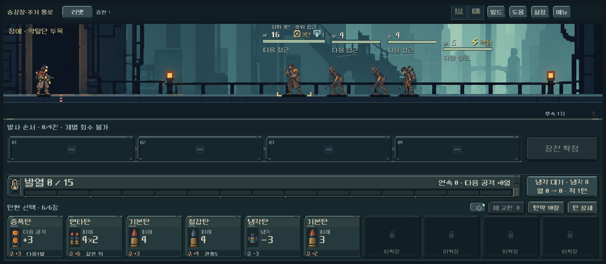
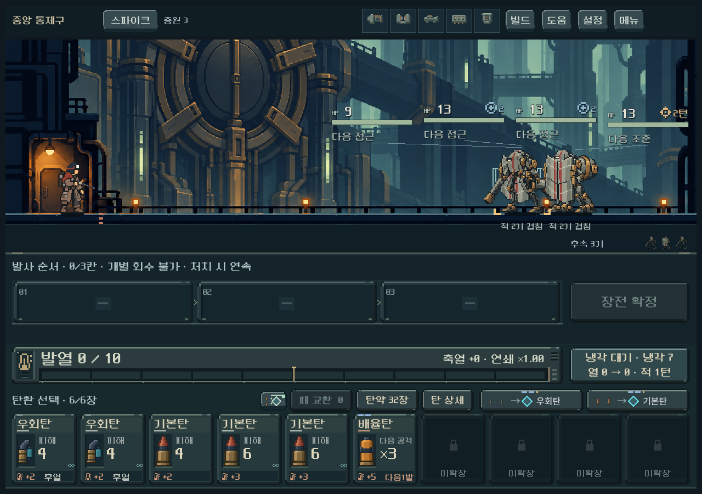
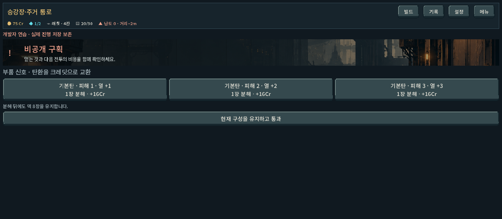
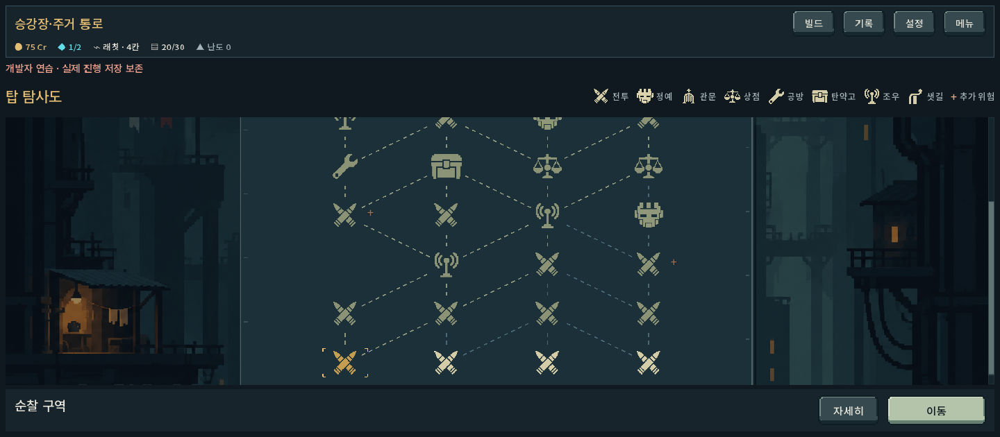
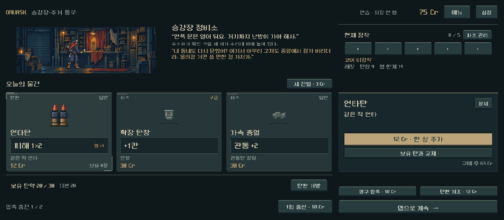
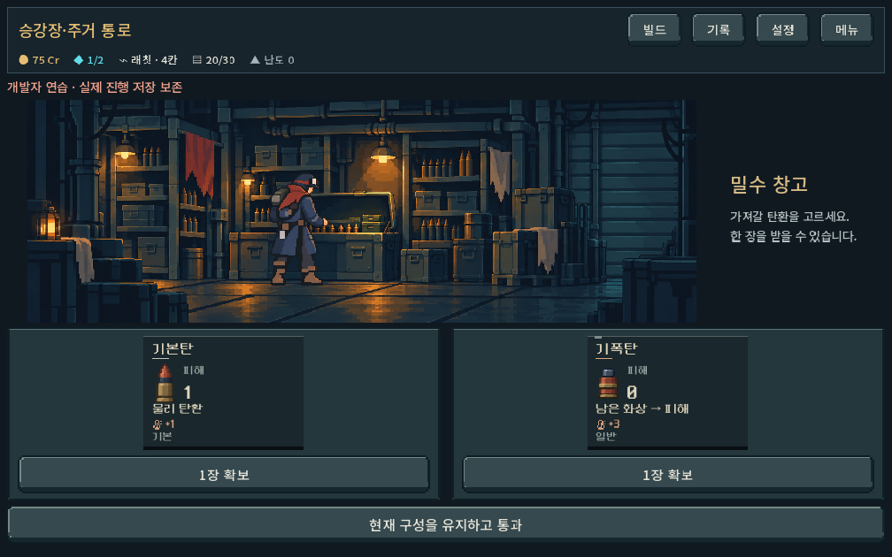
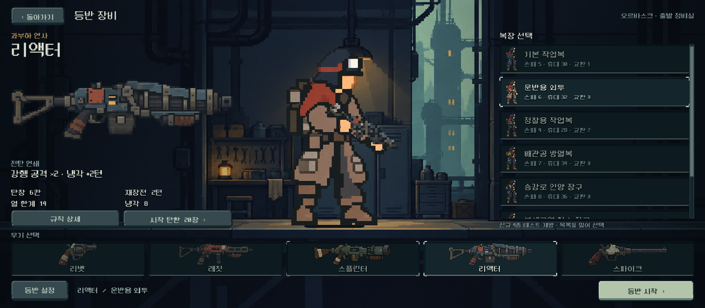
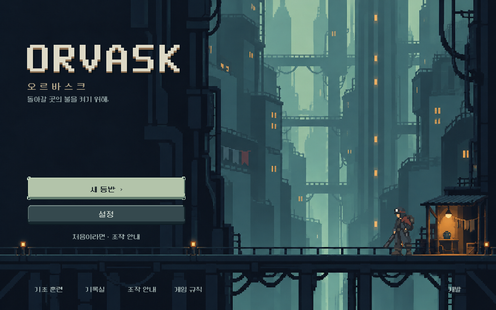

# 전체 UI 레이아웃 검토 — 2026-10-31

사용자 요청으로 게임 전체 화면의 레이아웃을 검토했다. 이 문서는 디렉터 검토 의견이며 사용자 결정이나 구현 변경이 아니다. 게임 코드·저장·APK는 바꾸지 않았다.

## 근거

- 현재 작업 트리로 `tests/art_cohesion_ui_runner.gd`를 격리 저장(임시 폴더의 `qa_runtime/art_cohesion`)에서 실행해 65장을 새로 찍었다. 검사 436개 통과, 실패 0개. 1280×900·1008×630·1440×630에서 본편 전투 5지역, 출발 장비 5총기, 지도·상점·공방·탄약고·조우, 타이틀을 확인했다. 대표 8장을 [assets](ui_layout_review_2026-10-31_assets/)에 보존했다.
- 탄창 여정·독립 비교의 최신 HUD는 [급탄 장비 보고서](combat_feedkit_2026-10-31.md)의 실제 캡처(전투·상세·메뉴·빼내기 선택), 보상·정비는 [색·형태 보고서](combat_identity_2026-10-31.md), 탄환 가방은 [탄환 아트 보고서](ammo_cohesion_2026-10-31.md)의 캡처를 사용했다.
- 기준 문서: [아트·UX](../../direction/art-and-ux.md)의 시각 언어·와이어프레임·정보 공개, [전투 HUD](../../direction/combat-hud.md).
- 화면을 보고 내린 판정이며, 사람의 이해도·실기기 판독성은 검증하지 않았다.

## 요약

전투 HUD 하나는 많이 정리됐다. 그러나 **게임 전체로 보면 화면마다 UI 체계가 다르다.** 사용자가 지적한 "디자인끼리 따로 논다"는 문제가 이제 전투 화면 안이 아니라 화면 사이에서 나타난다. 다음 개편은 부품을 다듬기보다 **공통 화면 틀**을 먼저 정해야 한다.

## 1. 전체 구조 문제

### 1-1. UI 계열이 세 갈래로 나뉨

| 계열 | 쓰는 화면 | 재질·글꼴 |
| --- | --- | --- |
| 급탄 장비(최신) | 탄창 여정·독립 비교의 전투 HUD | 강철 외피 원화, 깎인 모서리, 황동 접점, 도트 글꼴 |
| 평면 청록 패널 | 본편 전투, 상점, 출발 장비, 여정 보상·정비, 탄환 가방 | 단색 박스와 얇은 테두리, 도트 글꼴 |
| 평면 + 일반 글꼴 | 지도 상단바, 공방, 탄약고, 조우 | 단색 박스, **Noto Sans KR** |

글꼴은 `redesign/combat_pixel_font.tres`(NeoDunggeunmo)와 `redesign/ui_font.tres`(Noto Sans KR)이 함께 쓰인다. `screen.gd`가 두 글꼴을 모두 쓰며 공방·탄약고·조우가 Noto Sans로 나온다. 같은 등반 안에서 지도 → 공방 → 전투로 넘어갈 때 글자 모양이 바뀐다.

### 1-2. 공통 상단바가 없음

| 화면 | 상단 구성 |
| --- | --- |
| 여정 전투 | 진행·장소 / 총기 / 덱 / 코어 / 메뉴 — 글자만 |
| 본편 전투 | 장소 / 총기 버튼 / 증원 / 파츠 아이콘 3~5개 / 빌드·도움·설정·메뉴 |
| 지도·공방·탄약고·조우 | 테두리 상자 2줄: 장소 + Cr·코어·총기·탄약·난도 / 빌드·기록·설정·메뉴 |
| 상점 | ORVASK·장소 / Cr / 메뉴·설정 |
| 출발 장비 | 돌아가기 / 제목 / 장소 문구 |

크레딧·코어·탄약의 위치가 화면마다 다르다. 메뉴로 묶을 수 있는 보조 버튼(빌드·도움·기록·설정)도 화면마다 개수와 순서가 다르다.

### 1-3. 버튼과 선택 표시의 규칙이 없음

- **주 행동 색:** 타이틀·장비·지도는 연녹색, 여정 전투는 주홍, 상점 구매는 금색, 공방·탄약고·조우는 다른 버튼과 같은 회청색이다.
- **선택 표시:** 모서리 괄호, 금색 테두리, 밝은 배경이 섞여 있다. 출발 장비의 무기 줄과 보상 카드에서는 괄호(포커스)와 다른 표시(선택)가 동시에 나타나 무엇을 골랐는지 헷갈린다.
- **버튼 모양:** 입체 버튼, 밑줄만 있는 글자(여정 보상의 `코어 장착`, `현재 덱 유지`), 괄호를 두른 회색 상자(비활성 `선택을 확정하세요`)가 섞여 있다.

## 2. 화면별 문제 (우선순위 순)

### 본편 전투 — 가장 시급

- 1440×630에서 **전장이 화면 높이의 약 30%, 하단 조작부가 약 55%**를 차지한다. 빈 발사 순서 레일 줄, 화면 폭 전체의 발열 줄, 손패 줄이 쌓인 3단 구조다. 와이어프레임 기준의 "빈 장전 레일의 높이를 줄인다"가 반영되지 않았다. 여정 HUD(1280×800)는 전장이 약 53%다.
- 아직 확장하지 않은 손패 칸(`미확장`)이 손패 줄의 30~40%를 차지한다.
- 주인공과 적 사이 빈 바닥이 넓고 적이 작다. 사용자의 "적이 가까이 오지 않아 긴장감이 약하다"는 후기와 화면 구성이 관련 있을 수 있다(검증 전 가설).

### 적 명찰 — 본편과 여정 공통

- HP·`다음 접근` 명찰이 적 위쪽에 가로로 퍼지고 가는 선으로 연결된다. 적이 겹치면(관문·정원·중앙) 어느 HP가 어느 적의 것인지 찾기 어렵다.
- `적 2기 겹침` 문구 두 개가 서로 겹친다(중앙 통제구 1280).
- 오른쪽 끝 적의 HP 막대가 화면 밖으로 잘린다(정원 관문 1440의 HP 8, 중앙 통제구 1280의 HP 13).
- 밝은 배경(귀족 거주구)에서는 `다음 접근` 글자의 대비가 낮다.

### 조우 — 가장 미완성

- 1440×630에서 내용이 위쪽에만 있고 **화면 아래 약 40%가 비어 있다.** 배너가 얇고, 선택지가 글자 버튼 3개뿐이다. 다른 장소처럼 실내 장면이나 인물이 없다.

### 지도

- 실제 지도는 가운데 폭의 약 51%이고 양옆은 장식 배경이다.
- 맨 위 줄 노드가 반쯤 잘린 채 시작한다(스크롤 위치).
- 노드 색이 거의 같아 갈 수 있는 곳, 지나온 곳, 아직 못 가는 곳이 잘 구분되지 않는다.
- 하단 바에는 선택한 장소 이름만 있고 나머지가 비어 있다. 보상·위험·비용을 이 자리에 보여 주면 `자세히`를 누르지 않아도 된다.
- 범례가 오른쪽 위 작은 글씨다.

### 상점

- 오른쪽 열에서 `현재 장착` 아래가 비어 있고, 하단의 `영구 압축`·`탄환 개조`가 따로 떠 있다.
- 왼쪽 아래의 `보유 탄약` 줄과 `압축 충전` 줄도 떠 있다.
- 보조 버튼(새 진열, 탄환 가방, 1회 충전, 영구 압축, 탄환 개조, 파츠 관리, 상세)이 여기저기 흩어져 있다.
- 상품 3장 + 오른쪽 비교·구매 구조와 구매 버튼의 위치는 좋다.

### 탄약고 · 공방

- 탄약고는 큰 상자 안에 작은 탄환 카드가 있어 상자 대부분이 비어 있다.
- 공방(1440)은 장면 그림이 가운데에 있고 제목·설명이 오른쪽 끝에 떨어져 있다. 작업 카드 4장을 같은 크기로 나눈 것은 좋다.
- 두 화면 모두 Noto Sans 글꼴이다.

### 여정 전투 HUD (최신)

- 전체 정리는 잘 됐다. 주홍 사격 버튼이 확실한 주 행동이고, 이번 발사 탄과 대기 탄의 구분이 명확하다.
- 1280×800에서 하단 행동 줄의 왼쪽 절반이 비어 있다.
- 대기 탄 6~7장은 이름과 작은 그림만 있는 어두운 판이라, 화면 약 1/4이 정보 없이 반복된다.
- `빼내기 · 2` 아래에 아무것과도 연결되지 않은 가로선이 있다.
- 냉각 버튼의 보조 글자(`열 −6 · 적 1행동`)는 어두운 청색 위라 대비가 낮다.
- 탄 상세 창이 화면 대부분을 덮는다. 하단 `위로 / 아래로 / 전투로`는 의미가 바로 읽히지 않는다(이전/다음 탄인지 스크롤인지).

### 여정 보상 · 정비

- 카드의 설명 아래 빈 공간이 크다.
- 선택 표시 두 종류(괄호, 금색 테두리)가 동시에 보인다.
- 비활성 확정 버튼이 활성 버튼처럼 괄호를 두르고 있다.
- 바로 위 전투 HUD와 재질이 다르다(평면 청록 카드).

### 출발 장비

- 왼쪽 무기 정보, 가운데 인물, 오른쪽 복장 목록, 아래 무기 줄과 출발 버튼 구성은 좋다.
- 인물을 크게 확대해 픽셀 한 칸의 크기가 무기 그림·배경과 다르다. 아트·UX 기준의 "같은 픽셀 밀도" 원칙과 충돌한다.
- 복장 목록의 첫·마지막 항목이 반쯤 잘려 보인다.

### 타이틀 · 탄환 가방

- 타이틀은 양호하다. 하단 보조 링크가 난간 위의 작은 글씨라 대비가 낮다.
- 탄환 가방은 정보가 지나치게 많다. 1008×630에서 카드 둘째 줄이 잘리고, 아래 설명이 긴 문단이다.

## 3. 권고 순서

1. **공통 화면 틀 정의.** 상단바 한 종류(장소 / 자원 / 메뉴), 주 행동 위치(오른쪽 아래)와 색 하나, 선택·포커스 표시 각각 하나, 버튼 3단계(주 / 보조 / 위험·비활성), 글꼴 한 계열. 최신 급탄 장비 재질을 공통 재질로 쓸지는 아직 사용자가 미감을 확정하지 않았으므로 확인 후 확장한다.
2. **본편 전투 HUD의 방향 결정.** 탄창 구조를 본편에 적용하는지와 묶어서 결정한다. 적용하지 않더라도 3단 하단부를 2단으로 줄여 전장 높이를 확보한다.
3. **적 명찰 재배치.** 각 적 바로 위에 고정하고, 겹치면 세로로 쌓고, 화면 가장자리 안으로 제한한다. 근접한 적이 화면에서 더 위협적으로 보이게 하는 연출은 접근 압박 비교와 함께 다룬다.
4. **빈 공간 화면 재배치.** 조우 → 지도 하단 정보 → 탄약고 → 상점 보조 버튼 정리 순서다.
5. **세부 수정.** 장비 화면 인물의 픽셀 배율, 탄환 가방의 정보량, 냉각 버튼 대비, 고아 선, 상세 창 버튼 이름.

## 검증 경계

- 기능 검사: 캡처 실행기 436개 검사 통과(가로 넘침 없음 포함).
- 시각 확인: 위 캡처를 디렉터가 검토했다. 실기기 화면은 확인하지 않았다.
- 사람의 이해도: 검증하지 않았다.
