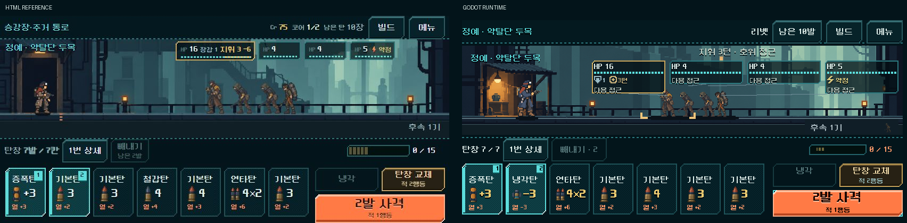

# 라인 + 도트 UI — Godot 적용과 검증

2026-11-01. 사용자 확정 [테마 기준](../../direction/ui-line-theme.md)을 실제 Godot 화면에 적용했다. 실행은 루트의 `OPEN_COMBAT_UI_STUDY.cmd`. 기본 진입 씬은 유지하며, 기존 본편 지도·탄약고·공방·상점에도 같은 표면 자원을 연결했다.

## 적용과 보존

- 전투 HUD: HTML 원본 도트 틀 15종을 정확히 최근접 2배로 만들고 12/8px 9분할·타일 반복으로 연결했다. 청록 발사 대상·붉은 제외·빈 소켓, 주황 사격·청록 냉각·황동 교체, 상태별 비활성/호버를 적용했다. 동적인 순서 번호와 수치·이름은 그대로 Label이다.
- 공통 창: 메뉴·탄 상세·보상·정비·여정 경로를 같은 반투명 틀과 글자 단계로 통일했다. 후보 선택은 청록, 경로 목록은 점선 행, 확정 행동은 주황이다.
- 지도·장소·상점: 실제 기존 씬·공용 스킨을 교체했다. 지도 선택은 청록 면, 갈 수 있는 곳은 금색 선, 현재는 흰 점선이다. 경로 선의 안티앨리어싱은 껐다. 상점은 실제 구매/교체/재진열/저장을 계속 사용한다.
- 전투 UI 글자는 12/16/24/32 단계로 정리하고 NeoDunggeunmoPro의 안티앨리어싱·서브픽셀을 껐다. 그림자, 반투명 디더, 2px 점선, 실제 열 한계 수의 게이지를 사용한다. 적 HP는 4px 칸/2px 간격이며 예상 피해는 기존 Forecast를 읽는다. 무작위 무기는 확정 피해 구간만 금색으로 표시한다.
- 카드76×96·버튼44/50·탄창 가로 스크롤·전체 씬 배치와 입력 연결을 보존했다. 안쪽 글자 여백은 강철 걸쇠 여백을 해제했다. 사격 버튼 내용만 눌렀을 때2px 내려간다.
- `model.gd`, `campaign.gd`, `magazine_journey.gd`, `forecast.gd`, 두 기존 전투 컨트롤러, 여정 HUD 컨트롤러, `project.godot` 8개는 작업 전 해시와 동일하다. 기존667개 컨트롤의 배치·입력 영역 속성에서 변경0건, 본편 주요5스크립트의 신호 연결도 동일하다. 장식 NinePatch의 배율/분할과 버튼 안쪽 글자 여백은 외형 변경으로 별도 구분했다.

근거: `qa_runtime/line_theme_20261101/invariants.json`, `validation.json`, `source_before/`. 최종 자산은 `assets/ui/line_theme_20261101/`, 출처와 2배 원본 일치는 그 폴더의 `provenance.json`에 기록했다. 이전 강철 자산은 보존했다. Godot MCP로 활성 프로젝트/4.7 버전을 확인했고, 실제 실행·입력·캡처는 기존 격리 CLI 경로를 사용했다.

## 비교 계약

정답은 `index.html#tab=elite&theme=line`의 외형이다. 사용자가 배치를 유지하도록 지정했으므로 HTML의 배치·전장 크롭·게임 데이터를 이식하지 않는다. HTML의 도구 줄을 제외한 `#app` 사각형과 Godot 전체 뷰포트를 정확히 같은 크기로 비교했다. 브라우저의 부분 캡처가 원점을 잘못 적용해 첫 결과에서 하단이 잘린 것을 발견했으며, 최종본은 전체 브라우저 캡처에서 실제 DOM 경계를 추출했다.

1280×800 기준 `(x,y,w,h)`:

| 영역 | HTML 기준 / 정규화 | Godot 유지 영역 | 외형 담당 | 동적 내용 |
| --- | --- | --- | --- | --- |
| 상단 | (0,0,1280,52) / (0,0,1,.065) | (8,8,1264,44) | 테마·line_band | 위치·총기·잔탄 |
| 하단 독 | (0,636,1280,164) / (0,.795,1,.205) | (8,638,1264,154) | line_band | 탄창·발열·선택 |
| 탄창 | (10,688,770,106) / (.0078,.86,.6016,.1325) | (8,688,1010,104), 카드76×96 | NinePatch·동적 Label | 탄·열·발사 순서 |
| 행동 | (986,688,284,106) / (.7703,.86,.2219,.1325) | (1028,688,244,104), 사격244×50 | px_fire/cool/reload | 사격 수·비용·위험 |

좌표 원본: `qa_runtime/line_theme_20261101/html/crops.json`, `line_theme_20261101/capture/bounds.json`. 실제 전장/명찰·메뉴 크기와 경로/보상 배치는 Godot의 기존 구성을 유지한다. HTML은 임의 시드이고 Godot 비교는731042이므로 탄 순서·예상 피해가 다르다. 전체 화면 차이값은 픽셀 일치 합격률로 쓰지 않았다.

## 실제 화면

왼쪽 HTML, 오른쪽 Godot. 원본 크기로 저장했으며 클릭해서 확대할 수 있다.

- [740×360](ui_line_godot_2026-11-01_assets/elite_740x360_side_by_side.png)
- [1008×454](ui_line_godot_2026-11-01_assets/elite_1008x454_side_by_side.png)
- [1280×800](ui_line_godot_2026-11-01_assets/elite_1280x800_side_by_side.png)
- [틀·글자3배 확대](ui_line_godot_2026-11-01_assets/hud_zoom_3x.png)
- [반투명 겹치기·차이 보기](ui_line_godot_2026-11-01_assets/elite_1280x800_audit.png)
- [선택/빼내기](ui_line_godot_2026-11-01_assets/selected_1280x800.png) · [메뉴](ui_line_godot_2026-11-01_assets/menu_1280x800.png) · [탄 상세](ui_line_godot_2026-11-01_assets/detail_1280x800.png)
- [상점 비교](ui_line_godot_2026-11-01_assets/shop_1280x800_side_by_side.png) · [지도 비교](ui_line_godot_2026-11-01_assets/map_1280x800_side_by_side.png)
- [탄약고](ui_line_godot_2026-11-01_assets/supply_1280x800.png) · [공방](ui_line_godot_2026-11-01_assets/workshop_1280x800.png)

`reference_parity_audit.py`로6개 비교의 같은 크기/비율, 겹치기와 차이 이미지를 만들고 검토했다. 1배의 HUD 틀은 원화1픽셀=논리2×2이며 카드/키의 계단 경계를 확인했다. 상점은 기존1600×900 캔버스를1280×800에서0.8배로 맞추므로 틀의 실제 도트는 약1.6px다. 기존 확대 정책 보존 범위의 선명도 차이이며, 이를 고치기 위한 배율/배치 변경은 이번 작업에 포함하지 않았다. 적·탄환 원화의 도트 밀도와 배경 확대 방식도 기존 값을 유지했다.

## 검사 결과

모두 `qa_runtime/` 아래 별도 APPDATA/LOCALAPPDATA에서 실행했다. 기존 사용자 저장에 접근하지 않는다.

| 검사 | 결과 | 확인 내용 |
| --- | --- | --- |
| prototype ui | 11,536 / 실패0 | 4크기·5총기, 영역·입력·실제 명령 |
| prototype flow | 4,274 / 실패0 | 실제5전투·보상·정비·관문·재시작 |
| prototype visual | 1,999 / 실패0 | 독립 씬, 한글·빈 소켓·선택·열 상태 |
| prototype direct | 2,167 / 실패0 | 선택 후 즉시 빼내기, 터치/키보드, 상태 보존 |
| prototype scroll | 7 / 실패0 | 가로 스와이프·의도치 않은 선택 방지 |
| prototype restart | 쓰기5 + 재개6 / 실패0 | 새 프로세스의 탄 순서·RNG·한도·재개 사격 |
| prototype journey | 412 / 실패0 | 보상 미리보기·실제 확정·저장·경로·연속 입력 |
| 본편 상점 | 1,295 / 실패0 | 구매·교체·재진열·보관·저장/재개·작은 화면 |
| 현행 본편 지도/장소 | 669 / 실패0 | 3크기·5구역, 상세·미래 열람·한 번 이동·장소 이탈·저장 |
| 같은 크기 캡처 | 33 / 실패0 | 실제 정예 상태4크기·메뉴·상세·탄약고/공방 |

재현: `powershell -ExecutionPolicy Bypass -File tools/run_prototype_hud.ps1 -Mode <ui/flow/visual/direct/scroll/journey> -Fast -Suite line_theme_20261101`. 재개는 `-Mode restart -Stage write/read`. 추가 본편 검사는 `tools/run_line_world_checks.ps1 -Mode shop/map/capture`. 정합성과 비교 그림은 `python tools/audit_line_theme.py`.

기존 HUD 검사의 명령·흐름 검증은 유지했다. 글자 검사 한 곳의 예전 ‘모든 메타데이터14px 이상’ 기대만 확정 문서의 ‘열12px, 이름/값16px 이상’으로 갱신했다. 과거 지도 검사 `route_map_chart_ui_runner.gd`는 첫 보상2단계와 현행 공방을 반영하지 않아 실패했다. 원래 검사 파일은 보존하고 `line_world_ui.gd`에서 현행 목적지 선택·상세·이동·장소·저장을 검사했다. 원문 실패 로그: `qa_runtime/line_theme_20261101/legacy_map_stderr.log`.

파싱/실행 오류는 없으며 에디터 임포트에 기존 Android build-tools 경로 경고가 있다. APK는 생성하지 않았다.

## 남은 확인

- 기능 검사 통과와 화면 검토 완료. 사용자의 최종 미감·정보 이해도와 연속 플레이 체감은 사람 확인 대상이다.
- Android 실기기 터치/안전 영역, 비정수 배율의 선명도, 지속 성능·기기 발열은 미검증이다.
- 기본 진입 전환·APK·커밋·푸시·외부 게시를 수행하지 않았다. 기존 실행 파일에서 새 테마를 확인할 수 있다.
