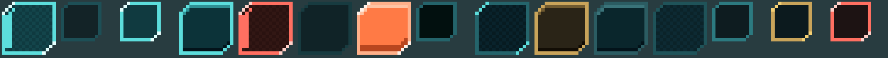
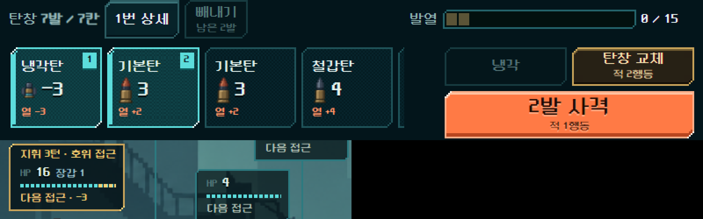
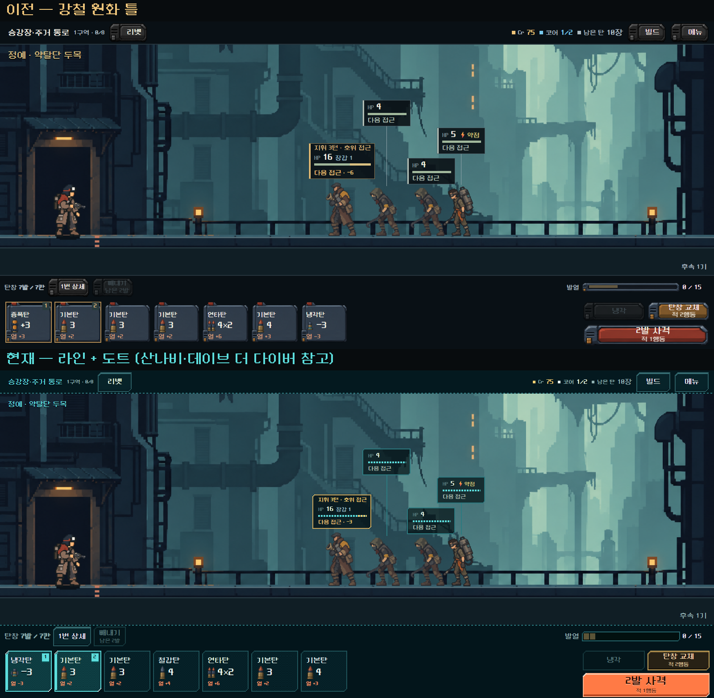
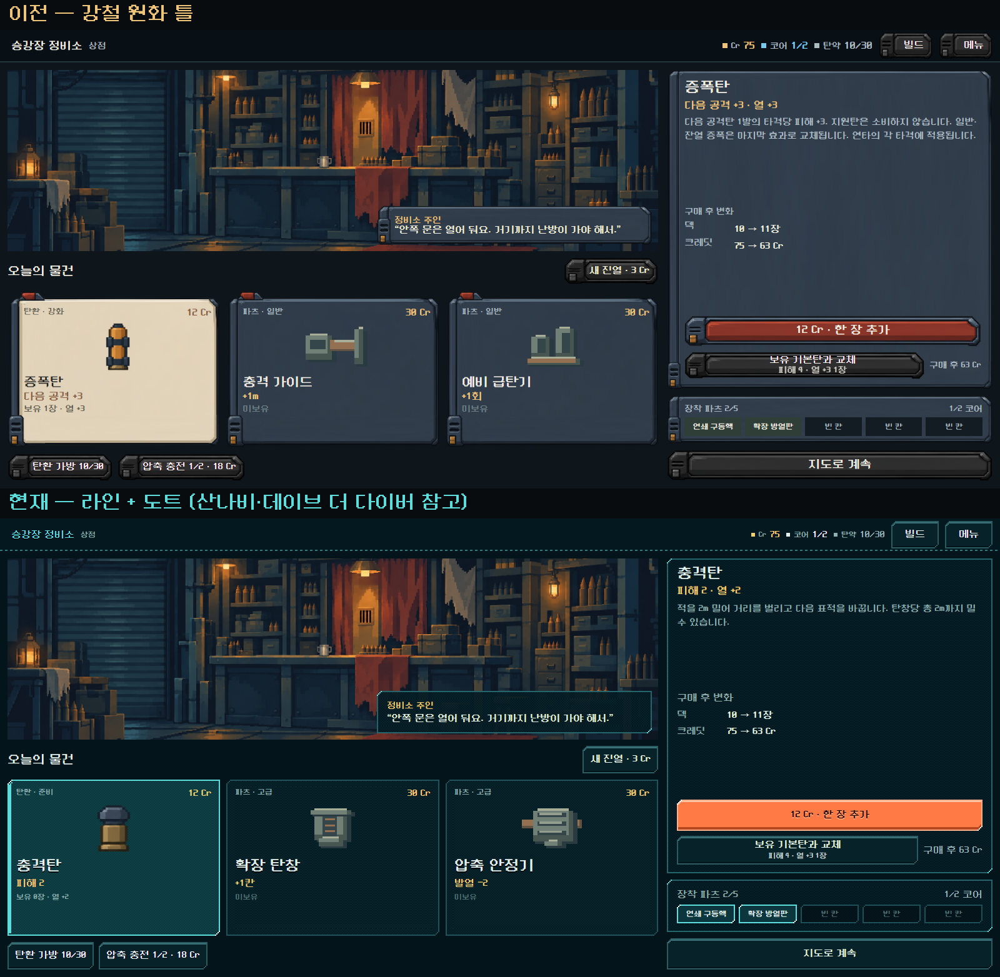
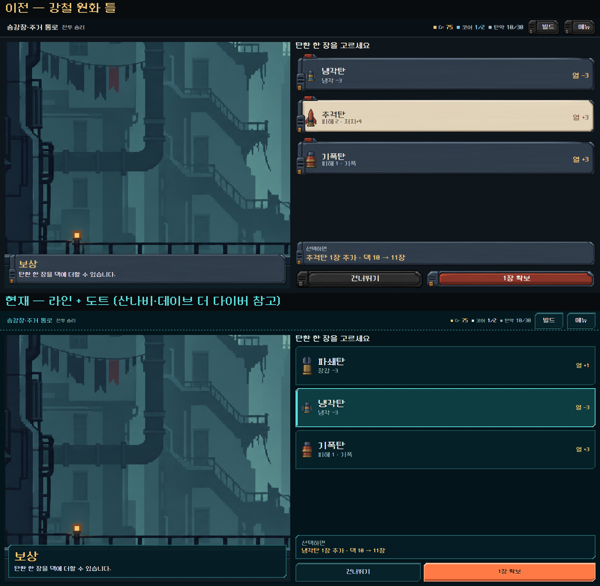
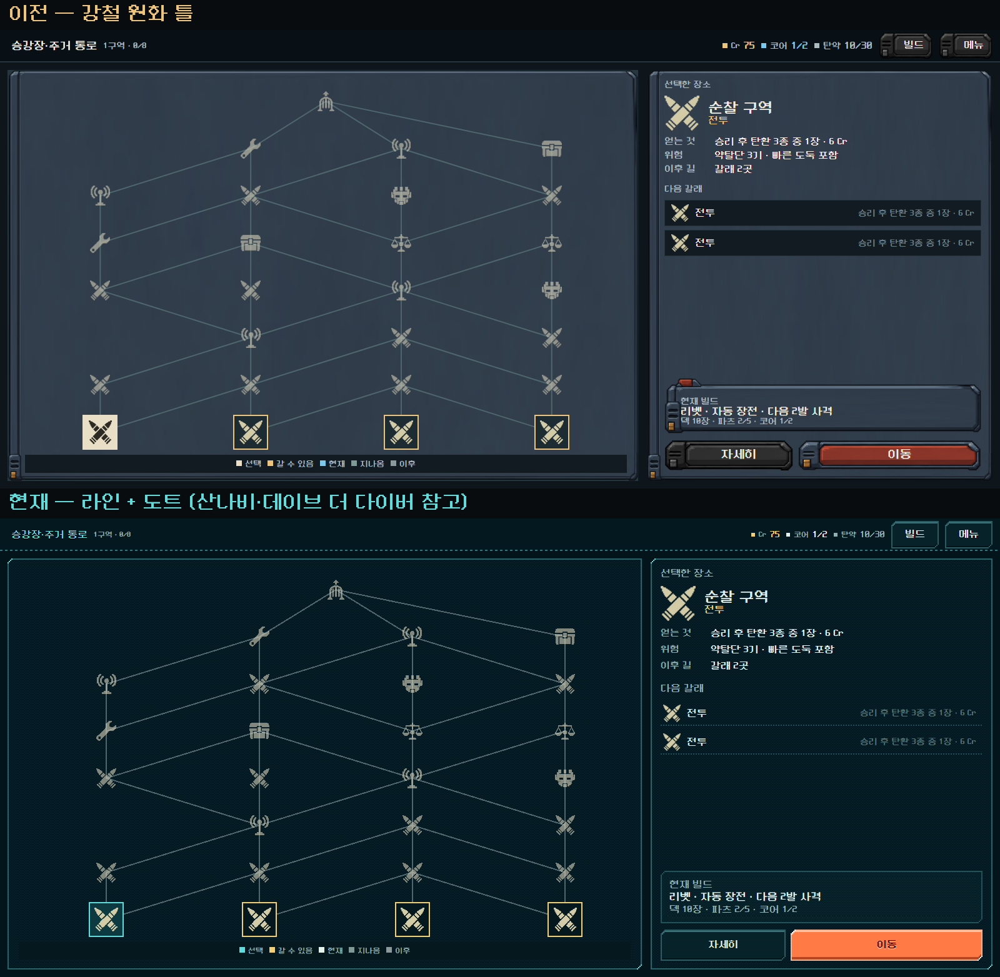
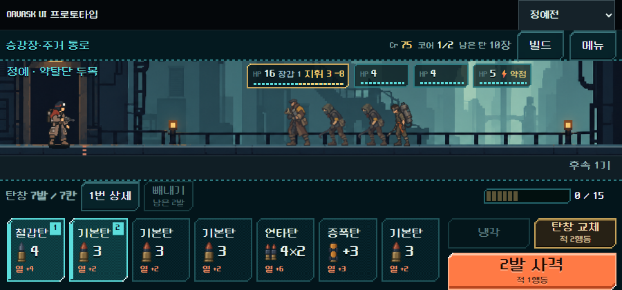

# UI 라인 시안 — 레퍼런스 분석과 적용 (2026-11-01)

사용자 목표: UI의 AI 슬롭 느낌을 없애고 더 좋은 퀄리티의 게임처럼 보이게 한다. 사용자가 산나비·데이브 더 다이버 화면 4장과 산나비풍 리소스 팩을 레퍼런스로 줬다([레퍼런스](../../art/references/2026-11-01-user/README.md)). 이 문서는 그 분석과, 동작하는 HTML 프로토타입에 넣은 **라인 시안**의 기록이다.

상태: **사용자가 라인 시안 방향을 골랐다**(2026-11-01, "도트풍 감성만 더하면 된다"). 그 뒤 도트 처리를 더했다(아래 2-1). 도트 처리 세부는 디렉터 구현이며 사용자 확인 전이다. Godot 게임 화면·규칙·저장은 바꾸지 않았다.

## 1. 레퍼런스에서 읽은 것

| 항목 | 산나비 | 데이브 더 다이버 | 현재 ORVASK(강철) |
| --- | --- | --- | --- |
| 틀 | 1px 선 + 모서리 절삭, 속은 반투명 | 제목 띠 하나 + 평평한 면, 행은 구분선 | 두꺼운 생성 원화 강철 틀을 모든 요소에 9분할 |
| 색 | 짙은 청록 바탕 + 청록 선 하나, 선택은 마젠타·밝은 청록 | 짙은 남청 바탕 + 하늘색 강조, 행동 버튼만 채도 높은 색 | 청회색 판 + 상아·금·적·청·황토 강조 |
| 선택 | 선택한 것만 면을 채우고 선을 두껍게 | 선택 행만 밝은 테두리 | 상아색 면(텍스트가 어두워짐) |
| 정보 | 큰 글자 몇 개, 장식용 미세 문자·바코드는 읽지 않아도 됨 | 키캡·초상화·아이콘이 단어를 대신함 | '이번 사격', '구매 후 변화' 같은 라벨과 표 |
| 장면과 관계 | 창 뒤로 장면이 비침 | 장면 위에 얇게 얹힘 | 하단 판이 장면과 분리된 별도 기계 |

주요 색(감소 색상 추출): 데이브 #001b22 · #004059 · #4e777e, 산나비 #06474c · #11343d · #5cdddc. 두 게임 모두 화면의 대부분이 짙은 청록 계열 3~4단계이고, 밝은 색은 선택과 주 행동에만 쓴다.

**판단:** 퀄리티 차이의 큰 부분은 "모든 것을 두꺼운 재질로 감싸지 않는 절제"에서 온다. 지금 강철 틀은 원화 자체의 품질과 별개로, 같은 틀이 카드·버튼·창·명찰에 반복되면서 템플릿처럼 보인다.

## 2. 라인 시안에 적용한 것

- 틀: 1px 선 + 왼쪽 위·오른쪽 아래 모서리 절삭. 속은 반투명 짙은 청록.
- 색: 바탕 #03141a, 선 #1d4f56~#24646b, 강조 #5cdddc 하나. 숫자는 금색 유지.
- 주 행동: 화면마다 하나만 채운 주황(#ff7a45)에 어두운 글자. 열·사격과 같은 색이다.
- 보조 행동: 선만 있는 버튼. 냉각은 청록 선, 탄창 교체는 황동 선.
- 선택: 왼쪽 3px 청록 띠 + 옅은 청록 면. 글자는 밝은 색을 유지한다(상아 면에 어두운 글자를 쓰지 않음).
- 목록: 상자 대신 구분선 행(빌드 서랍, 상점 다음 갈래).
- 적 명찰: 더 투명한 바탕, 얇은 HP 막대.
- 지도: 선택은 청록 면, 현재 위치는 흰 점선, 갈 수 있음은 금색 선.

### 2-1. 도트 처리 (사용자 방향 확정 뒤 추가)

- **틀을 작은 도트 그림으로 바꿨다.** `tools/build_line_theme_assets.py`가 16×16(작은 것은 12×12) 9분할 틀 15종을 그린다(`px_*.png`). CSS가 정확히 2배, 최근접 확대로 그려서 도트 하나가 화면 2×2px다. 매끈한 사선 대신 계단식 모서리를 쓴다.
- **면에 체크 디더**를 아주 약하게 넣었다. 패널·선택 카드에만 쓴다.
- **버튼은 위 1도트 밝은 줄 + 아래 그림자**로 튀어나온 키처럼 보인다. 사격 버튼은 그림자 2도트, 누르면 2px 내려간다. 깎인 모서리 끝에 밝은 점(반짝임)을 둔다(패널·선택·사격).
- **선택한 탄(다음 발사)·빼낼 탄**은 사각 외곽선 대신 청록·붉은 도트 틀로 바꿨다.
- **발열 게이지는 15칸**, 적 HP 막대는 4px 칸으로 끊었다. 상단바·하단 독·목록 구분선은 점선 도트 줄이다.
- **글자 크기를 도트 글꼴의 격자에 맞췄다.** NeoDunggeunmo는 12·16·32px에서만 획이 고르게 찍힌다(14·15·17·20px은 획 두께가 들쭉날쭉). 작은 글자 12px, 본문·버튼 16px, 중간 숫자 24px, 창 제목 32px로 정리하고 줄 높이를 정수 px로 고정했다. 제목·큰 숫자에는 아래 2px 단단한 그림자를 둔다.
- 지도 경로선은 `crispEdges`로 계단형 도트 선, 스크롤바는 틀 색으로 맞췄다.

상점 진열은 매번 무작위라 위아래 상품이 다르다.

## 3. 보는 방법

- `OPEN_UI_PROTOTYPE.cmd`로 서버를 켜고 `http://127.0.0.1:8765/index.html`을 연다.
- 위쪽 도구 줄의 **스타일: 현재 강철 / 라인 시안**으로 바꾼다. 선택은 탭을 옮겨도, 다시 열어도 유지된다.
- 주소에 `#tab=elite&theme=line`처럼 붙여도 된다. 작은 화면에서는 도구 줄 버튼이 숨으므로 이 주소를 쓴다.
- 구현: `ui_prototype_2026-10-31/assets/theme_line.css`와 `px_*.png`. `html[data-theme="line"]`일 때만 적용되므로 강철 화면에는 영향이 없다. 틀 색·모양을 바꾸려면 `tools/build_line_theme_assets.py`의 표를 고치고 다시 실행한다.

## 4. 확인한 것 / 하지 않은 것

- Edge 헤드리스로 정예전·상점·보상·지도를 두 스타일로, 정예전을 900×420으로 캡처해 직접 봤다. 전투는 실행 중인 로컬 서버의 실제 Godot 전투 계산으로 그렸다.
- 첫 캡처에서 반투명 면 아래로 선 색이 비쳐 '탄창 교체'가 꽉 찬 황동색으로 보였다. 선 층을 가운데가 뚫린 고리로 바꿔 고쳤다.
- 지도의 '선택'과 '현재'가 같은 청록이어서, 현재 위치를 흰 점선으로 바꿨다.
- 도트 처리 뒤 정예전·상점·보상·지도·탄 상세·900×420을 다시 캡처하고 3배 확대로 도트 크기와 글자 선명도를 확인했다. 지도 범례가 2px 넘쳐 기본 흰 스크롤바가 생긴 것을 고쳤다.
- 하지 않은 것: 실기기 터치, 사람의 이해도, Godot 적용. HTML 브라우저 렌더는 도트 선명도를 정확히 재현하지 않는다.

## 5. 이 시안으로 해결되지 않는 것

라인 시안은 틀과 색만 바꿨다. 다음은 그대로 남아 있다.

1. **도트 크기 불일치.** 적 그림은 큰 원본을 약 0.135배로 줄여 써서 배경보다 도트가 곱고 경계가 번진다. AI 그림 느낌의 가장 큰 원인이며, UI가 아니라 그림 정리 작업이다.
2. **글자 라벨과 표.** '이번 사격', '구매 후 변화 · 덱 10 → 11장' 같은 문장형 정보. 데이브처럼 아이콘·키캡·초상화로 바꾸는 작업이 필요하다.
3. **빈 공간.** 상점 오른쪽 설명 칸 중간, 보상 선택지 아래가 비어 있다.
4. **움직임.** 선택·장전·사격의 반응 연출은 이번 범위가 아니다.
5. 산나비의 장식층(미세 문자·바코드·큰 워터마크 글자·격자 바탕)은 일부러 넣지 않았다. 세계관(빈민가·주거 통로)과 맞는지 먼저 판단해야 한다.

## 남은 판단 (사용자)

- ~~라인 시안과 강철 중 선택~~ → 라인 시안으로 확정(2026-11-01). "급탄 장비 재질을 모든 화면의 기준으로" 질문은 '아니오'로 정리됐다.
- 도트 처리의 세기(디더·반짝임·버튼 두께)가 적당한지.
- Godot 본편 UI로 옮길 시점.
- 주 행동 색: 주황(열·사격과 같은 색) 그대로 갈지, 산나비처럼 마젠타 계열로 갈지.
- 산나비식 장식층을 넣을지.
