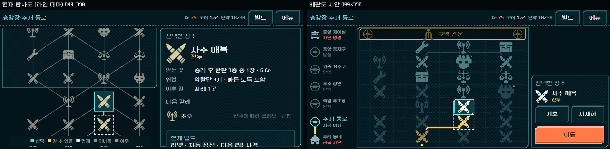
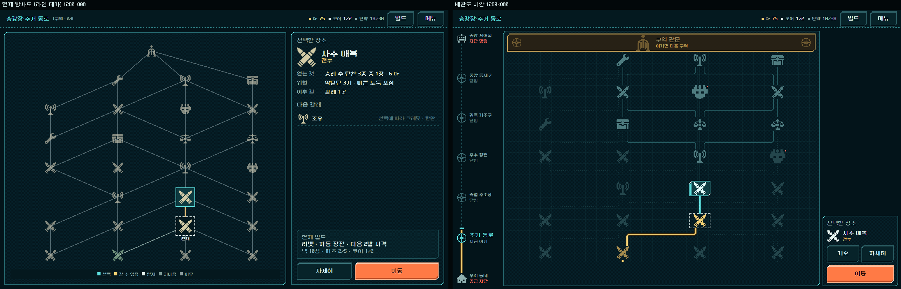

# 지도 배관도 시안 — HTML 검토판 (2026-11-01)

사용자 요청: [지도 UI 검토](../../history/design/map-ui-review-2026-11-01.md)의 권고안 B(공급 계통도)를 HTML 시안으로 제작. **디렉터 제안이며 사용자 채택 전이다.** Godot 게임 화면·규칙·저장은 바꾸지 않았다.

## 보는 방법

- `OPEN_UI_PROTOTYPE.cmd` → `http://127.0.0.1:8765/index.html#tab=map&theme=line&map=pipe`
- 위쪽 도구 줄의 **지도: 탐사도 / 배관도**로 바꿔 가며 비교한다. 선택은 다시 열어도 유지된다. 작은 화면에서는 도구 줄 버튼이 숨으므로 주소의 `map=pipe`를 쓴다.
- 라인 테마(`theme=line`)에 맞춰 만들었다. 강철 테마에서도 동작한다.

## 만든 것

| 요소 | 내용 |
| --- | --- |
| 배관 | 같은 노드·`next` 연결을 위로 오르다 직각으로 꺾는 관으로 그린다. 꺾이는 곳에 2도트 계단 모서리. 이웃 열의 꺾임 높이를 6px 엇갈려 두 관이 한 줄로 이어져 보이지 않게 했다. |
| 관 상태 | 지나온 길 = 굵은 금색 관(공급이 이어진 관), 지금 갈 수 있는 길 = 청록 실선, 고른 길 = 굵은 청록 + 흐르는 점, 그 뒤의 길 = 가는 실선, 이제 갈 수 없는 길 = 흐린 점선. 출발 줄 아래에 구역 입구 관을 둔다. |
| 장소 기호 | 채택된 8종의 모양을 작은 1색 도트 실루엣으로 다시 뽑았다(일반18·정예22·관문24도트, 2배 표시). 상태별로 색만 바뀐다. 상시 박스 없음: 갈 수 있음 = 금색 모서리, 선택 = 청록 도트 틀, 현재 = 흰 점선, 정예 = 작은 붉은 점. |
| 관문 | 구역 폭 전체에 걸친 황동 차단문 띠. 항상 지도 위에 고정되어 스크롤해도 보인다. 높이가 낮은 화면에서는 얇은 판(작은 2배 틀·16도트 아이콘)으로 바뀐다. |
| 왼쪽 구역 막대 | 아래 '우리 동네 · 공급 차단'부터 위 '중앙 제어실 · 차단 명령'까지 다섯 구역의 밸브. 지나온 만큼 금색 관이 차오르고 청록 표시가 지금 위치다. 층수·숫자는 쓰지 않는다. |
| 오른쪽 | 선택 장소 이름·종류, 선택 전에 알아야 하는 예외 한 줄(정예·공방·조우·관문만), `기호`·`자세히`·`이동`. 미래 장소는 '미리보기'와 함께 `이동`을 숨긴다. 상단 상시 범례는 없애고 `기호` 버튼의 설명 창으로 옮겼다. |
| 움직임 | 고른 관의 흐름 점(4단계로 끊어 움직임), 선택 기호의 짧은 밝아짐. 움직임 줄이기 설정에서는 끈다. |

파일: `ui_prototype_2026-10-31/assets/map_pipe.js`, `map_pipe.css`, `pm_*.png`. 기호 그림은 `tools/build_pipe_map_assets.py`가 만든다. 기존 지도 코드는 그대로 두고 `renderMap`만 감싸서 전환한다.

## 화면

- [출발 상태 1280×800](ui_pipe_map_2026-11-01_assets/start_1280.png) · [관문 미리보기](ui_pipe_map_2026-11-01_assets/preview_844.png) · [기호 창](ui_pipe_map_2026-11-01_assets/key_844.png) · [740×360](ui_pipe_map_2026-11-01_assets/pipe_740.png) · [3배 확대](ui_pipe_map_2026-11-01_assets/zoom_3x.png)
- 왼쪽 비교 대상은 HTML 검토판의 기존 지도다. 이 화면에는 Godot 본편에서 없앤 오른쪽 정보 패널이 남아 있다. Godot 본편 지도는 [검토 문서의 캡처](../../history/design/map-ui-review-2026-11-01-assets/current_map_1440x630.png)를 본다.

## 확인한 것

- Edge 헤드리스, 같은 앱 크기(1280×800 / 844×390 / 740×360)로 출발·두 칸 진행 후·관문 미리보기·기호 창을 캡처해 직접 봤다.
- **한 구역 전체가 보이는지:** 844×390에서 지도 면 298px에 필요한 높이 302px. 관문과 1구역 7줄이 모두 보인다(4px 스크롤). 740×360은 268px에 290px이 필요해 맨 윗줄 일부가 스크롤 아래에 있다. 관문 띠는 고정이라 항상 보인다.
- 클릭 흐름 13항목 통과: 장소 선택, 미래 장소에서 `이동` 숨김, 관문 선택, 기호 창 열기/Escape 닫기, `자세히` 열고 닫기, `이동`으로 실제 전투 시작(로컬 서버의 Godot 전투 계산), 지도 복귀, 탐사도↔배관도 전환, 강철 테마에서 그리기.
- 3배 확대에서 관·기호·틀의 도트가 2×2px로 고르고 계단 모서리가 번지지 않는다.

## 처음 측정이 틀렸던 점

캡처 도구가 처음에는 앱을 실제보다 크게(844×442) 그려 "844×390에서 다 들어간다"고 잘못 봤다. 크기를 바꾼 뒤 앱 배치를 다시 계산하도록 고쳐 정확한 390 높이에서 다시 쟀다. 그 과정에서 맨 윗줄 아이콘이 지도 면 위로 잘리는 여백 계산 실수도 찾아 고쳤다(첫 줄·끝 줄 아이콘 크기로 여백 계산).

## 한계와 남은 판단

- 휴대폰에서 줄 간격이 40px까지 줄어든다. 터치 영역 44px과 4px 겹친다. 실기기 터치 확인이 필요하다.
- 관을 '갈 수 있는 길'로 읽는지, 흐름 점이 거슬리지 않는지는 사람 확인 대상이다.
- 구역 막대의 2~5구역 이름은 현재 작업 명칭이다. 검토판에는 1구역만 있어 구역 전환 연출은 만들지 않았다.
- 샛길(전투 생략) 연결은 검토판 데이터에 없어 그리지 않았다. 본편으로 옮길 때 '건너뛰는 관'을 별도로 설계해야 한다.
- 사용자 판단: 이 방향으로 갈지, 구역 막대·관문 띠·흐름 점 각각을 유지할지, Godot 적용 시점.
