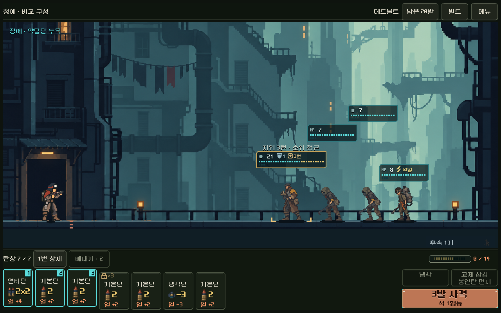
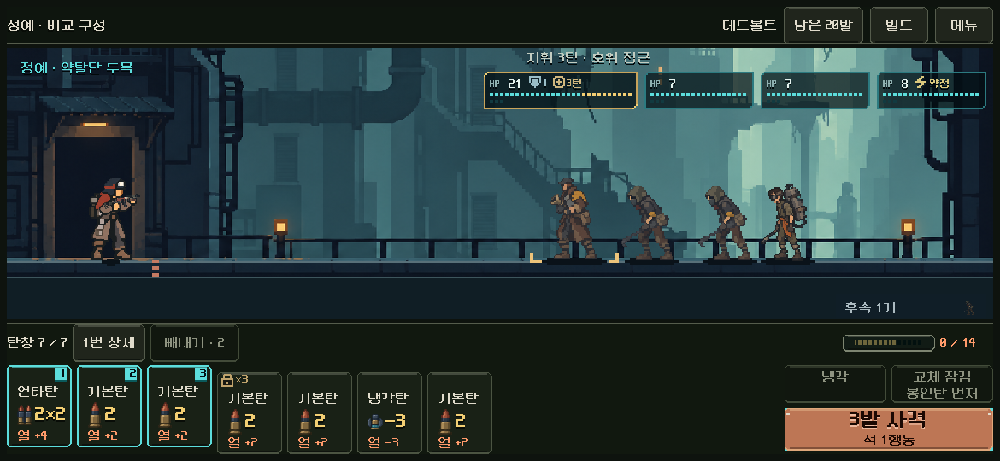
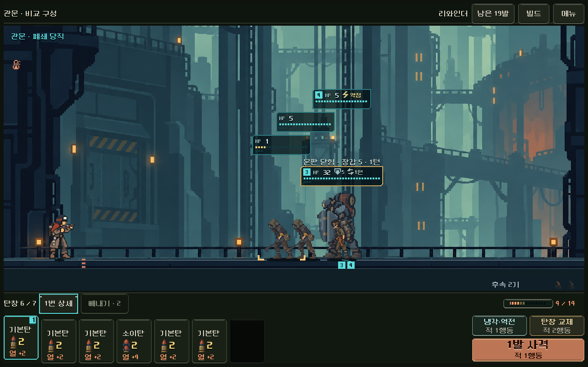
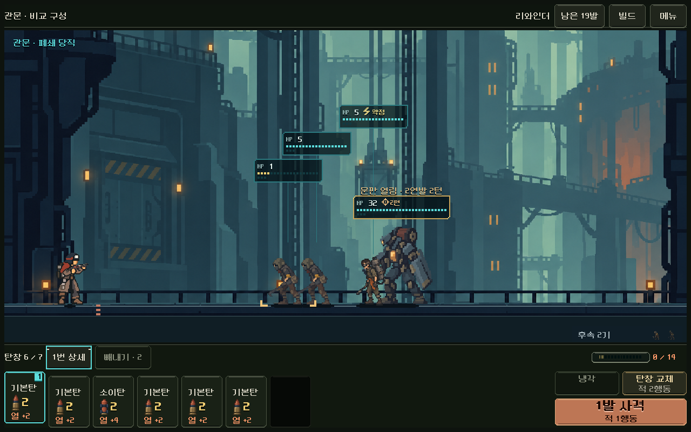

# 데드볼트·리와인더 — 실제 전투 비교판

사용자가 능력 방향과 두 이름을 수락한 뒤 구현한 첫 비교판이다. **실제 명령·예측·저장과 기존 HUD 연결까지 완료**했다. 본편의 총기 선택은 기존5종이며, 새2종 전용 외형/7복장·본편 선택·자연 획득 이후 균형과 사람의 재미는 후속이다. [현행 결정과 연결 조건](../../../direction/weapon-expansion.md).

## 실행과 비교

저장소 루트의 [PLAY_WEAPON_ROLES.cmd](../../../../PLAY_WEAPON_ROLES.cmd)를 실행한다. 메뉴 → 다음 총기에서 **데드볼트 → 리와인더 → 래칫**을 순환하고, 다음 전투에서 첫 교전/정예/관문을 바꾼다. 재시작은 같은 시드/구성을 다시 연다. 자동 저장은 별도 `qa_runtime/weapon_role_play` 아래에 두며 본편 저장을 열지 않는다.

- 첫 교전: 현행 새 도전, 시드17·운반복·래칫 플랫폼의 실제 출발/101 진입 명령으로 얻은20장 기본 구성이다.
- 정예·관문: 현재 콘텐츠의 첫 정예/관문 조우 생성 경로를 재사용하되, 같은20장 혼합 덱과 제3 격발기를 배치한 **통제 구성**이다. 자연 획득 경로 또는 전체 여정 난이도를 재현한 결과가 아니다.
- 두 후보는7칸/최대3장/열14/교체2행동으로 비교한다. 래칫의3회 집중 추가 피해는 후보에 적용하지 않는다. 래칫 대조군은 원래 규칙을 사용한다.
- 외형은 현재 래칫의 공용 비교 외형이다. 새 총기 아트/애니메이션 완료 화면으로 보지 않는다.

데드볼트의 황동 자물쇠 ×3은 선택된 개별 탄이다. 청록 사격 범위·빨강 빼내기와 별개다. 봉인탄을 누르면 이유를 보여 주며, 다른 탄은 기존처럼 선택 후 빼낸다. 교체 버튼은 `교체 잠김 / 봉인탄 먼저`로 표시한다. 리와인더는 미사용 첫 반전이 있으면 `냉각·역전`, 사용 뒤에는 `냉각`으로 표시한다. 배치·카드/버튼 크기를 바꾸지 않았다.

## 실제 구현 범위

- `weapon_role_trial.version=1`을 명시적으로 활성화한 상태만 새 능력을 쓴다. 기존 본편/구형 저장은 자동 활성화하지 않고 모델의 기존 저장 버전도 유지한다. 프로필 종류/버전/위치/사용 여부·무기/냉각 모드와 저장의 탄약 소유량/고정 제약을 검증한다. 잘못된 상태는 원래 모델을 바꾸지 않고 거부한다.
- 데드볼트는 실제 전체 탄창 장전 뒤 공격탄의 **배열 위치** 하나를 추첨한다. 동일ID 전체를 강화하지 않는다. 앞 탄 발사/빼내기로 위치를 추적하고, 봉인탄 소모 때 풀며 명중/처치를 요구하지 않는다. 수동 교체·혼합 빼내기 선택은 변경 전 검증한다. 실제 새 장전 외의 냉각·예측·상세·복원은 추첨하지 않는다.
- ×3은 해당 한 탄의 장갑 적용 전 직접 피해에 한 번 적용한다. 증폭·배율·위치/성장 파츠와 합성되며 직접 연타·처치 후 잔여 직접 타격/초과 피해는 현재 코어 규칙을 따른다. 화상/불길·고정 전격·기폭·열 충격파의 효과를 추가로3배 하지 않는다. 이번 탄창의 임시 상태로서 덱의 원본 위력은 바꾸지 않는다.
- 리와인더는 수동 냉각의 적1행동을 실제로 해결하고, 전투가 살아 있을 때 이동 가능한2장 이상을 한 번 역순으로 바꾼다. 앞/뒤 고정 위치는 유지한다. 열0·강제 냉각·냉각탄은 반전을 쓰지 않는다. 사용 횟수는 새 장전/전투에서 복구하며 발사 기록/빼내기 한도·덱/예비/사용함·난수를 초기화하지 않는다.
- 탄창 모드 비교판에서는 현장 압축을 명시적으로 막아 봉인을 우회 제거하지 못하게 했다. 이미 영구 압축된 탄은 그대로 장전/추첨/고정 제약을 따른다.
- Forecast는 원래 `Model.fire()` 경로를 실행해 새 상태를 포함한다. `forecast.gd`를 별도 계산기로 변경하지 않았다. 공개된 현재 봉인탄/현재 탄창만 확정 예측하며 다음 장전의 무작위 당첨을 화면에 미리 보여 주지 않는다.

## 검증 결과

Godot4.7 `5b4e0cb0f`, Windows·OpenGL compatibility·RTX4060Ti. 자동 검사는 본편과 분리한 APPDATA/LOCALAPPDATA에서 실행했다.

| 범위 | 결과 | 증거 |
|---|---:|---|
| 새 능력 명령·피해/예측·저장 | 1,166검사, 실패0 | [규칙 결과](rules.json), [실행 로그](rules_stdout.log) |
| 실제 터치·메뉴·상세·빼내기/사격·교체/냉각·이어하기·작은 창 | 1,772검사, 실패0 | [UI 결과](ui.json), [실행 로그](ui_stdout.log) |
| 기존5종360조건의 변경 전후 전체 결과 | JSON 동일, 실패0 | [정합 기록](validation.json), [로그](five_gun_stdout.log) |
| 기존 전체 탄창 규칙 | 7,101검사, 실패0 | [로그](legacy_magazine_stdout.log) |
| 기존 `run_prototype_hud.ps1 -Mode ui -Fast` | 11,558검사, 실패0 | [로그](legacy_hud_stdout.log) |
| 본편5구역293명령 진행·표현 연결 | 1,532검사, 실패0 | [로그](production_flow_stdout.log) |

규칙 검사는 봉인 위치 앞/중간/뒤·동일ID 복수·공격탄 없음/1장·지원/위치/코어·압축/고정·장갑/배리어·두 종류 냉각·전투 종료·부분 저장을 포함한다.128개 시드에서 모든7개 위치가 추첨될 수 있었고 동일 시드/장전은 같은 봉인과 RNG를 복구했다. 확률의 통계적 균일성이나 최종 균형을 판정한 것은 아니다.

처음 검사에서 잘못된 테스트 탄종 ID와 손상된 저장의 boolean 버전 비교를 검출해 올바른 현행 ID/엄격한 버전 검증으로 고쳤다. 화면 검수에서는 교체/냉각 조건이 좁은 버튼에서 잘리는 것을 찾아 문구를 줄이고 생략 없는 글자 폭 검사를 추가했다. 최종 오류 로그는 비어 있다.

현재 파츠/저장/상점 획득 수치를 바꾸지 않았으므로 경제 전체 재검사는 이번 기능 근거로 주장하지 않는다. 실제 본편 진행 대조군은 새 무기 전체 여정 검사가 아니다.

## 선택 가치의 제한된 근거

같은 부분 탄창에서 제3 격발기를 다음 한 발에 적용할 때:

| 합법 선택 | 다음 사격 피해 | 적 행동 |
|---|---:|---:|
| 바로1발 사격 | 6 | 1 |
| 냉각·역전 후1발 | 12 | 2 |

앞의 적을 한 발로 처치할 수 있는 접촉 직전 상태에서는 즉시 사격이 생존하고 냉각은 사격 전에 패배했다. 반전 자체가 무료 피해가 되는 것은 아니며, 위치/접근 시간의 대가는 실제 명령에서 작동한다. 이 사례는 선택 구조의 기능 근거이며 획득 난도·평균 승률·사람의 재미 근거가 아니다.

## 실제 화면 확인

1280×800·1170×540(S26 가로 비율)·1008×454에서 카드/행동 영역과 문구/봉인 표시를 확인했다. PC에서 해당 크기로 렌더링한 결과이며 Android 실제 터치·안전 영역·발열 검증을 대체하지 않는다.









기능 통과·실제 화면 확인·사람 이해도/미감 확인을 구분한다. 마지막 항목은 **사람 확인 대기**다. 유지 질문은 공개된 봉인탄의 의무와 시간 유료 순서 제어가 서로 다른 사격/빼내기·덱/파츠 선택을 만드는지다. 이후 전용 외형/7복장·본편7종 선택을 연결하며, 기존 카드 크기와 시작 버튼 노출을 유지한다.

## 재현과 소스

```powershell
powershell -NoProfile -ExecutionPolicy Bypass -File tools/run_weapon_abilities.ps1 -Mode rules
powershell -NoProfile -ExecutionPolicy Bypass -File tools/run_weapon_abilities.ps1 -Mode ui
```

[파일 해시](source_sha256.json), [기존 Model/Content에서 이번에 바뀐 부분](model_content_changes.patch), [전체 검증 메타데이터](validation.json). 구현/검사는 활성 Godot 프로젝트의 `redesign/weapon_role_trial.gd`, `redesign/samples/weapon_roles/`, `tests/weapon_abilities_*.gd`에 있다. 과거 누적 작업은 이 패치 범위와 구분한다. APK·커밋·푸시·외부 업로드는 수행하지 않았다.
