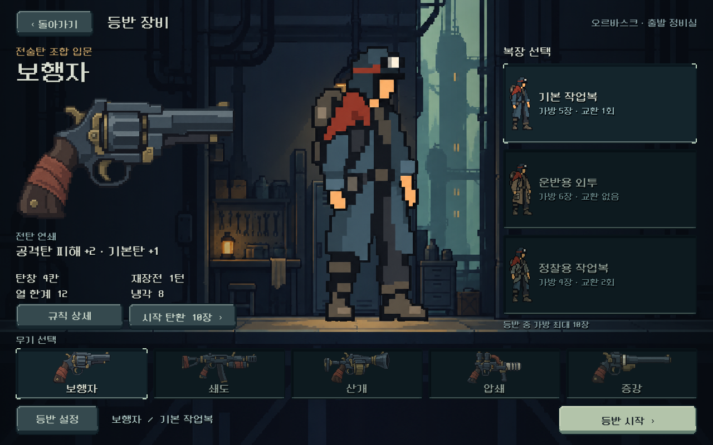
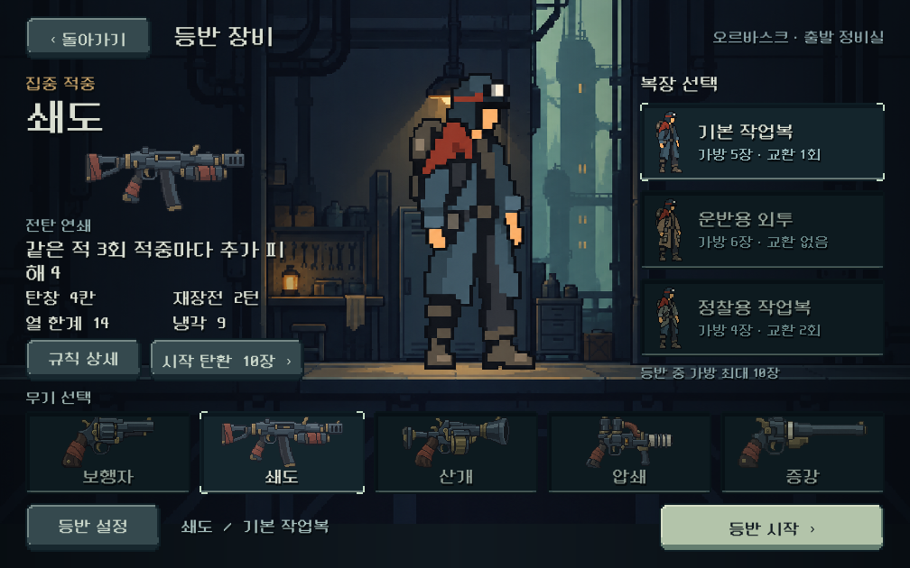
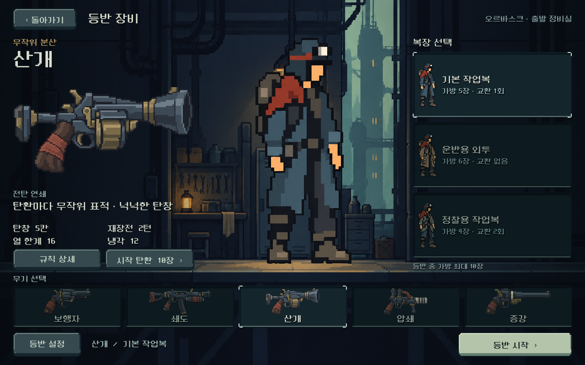
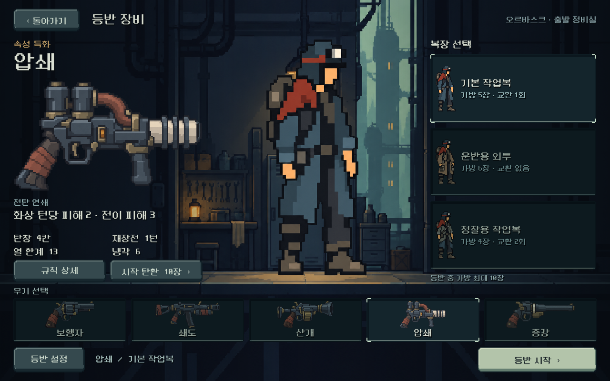
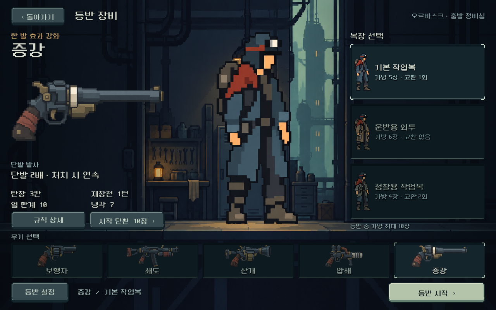

# 총기 디자인 — 2026-10-11

사용자 요청에 따라 장비 선택에 표시하는 다섯 총기를 새 원화로 교체했다. 기존 공통 몸체의 총열 변형에서 벗어나 약실·몸체·탄창·총구의 큰 형태로 역할을 구별한다. 청회색 철, 탁한 황동, 녹슨 색의 천 손잡이가 가족성을 만든다.

| 무기 | 디자인 판단 |
|---|---|
| 보행자 | 제식 리볼버, 큼직한 원통 약실과 짧은 무거운 총열 |
| 쇄도 | 집중 연사를 연상시키는 기관총, 긴 몸체·개머리판·곡선 탄창 |
| 산개 | 넓게 벌어진 총구와 회전 약실, 짧고 부피 있는 형태 |
| 압쇄 | 속성탄 투사기, 두 압력통과 구리 배관·절연 총열 |
| 증강 | 단발 정밀 권총, 큰 후방 약실과 길고 가는 총열 |

## 게임 화면

## 자산과 적용

- 제작: built-in `image_gen`. 실제 승인 주인공 PNG를 스타일 입력으로 사용했다. 첫 리볼버를 후속4종의 재료 표현 참조로 함께 제공했다.
- 원본: `새-게임-프로젝트/assets/art/weapons_20261011/*_v1.png`, 각1536×1024 RGBA. 원본 비트맵은 수정하지 않았다.
- [전체 프롬프트·참고·해시](../../../새-게임-프로젝트/assets/art/weapons_20261011/provenance.json).
- 표시: 불투명 실루엣 경계에8픽셀 여백을 추가한 AtlasTexture, nearest, 기존 alpha0.5 컷오프. 원본의 반투명 후광은 표시에서 제외한다.
- `equipment_weapon.tscn/.gd`를 단일 이미지 표시로 변경. 큰 무기와 하단 목록이 같은 원화를 사용한다. 기존 SubViewport6개는 장비 화면에서 제거했다.
- 이전 절차형 총기 그림 코드는 남아 있으며 색상 상수 참조를 보존한다.

## 확인과 한계

격리 저장에서 `tools/run_equipment_checks.ps1`: **457검사, 실패0**. 다섯 무기를1280×800 /1008×630 /1440×630의 실제 Godot 화면으로 캡처했다. 총구·개머리판·그립 잘림과 투명 후광, 주인공/배경 대비, 작은 선택 목록의 실루엣을 검토했다. 이미지 인상은 비교 원화보다 실제 크기의 판단을 우선했다.

현재 적용 범위는 장비 선택의 큰 무기 그림과 목록이다. 전투 주인공의 총기별 손 자세·재장전·반동 그림은 후속 제작이다. 규칙·무기 수치·저장 구조는 이번 아트 작업에서 변경하지 않았다. 사람 선호와 Galaxy 실기기는 미검증이다. APK·커밋·푸시 없음.
