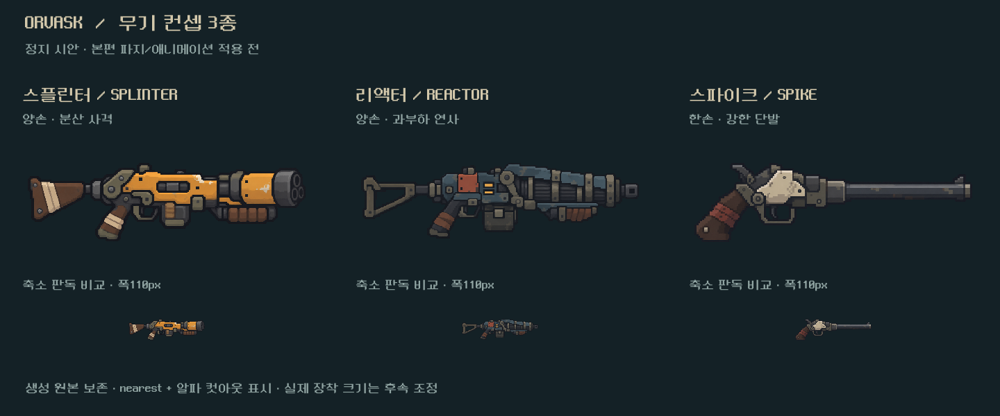
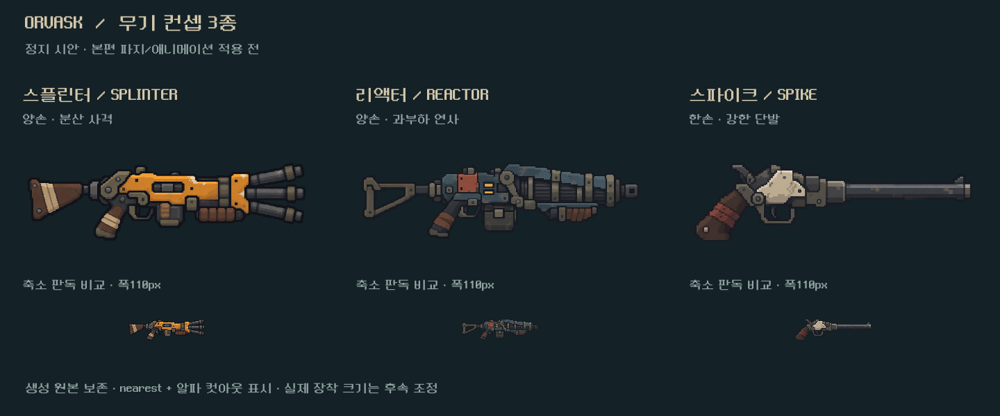
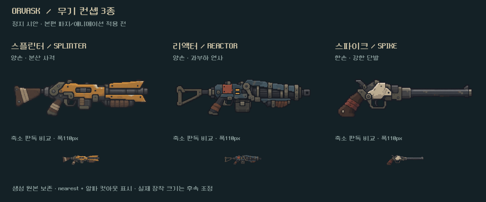
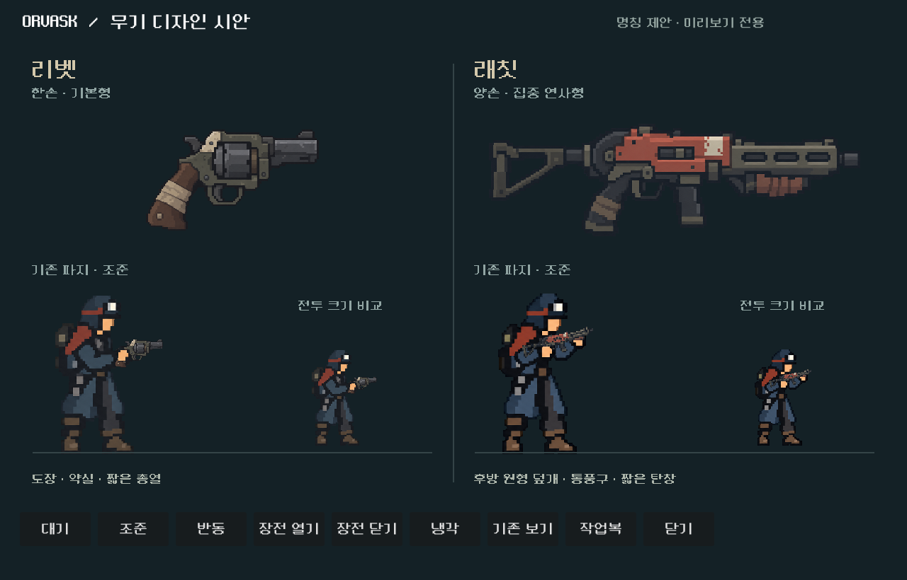
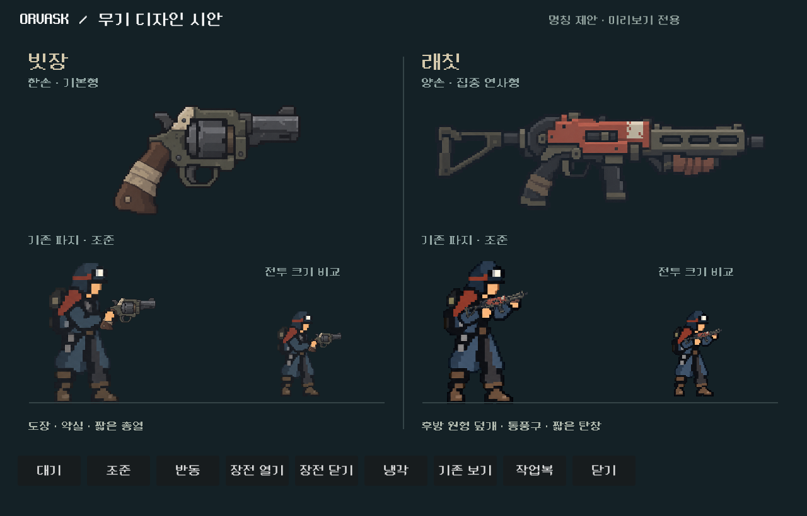
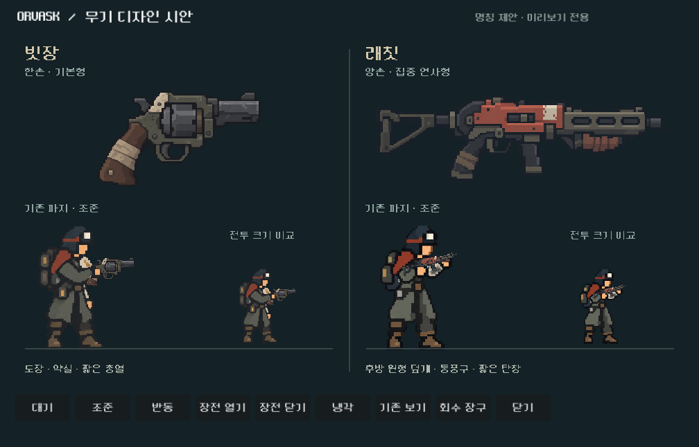

# 무기 디자인 시안 — 2026-10-24

## 스플린터 원통형v3 — 최신

v2는 세 총열의 시각 구분은 됐으나 사용자가 닭발 같은 형태로 판단해 제외했다. 기능적 판독성과 외형 선호를 구별한다. v1을 실제 이미지 입력으로 다시 편집해 짧은 원통형 덮개 안에 세 총열을 묶었다. 원본2172×724 RGBA/프롬프트/참조·출력 해시 보존. 동일 캡처 스크립트 `-- --splinter-v3`, 격리 Godot 실행 오류 없음.400px에서는 전면 세 구멍,110px에서는 짧고 굵은 원통형 윤곽이 주로 읽힌다. 작은 구멍 수를 전투 상태 정보로 사용하지 않는다. 실제 파지·모션·전장 통합 및 사용자v3 선호는 후속이다.

## 스플린터 세 총열 수정

사용자 요청으로 기존 스플린터만 image_gen 편집1회, 실제v1 참조 입력,2172×724 RGBA 원본 무편집 저장. 몸체·개머리판·양손 파지 형태를 이어가며 앞부분을 세 노출 총열로 교체했다. 같은 정지 비교 스크립트에 `-- --splinter-v2`를 전달해 별도 출력 폴더로 렌더했다. 실행 오류 없음,400px/110px에서 세 총열 간격이 읽히는 것을 직접 확인했다. 실제 손/발사점/모션은 아직 등록 전, 본편 규칙과 아트는 유지한다.

## 후속 — 나머지3종 정지 시안

사용자 요청대로 스플린터/리액터/스파이크를 각1장씩 제작했다. 내장 image_gen3호출, 리벳/래칫 원화와 승인 주인공을 참조. PNG 원본은 무편집 복사하고 RGBA/크기/알파 영역/파일 동일성 및 전체 프롬프트·해시를 [제작 기록](../../../새-게임-프로젝트/assets/art/weapon_redesign_20261024/remaining_concepts_provenance.json)에 저장했다.

격리 저장 경로의 Godot 렌더1장, 실행 오류 없음. 아래400px/110px 비교를 직접 확인했다. 황토색으로 벌어진 전면틀/청회색 방열통/밝은 쐐기 약실과 긴 총열이 작은 크기에서도 구분된다. 작은 나사·표면 흠집은 축소하면 사라지며 핵심 식별 요소로 사용하지 않는다. alpha0.5 컷아웃+nearest 표시, 생성 원본은 그대로다. 실제 몸체 장착/총구·손 위치/모션/본편 밝기와 Galaxy는 검증하지 않았고, 기존 파지 뷰어는 앞의2종만 지원한다. 밸런스·기능 변경이 없는 아트 검토이므로 전투 회귀 검사를 반복하지 않았다.

- 재현: `res://tests/weapon_remaining_concepts_capture.gd`
- 이미지/로그: `assets/weapon_remaining_concepts_2026-10-24/`

## 후속 — 영문 음차 명칭과 리벳 축소

사용자가 영문 음차 계열의 이름, 보행자 축소, 압쇄 능력 자체 재설계를 요청했다. 현재 뷰어의 이름은 리벳/래칫. 리벳의 캐릭터 부착 축척0.13→0.10(약23% 감소), 진열 그림18% 축소. 손 기준점/몸체/총구 계산 경로는 유지하고 원본PNG는 수정하지 않았다. 나머지 이름과 리액터 능력은 [설계안](../../direction/weapon-design.md)에 있으며 본편 미적용이다.

같은 격리 렌더 경로로 `weapon_concepts_refine_2026-10-24/`에9장을 별도 저장했다. 실행 오류 없음. 작업복 조준/장전 열기와1008회수 장구3장을 직접 확인해 파지·몸통 비율·크기 감소를 검토했다. 기존 시안 화면은 아래 보존한다. 사람의 크기 선호/본편 연출·Galaxy는 후속이다.

## 범위

빗장(기존 보행자)·래칫(기존 쇄도) 두 원화와 아트 비교 전용 Godot 장면을 제작했다. 이름5개는 디렉터 제안이다. 본편 무기 이름/이미지/전투 규칙/저장키는 변경하지 않았다.

- 실행: [WEAPON_CONCEPTS.cmd](../../../WEAPON_CONCEPTS.cmd)
- 장면: `res://redesign/weapon_concept_preview.tscn`
- 합성: `weapon_concept_actor.gd`가 기존 몸체/손/반동/재장전 구현을 상속하고 새 이미지 좌표만 등록한다. 기존 `weapon_actor.gd`는 수정하지 않았다.
- 도구: 내장 image_gen2호출. 생성 PNG를 수정 없이 보관했고 알파0~254/255와 해시를 측정했다. 생성된 흐린 알파 가장자리는 기존0.5 cutout 셰이더에서 제외한다.
- 제작 의도/출처/잔여: [현행 설계](../../direction/weapon-design.md), [전체 프롬프트·해시·크기](../../../새-게임-프로젝트/assets/art/weapon_redesign_20261024/provenance.json).

## 실행 확인

Godot4.7 구문 검사 통과. 별도 APPDATA/LOCALAPPDATA `qa_runtime/weapon_concepts/check/`에서 Compatibility 렌더를 실행했다. 렌더 프로그램은 캠페인/저장 API를 사용하지 않는다.

`QA_OUTPUT_DIR=docs/qa/reports/assets/weapon_concepts_2026-10-24`를 지정하고 `--script res://tests/weapon_concept_capture.gd --rendering-method gl_compatibility` 실행. 최종 출력: `WEAPON CONCEPT RENDER: 9 captures; art-only scene, no campaign save access`. stderr 오류 없음. 이9장은 기능 테스트9개를 의미하지 않는다.

1280×820 작업복6자세, 기존 조준1장, 회수 장구 조준1장 및1008×646 회수 장구1장을 생성했다. 조준/반동/냉각/회수 장구 축소 화면을 직접 검수했고 손 접점·총기 크기·얼굴 가림·잘림을 확인했다. 첫 확대 뷰의 머리 잘림은 비교 화면의 소스 영역을 전신으로 고쳐 최종 캡처를 다시 만들었다. 본편 배우나 몸체 아트 오류는 아니었다.

## 대표 화면

## 한계

6자세는 현재 몸체 키포즈와 절차형 반동/부품 분리를 이용한 정지 상태 비교다. 실시간 전투의 발사 이벤트·탄도/열기 타이밍·피니시 연출을 통합 검증한 결과가 아니다. 전투 크기는 기존1280전장 캐릭터 높이와 가까운 비교 축척이며 실제 전장 캡처로 표기하지 않는다. 사용자 미감·Galaxy·나머지3종 원화·본편 이름 전환은 후속이다.
