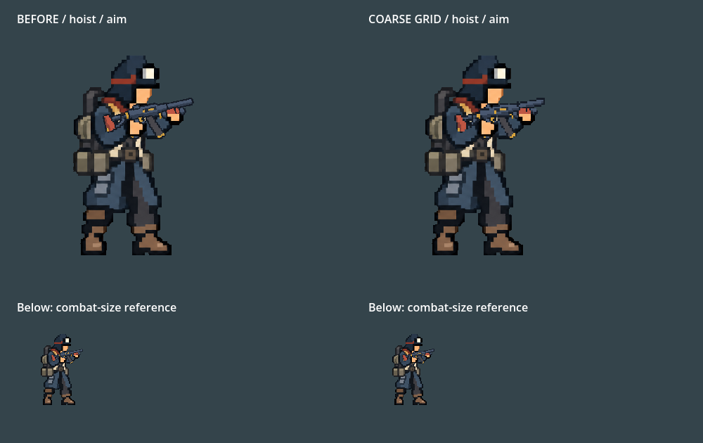
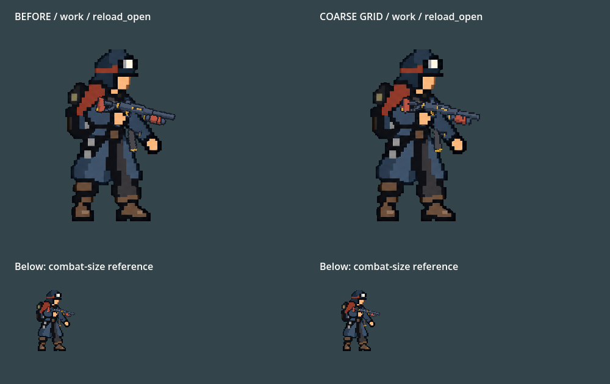
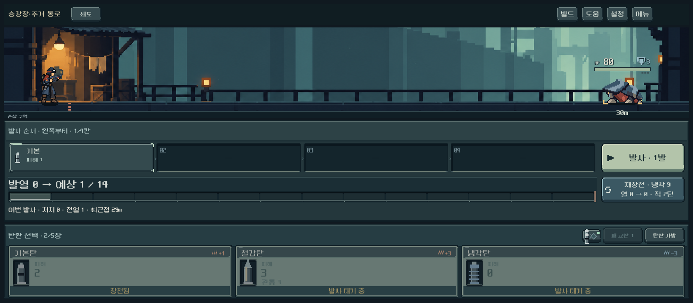

# 쇄도 표시 해상도 비교

**후속 사용자 확인 — 2026-10-14:** 현재 수준에서 마무리하기로 채택했다. 아래 제작 당시 미확인 설명과 구별한다. 다른 총기에 일괄 확장하지 않으며 Galaxy 실측은 여전히 미검증이다.

사용자가 쇄도가 여전히 캐릭터보다 선명하다고 느꼈고, 현재 버전과 도트 단위를 더 굵게 만든 버전을 실제 전투 크기로 비교하는 작업을 승인했다.

## 결과와 구현

원화 선을 반복해서 수정하기보다, 쇄도의 무기 레이어를 낮은 해상도에서 그리는 경로를 추가했다. `burst_v4.png` 원본은 그대로다. 이미지 생성이나 비트맵 사후 편집 없이 Godot 렌더 구성을 수정했다.

- 몸체 공간 768×512에서 무기만 192×128 SubViewport에 그린 뒤 nearest로 합성한다. 몸체·앞손은 기존 경로를 유지한다.
- 회전·반동·탄창 분리·열기 색을 먼저 무기 레이어에 그리므로 이들도 같은 격자를 따른다. 총구 및 손잡이 등록값, 전투 계산은 변경하지 않았다.
- 최초 6단위 격자는 총열이 끊겨 보이는 구간이 있어 제외했다. 최종은 4단위다. 이는 이번 쇄도 비교의 구현값이며 모든 무기의 영구 규격이 아니다.
- `weapon_actor.gd`와 `weapon_pixel_layer.gd`에서 구현한다. `coarse_burst=false`로 기존 경로와 같은 자세를 비교할 수 있다. 다른4총기는 기존 직접 렌더와 같은 픽셀이 나오는 것을 검사했다.
- 본편은 쇄도에만 새 경로를 적용했다. 새 프레임버퍼는 192×128이며 모바일 성능·감도 실측은 후속이다. 사용자 화풍 채택 전이므로 다른 총기에 일괄 적용하지 않는다.

## 비교

왼쪽 기존 / 오른쪽 낮은 표시 해상도. 윗줄은 확대 비교, 아랫줄은 인물 높이 약100px의 전투 크기 참고다. 각 실제 화면의 캐릭터 점유 크기와 동일하다고 주장하지 않는다.

제작자 판단: 실제 표시 크기에서 잔선이 줄고 몸체의 굵기와 가까워졌다. 6단위 후보보다 총열과 탄창 연결을 보존하므로 4단위에서 멈추는 것을 권장한다. 사람의 선호 확인은 아직 남아 있다.

## 검증

- Godot 4.7 Compatibility, 격리 APPDATA/LOCALAPPDATA. 기존 저장 보호.
- 동작 회귀 508검사 실패0, 2,823프레임 관찰, 접지·거리 순서 오류0. GPU 반동·부품 추출/복귀 외에 렌더 경로 전환, 다른 무기 픽셀 동일, 쇄도 열기 변화/냉각 후 원복 검사를 추가했다.
- 신규 복장 본편 1,487검사 실패0. 4복장×5무기×6자세, 세 해상도 및 저장/장전/발사 검사 포함. 출력 `qa_runtime/outfits_live/20261014_000834`.
- 작업복·인양 장구 조준/재장전/냉각 비교 캡처와 본편 쇄도 조준·재장전 화면을 직접 확인했다. 확대 시 계단 변화는 의도된 표시 해상도 차이다.
- Galaxy 실기기 성능과 체감은 미검증. APK·커밋·푸시 없음.

재현: `tests/weapon_density_preview.gd`는 QA_OUTPUT_DIR에 비교 화면을 출력한다. 기능 검사는 `tools/run_actor_motion_checks.ps1`, `tools/run_outfits_live_checks.ps1`을 사용한다. 최종 로그는 아래 증거 폴더에 보존했다.
