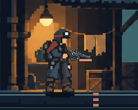

# 총 아래 돌출 막대 — 원인 정정과 수정

## 재현과 원인

2026-10-11 사용자 재검수 캡처의 화살표는 총 아래의 주황색 직사각형을 가리킨다. 보행자 대기 자세에서 발열0→1로 바꾸면 같은 막대가 나타나는 것을 실제 렌더에서 재현했다. 사용자가 말한 대로 총구와 함께 움직인다.

`risk_battle_view.gd`가 잔열이 조금이라도 있으면 총구에서(-16,+1) 떨어진 위치에18×3 사각형을 그렸다. 이 효과는 총기 이미지와 별개이고 총열 회전/크기/윤곽을 따르지 않는다. 별도 Bone이나 아트 잔여물이 아니다. 앞선 총기 원화 단순화는 이 원인을 해결하지 못했으며 당시 원인 판단은 정정한다.

## 수정

- 잔열 막대와 순간 과열 때 총 아래에 그리던3개 사각형을 제거했다.
- 열기는 각 무기의 실제 총열 텍스처에 제한된 색 변화로 표시한다. 발열/무기 한계 비율로 강도가 바뀌고 냉각0에서 원래 색으로 돌아간다.
- 텍스처의 투명 픽셀과 몸/손은 그대로 유지한다. 총열 회전, 반동, 증강의 꺾이는 재장전에도 같은 변환이 적용된다.
- 기존 발열 게이지·냉각 수치·연기·전투 규칙은 유지한다. 원화의 재생성은 하지 않았다.

## 동일 조건 실제 화면

수정 전 발열1:

수정 후 발열1:

[발열12](weapon_heat_artifact_2026-10-11_assets/player_heat_12.png) · [수정 전 전체](weapon_heat_artifact_2026-10-11_assets/before_full.png) · [수정 후 전체](weapon_heat_artifact_2026-10-11_assets/heat_1.png). 비교는 격리 저장·1280×900·같은 대기 자세, 움직이는 연기만 정지한 조건이다.

## 검증

- `tools/run_weapon_heat_checks.ps1`: **100검사/실패0**. 5무기×6자세의 GPU 결과에서 열기 유무에 따른 알파 일치, 표면색 변화, 냉각 후 원본 픽셀 복구를 검사한다.
- 사용자 지적 위치가 발열1/12에서 배경 그대로인지 확인한다. 이전18×3 막대를 테스트 전용 레이어로 복원하면 차이를 검출하는 교차 확인도 포함했다. [로그](weapon_heat_artifact_2026-10-11_assets/heat_checks.log).
- 실제 동작 **502검사/실패0**. 세 화면 비율에서 반동·재장전·냉각·건너뛰기 확인. [로그](weapon_heat_artifact_2026-10-11_assets/actor_motion.log). 전투 피드백 회귀 **911검사/실패0**도 통과했다. 이번 합계 **1,513검사/실패0**. [전투 로그](weapon_heat_artifact_2026-10-11_assets/combat_feedback.log).
- 실제 수정 전/후 이미지에서 돌출 막대 제거를 확인했다. 사용자 재검수와 Galaxy 실기기 확인은 후속이다.
