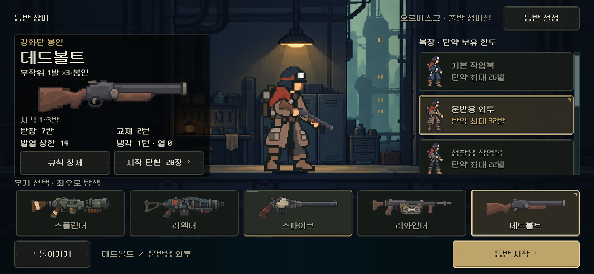
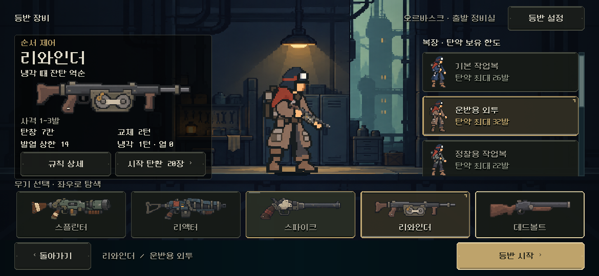
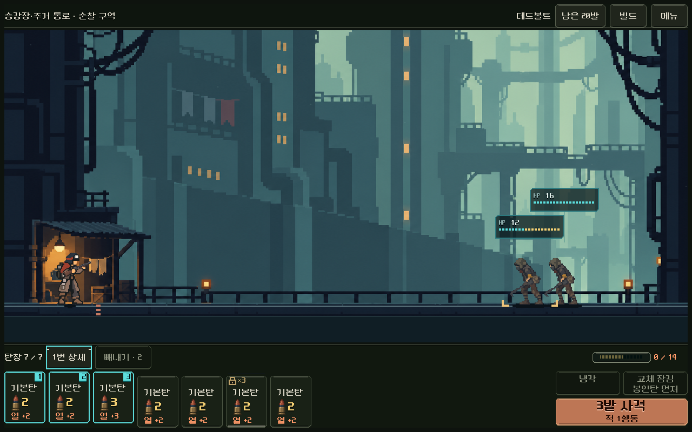
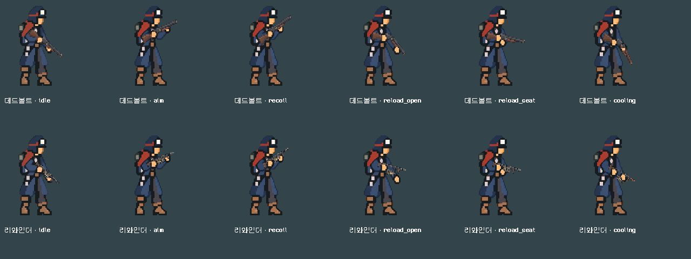
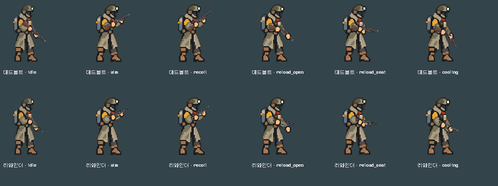

# 신규2총기 본편 연결 — 데드볼트·리와인더

별도 비교판의 두 능력을 **본편 새 출발의 장비 선택·전투·성장·저장**에 연결했다. [현재 규칙](../../../direction/weapon-expansion.md). 기존5총기의 상태/규칙을 바꾸거나 기존 이어하기에 새 능력을 붙이지 않는다. 최종 균형·사람의 재미·Android 실기기 확인은 남아 있다.

## 외형 결정과 적용

- **리와인더:** 사용자가 괜찮다고 한 이중 릴 급탄 외형을 유지했다. 장전 때 카세트가 빠졌다 돌아오는 기존 부품 합성 경로를 쓴다.
- **데드볼트:** 사용자가 목재 카빈, 아이보리 본체, 클램프/레일 시안을 재검토한 뒤 **실제 총에 가까운 중절식 장총**을 선택했다. 그 방향의 단순한 목재 개머리판·굵은 약실/총열로 구현했다. 총열 앞부분이 등록된 경첩을 중심으로 꺾이며 장전/냉각한다. **방향 선택과 최종 PNG/게임 화면의 미감 확인을 구분한다.** 최종 미감은 사용자 확인 대기다.
- 기존7복장의 장총 몸체/손/발 등록을 재사용했다. 새 몸체에 총을 구워 넣거나 복장 PNG를 바꾸지 않았다. 무기 원화/총구·파지·가동 부품은 `weapon_art.gd` 한 등록표에서 선택과 전투가 공유한다.
- [전체 시안/생성 프롬프트·선택 이력](../../../art/concepts/2026-11-06-new-weapons/provenance.json), [중절식 프롬프트](../../../art/concepts/2026-11-06-new-weapons/deadbolt_break_prompt.txt), 실제 PNG/등록/해시는 Godot 프로젝트의 `assets/art/weapon_expansion_20261106/provenance.json`에 기록했다. built-in image_gen을 사용했다. 원본 RGBA를 유지하고 현행 카탈로그/전투 픽셀 레이어를 적용했다. PixelOE를 무조건 반복 적용하지 않았다.

## 장비 선택과 본편 규칙

실행은 저장소 루트 [PLAY.cmd](../../../../PLAY.cmd) → 새 등반 → 무기 목록의 좌우 탐색이다. 게임 원래 저장 위치를 사용하는 본편 실행이며, QA/예전 비교판 실행과 구분한다.

- 목록은7종 한 줄이다. **종전 다섯 칸을 기준으로 한 카드 폭/92높이·그림 여백**을 유지하고 한 행을 가로로 탐색한다. 카드 폭 계산의 픽셀 반올림은 정수 단위다. 위계/중앙 배우 계수0.85·고정 시작 버튼250×54를 유지한다. 시작 버튼을 목록 스크롤에 넣지 않았다.
- 네이티브 ScrollContainer/HBoxContainer 계층과 편집기에서도 작동하는 공용 폭 바인딩을 사용한다. 실제 터치 드래그, PC 휠, 키보드 포커스 이동을 확인했다. 드래그로 총기가 잘못 선택되지 않으며 선택/포커스가 있는 카드를 보이게 한다.
- 새ID `deadbolt / rewinder`가 공통7칸/최대3장/열14/교체2행동/기본탄20장으로 시작한다. 성장과 장착 파츠에 따른 실제 용량/발수 보정은 기존 규칙을 따른다. 래칫의 집중 추가 피해를 물려받지 않는다.
- 기존 검증된 봉인·반전 해결기를 재사용한다. 새 총기는 일치하는 버전/종류의 상태를 저장에 반드시 가진다. 과거 `burst + weapon_role_trial` 비교 저장은 그대로 복원된다. 현재 능력을 지원하지 않는 삽입식 훈련에서는 두 새 총기를 비활성화하고 기존 총기로 진입한다.
- 본편 HUD에 동일한 황동 봉인 표시와 상세/빼내기 차단·교체 이유, 냉각·역전/사용 후 냉각 이름을 연결했다. 봉인 피해의 실제 배율은 기존 배율 적중 색/표시 규칙에 포함한다. 탄도/섬광은 기존 검증한 계열을 재사용하되 총구 좌표는 새 실제 원화를 따른다.
- 새 총기 설명/시작 탄환·파츠 호환/탄종 제시와 저장 검증을 함께 연결했다. 별도 가짜 계산기나 새 무기 전용 사격 명령을 만들지 않았다.

## 기능·회귀 검사

Godot4.7 `5b4e0cb0f`, Windows·OpenGL compatibility·RTX4060Ti. Godot MCP 프로젝트/버전 조회가 성공했으며, 기존 로컬 편집/실행·렌더 경로로 연결했다. QA는 각 런처의 격리 APPDATA/LOCALAPPDATA를 썼다.

| 범위 | 최종 결과 | 증거 |
|---|---:|---|
| 새ID/7복장·실제 Model/Forecast·상태 오류 거부/복원 | 1,344검사 실패0 | [규칙](rules/rules.json), [로그](rules/stdout.log) |
| 실제 장비 목록 탐색/전투 입력/자동 저장 재개·모션 캡처 | 151검사 실패0 | [UI](ui/ui.json), [로그](ui/stdout.log) |
| 2총기×7복장×6자세 | 84조합·343검사 실패0 | [접점](poses/contacts.json), [로그](poses/stdout.log) |
| 기존 장비 전체 검사, 49개 실제 총기/복장 시작·저장 | 3,997검사 실패0 | [로그](equipment_stdout.log) |
| 기존 전투 HUD | 11,558검사 실패0 | [로그](hud_stdout.log) |
| 이전 별도 비교판 UI/이어하기 | 1,772검사 실패0 | [로그](comparison_ui_stdout.log) |
| 기존5종 360조건 변경 전후 결과 | 원래5종 전체 데이터 동일 | [비교 범위](five_gun_baseline.json) |
| 두 새 총기의 실제 획득/5구역 완료 경로 | 4,446검사 실패0 | [전체 결과·명령](climb/balance.json), [로그](climb/stdout.log) |

기존360조건은 신규 총기가 추가된 진단504조건 중 **원래5종만 같은 방식으로 추출해** 변경 전 원본과 비교했다. 신규2종의 진단 수치를 기존 기준선과 혼합하지 않았다. 새 능력 자체는 위 전용 실제 명령/저장 검사로 검증했다.

검수 중 오래된 장비 검사가 가로 목록 전체를 화면 안에 넣으라고 요구하는 것을 찾아 가시 뷰포트/선택 카드·카드 크기/시작 노출을 검사하도록 갱신했다. 중첩 스크롤의 UI 입력은 뷰포트 좌표로 통일했다. PC의 터치 스크롤 검사는 터치 에뮬레이션과 Input 입력 경로를 사용한다. Godot ScrollContainer의 터치 스크롤은 합성된 마우스 입력 경로도 사용한다. [공식4.7 구현](https://github.com/godotengine/godot/blob/4.7/scene/gui/scroll_container.cpp).

## 실제 획득 진행의 범위

시드731042·운반복·현재 지도4/역할3·정비 우선 경로에서, 실제 보상·구매·장착·개조·사격/냉각/교체를 거친 두 경로가5구역 종료에 도달했다. 전체56전투다.

| 총기 | 실제 명령 수 | 최종 덱 | 장착한 핵심 구성 |
|---|---:|---:|---|
| 데드볼트 | 309 | 27장 | 돌파 코어·제3 격발기·후미 점화기 등 |
| 리와인더 | 291 | 28장 | 연쇄 구동핵·제3 격발기·다중 타격 파츠 등 |

각 전투의 상태와 종료/획득·명령은 `climb/`에 있다. 기존 탐색기는 이제 봉인 위치/반전 사용 여부와 장전 난수도 구분해 다른 상태를 합치지 않는다. **비공개 난수까지 사용하는 결정론적 경로 탐색**이므로 기능적 도달 가능성의 증거다. 사람 승률·선택 자연스러움·최종 밸런스를 뜻하지 않는다. 더 많은 빌드/시드와 사람의 판단은 후속이다.

## 실제 화면

PC에서1280×800·S26 가로 비율1170×540·짧은1008×454를 확인했다. 장비 전체 검사는844×390과2340×1080/960·글씨 배율0.9/1.0/1.1도 포함한다. 실제 Android 터치/안전 영역·장시간 성능/발열을 PC 검사로 통과 처리하지 않는다.











사격/냉각 중 원래 입력 잠금과 실제 카드 소모·총구/반동 프레임도 캡처했다. `ui/action_*.png`와 `ui/ui.json`에서 확인한다. 기능 통과·제작자 시각 확인·사람의 미감/재미 확인을 구분한다.

## 재현

```powershell
powershell -NoProfile -ExecutionPolicy Bypass -File tools/run_weapon_live.ps1 -Mode rules
powershell -NoProfile -ExecutionPolicy Bypass -File tools/run_weapon_live.ps1 -Mode poses
powershell -NoProfile -ExecutionPolicy Bypass -File tools/run_weapon_live.ps1 -Mode ui
powershell -NoProfile -ExecutionPolicy Bypass -File tools/run_weapon_live.ps1 -Mode climb
powershell -NoProfile -ExecutionPolicy Bypass -File tools/run_equipment_live.ps1
```

[현행 소스 해시](source_sha256.json), [검증 요약](validation.json), [작업 직전 스냅샷 대비 변경](tracked_changes.patch). 새 원화/총구·부품은 `weapon_art.gd`, 가로 목록은 `equipment_screen.tscn`/`equipment/weapon_rail.gd`, 실제 규칙은 기존 `model.gd`와 `weapon_role_trial.gd`가 담당한다. APK·커밋·푸시·외부 게시 없음.
