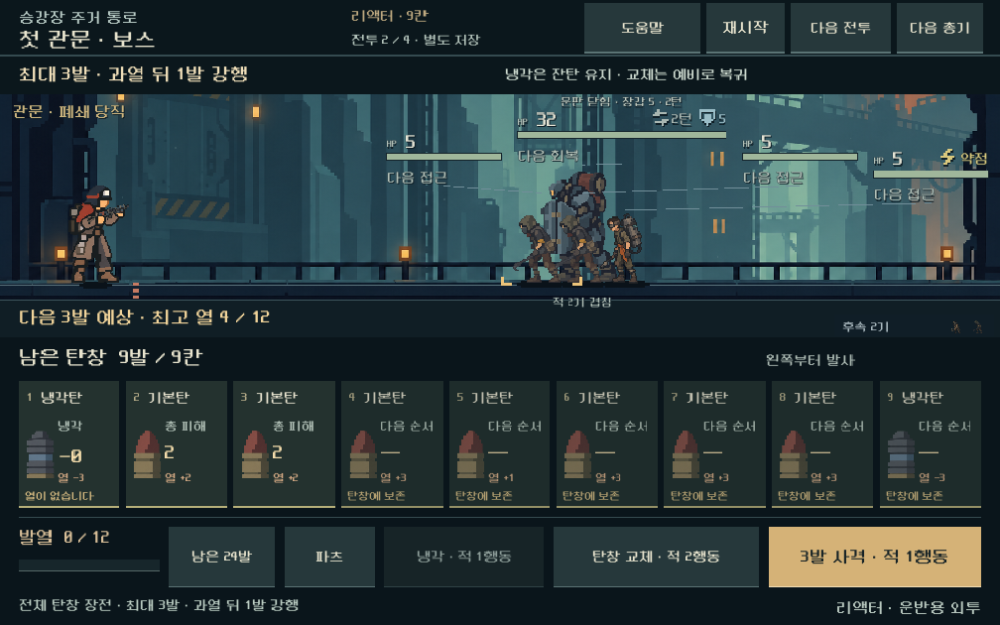
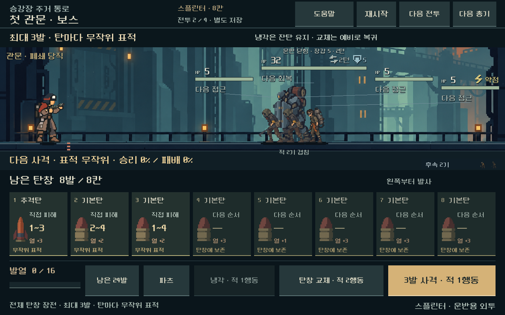
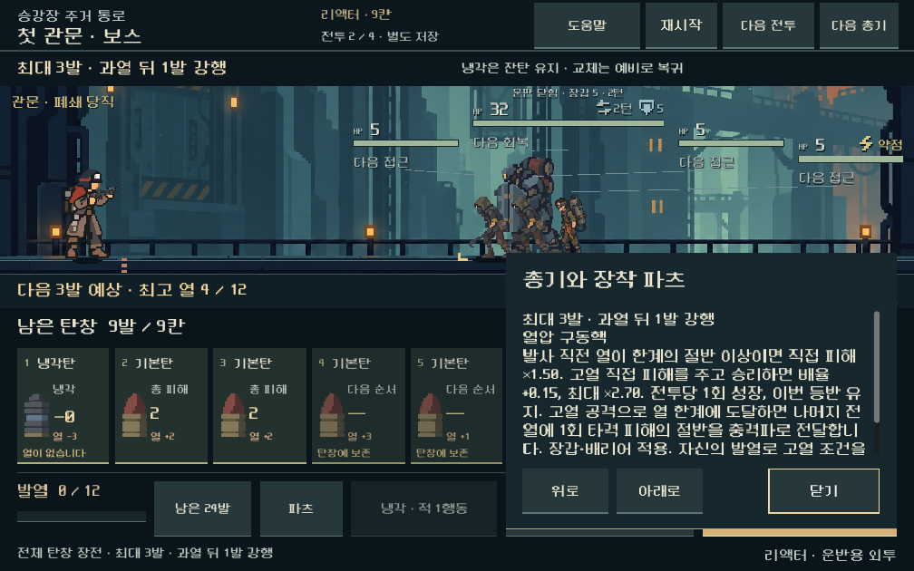
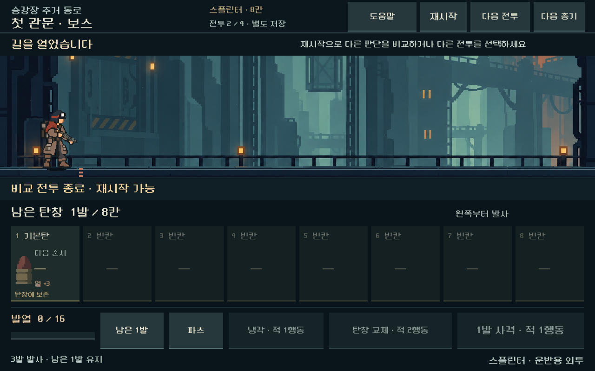

# 총기별 탄창 운용 검증 — 2026-10-31

**상태:** 독립 비교 플레이 구현·기능/화면 검사 통과. 본편 새 등반은 미활성. [현행 규칙과 다음 작업](../../direction/weapon-magazine.md).

## 비교한 변화

실제 획득한 다섯 총기의201/401/602/802 상태20개를 사용했다. 리벳/래칫/스플린터/리액터/스파이크의 현재 장착 상태는6/7/8/9/5칸이다. 기존 용량+3과 파츠 보정을 적용하며,2발/3발/3발/3발+과열 강행/단발 처치 연쇄로 구분한다. 전체 교체는 현재 장비에서2행동, 수동 냉각1행동, 강제 냉각과 리액터 강행 비용을 실제 계산에 연결했다.

리벳용 거리50%를 모든 총기에 적용했을 때의 실패를 재현하고, 이동 적 거리50/65/80%·속도+1의360조건을 비교했다. 방패50% 유지, 새 비교 보스80%를 선택했다. HP·장갑·고정 사수 주기/위치는 바꾸지 않았다. [360조건](assets/weapon_magazine_2026-10-31/probe.json), [기본 순서의 다른 행동 탐색](assets/weapon_magazine_2026-10-31/probe_audit.json).

최종 후보는5총기×4전투×6순서=120조건이다. 아래 승리는 자동 냉각 정책의 결과이며 사람 승률이 아니다. 다른 경로는 실제 모델에서 성공한 입력을 재생한 것이다.

| 총기 | 동일 냉각 정책 승리/24 | 다른 합법 경로 성공 | 제한 탐색 미해결 |
| --- | ---: | ---: | ---: |
| 리벳 | 24 | 0 | 0 |
| 래칫 | 18 | 6 | 0 |
| 스플린터 | 14 | 9 | 1 |
| 리액터 | 19 | 5 | 0 |
| 스파이크 | 23 | 1 | 0 |

스플린터 보스 순서17은 width48/depth26, 후속192/40 탐색에서 승리 경로를 찾지 못했다. 불가능 판정은 아니다. 무작위 표적의 미래를 아는 고정 난수 탐색이므로 발견된 경로를 UI의 확정 추천이나 인간의 성공 확률로 쓰지 않는다. 리액터 순서900001의 냉각 정책은 승리까지43행동이 걸렸다. 승리 수만으로 긴장감/재미/적절한 전투 길이를 검증했다고 보지 않는다. 이 두 편차와 새 규칙의 연속 획득/보상 검증을 후속으로 둔다.

## 기능·예측·저장

- **7,101검사, 실패0.** 실제 사격·교체·냉각,120조건의 진행과 대안 재생, 탄약 소유 보존, 매 판단 상태의 JSON 복원/다음 실제 입력 일치, 예측 시 원본·난수 불변.
- 리액터3번째 탄 과열 시4번째 강행, 강행 냉각탄으로 강제 냉각 회피, 강행 후 과열 비용4행동, 남은 탄 보존. 스파이크4회 처치 연쇄와 생존 표적에서 중단. 래칫3번째 적중+4를 별도 경계 사례로 검증했다.
- 스플린터는 다음 최대3발의 모든 표적 분기를 별도로 열거해 승패·강제 냉각 확률, 적별 HP 범위/처치 확률을 비교했다. 부분 탄창·상한 직전 열·마지막 공격탄 뒤 지원탄/공격탄 차이·이전 전체 탄창 예측 캐시와의 분리를 확인했다. 피해 범위는 직접 피해이며 임의의 숨은 표적을 확정하지 않는다.
- 전체 탄창의 자동 연사를 가정하지 않고 `scope=next_action`으로 다음 판단 한 번을 예측한다. 파츠·비상 보급 등은 기존 실제 모델을 재사용한다.
- 지원하지 않는 버전값/분리된 무기 플래그/선택 총기와 저장의 불일치를 거부한다. 본편 생성에는 비교 플래그를 붙이지 않는다.

[기능 보고서·120조건 경로](assets/weapon_magazine_2026-10-31/rules.json).

## 실제 화면과 조작

Godot MCP 프로젝트 정보로4.7 실행 환경을 확인한 뒤 기존 로컬 실행/격리 저장 경로로 검수했다. 별도TSCN에 하단 가로9칸과 행동 영역을 저장했다.1008×630,1280×576,1280×800에서 검증했다.

- 실제 터치 입력/연출/선택 총기 전환/4전투 순환/사격/냉각/전체 교체/모달 입력 차단/선택과 잔탄·표적 난수의 저장 재개: **5,291검사 실패0**. 다섯 총기 기본 보스 경로를 실제 버튼으로 승리까지 재생했다.
- 최종 카드 글씨16px와 긴 현재 파츠 설명의 스크롤/위로·아래로·닫기,3비율의 총기별 카드/라벨 경계, 낮은 확률을0%로 반올림하지 않는 표시: **2,131검사 실패0**. 최종 부분 수정은 이 화면 검사로 다시 확인했다.
- 최종 스플린터 보스 입력 재생: **15검사 실패0**. 모델과 전장의 적 HP가 모두0이며 적 표시가 사라진 종료 화면을 직접 확인했다.
- 초기 대기 검사가1800프레임 기준이라 빠른 렌더링에서 연출이 끝나기 전에 제한에 닿았다. 실제 시간20초 기준으로 바꿔 재검증했다. 통과한 전체 조작 검사에서 기록된 가장 긴 연출 대기는3.955초다. FPS나 모바일 발열 측정으로 해석하지 않는다.
- PC에서 합성한 드래그만으로는 설명 스크롤이 움직이지 않아, 명시적인 큰 위로/아래로 버튼을 넣고 실제 터치로 끝까지 읽을 수 있게 검증했다. 실기기 스와이프 동작은 미검증이다.

[조작 원자료](assets/weapon_magazine_2026-10-31/ui.json), [최종 화면/상세 검사](assets/weapon_magazine_2026-10-31/details.json), [종료 상태](assets/weapon_magazine_2026-10-31/terminal.json).

## 회귀와 변경 범위

기존 탄창797·접근3,498검사 모두 실패0. 기존5총기×5전투 재생 결과25개는 이전 보고서와 JSON 전체가 동일하다. 사전 스냅샷의296개 스크립트/씬/데이터 중292개 해시 동일, 변경4개는 opt-in 사격/비용/검증/예측/보스 비교 조정이다. 새 비교 파일과 문서를 추가했으며 사용자의 기존 변경은 보존했다.

[소스·검증 산출물 해시](assets/weapon_magazine_2026-10-31/manifest.json). 본편 저장에 접근하지 않고 전부 `qa_runtime/weapon_magazine_20261031`의 분리된 저장을 사용했다. APK·커밋·푸시·외부 게시 없음.

재현: `tools/run_weapon_magazine.ps1 -Mode probe|rules|ui|details|terminal`. UI와terminal은 rules 결과의 검증 경로를 사용하므로rules를 먼저 실행한다. 회귀: `tools/run_combat_magazine_loop.ps1 -Mode rules`, `tools/run_combat_approach.ps1 -Mode rules`, `tools/run_combat_ui_stage1.ps1 -Mode baseline`.

미검증: 새 규칙으로 획득하는 연속 등반·정예·후반/복장별 균형·전체 탄약 경제, 모든 무작위 분포의 장기 승률, 사람의 재미·판독성, 모바일 실제 기기의 지속 FPS·발열. 사용자 게임 완성도를 검증 완료로 표시하지 않는다.
