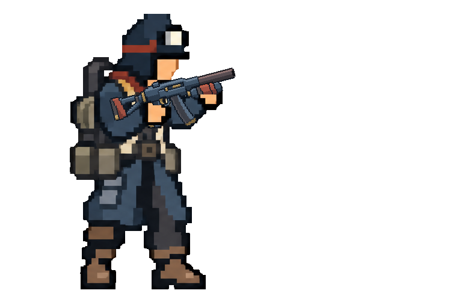
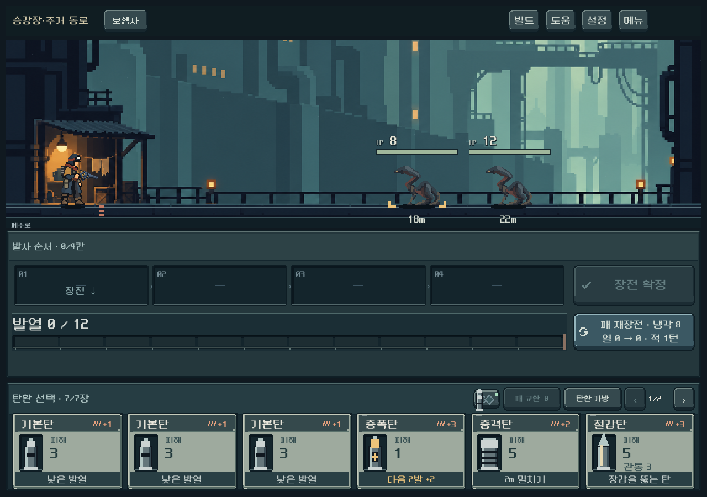

# 전투 총기 도트 밀도 조정

사용자가 총기가 캐릭터보다 진하고 튄다고 지적했고, 원인 검토 후 수정을 승인했다. 전투용 다섯 총의 내부 선·반사광·명암 분할을 줄였다. 무기 종류, 크기와 동작 규칙은 그대로이며 장비 선택용 큰 원화는 변경하지 않았다.

## 제작과 적용

- 내장 image_gen 편집으로 기존 전투 총기와 실제 캐릭터를 참조했다. 첫 v2는 밝은 테두리가 줄었으나 합성 화면에서 잔선 밀도가 여전히 높아 다시 제작했다.
- 최종 v3는 부품 사이의 검은 경계를 줄이고 금속·가죽·황동을 큰 색 덩어리로 묶었다. 얇은 금속 반사선과 작은 가죽 이음선을 덜어냈다. 전체를 어둡게 하거나 런타임 흐림 처리를 추가하지 않았다.
- 원본 1536×1024 RGBA를 그대로 저장했다. 생성 알파 범위는 0~254이며 기존 alpha-cutout 표시 경로에서 반투명 가장자리를 제외한다. 별도 비트맵 후처리는 없다.
- `weapon_actor.gd`의 다섯 이미지 경로만 v3로 연결했다. 손·총구·분리 부품 영역과 변환은 기존 등록값을 사용한다. 새 원본의 손잡이·보조 손·총구 기준점은 모두 불투명 영역 안에 있고 자세별 합성에서 접점을 확인했다. 생성 실루엣의 픽셀 단위 완전 일치를 주장하지 않는다.
- [저장된 자산·전체 프롬프트·입력·해시](../../../새-게임-프로젝트/assets/art/weapons_mass_20261013/provenance_v3.json). 같은 폴더의 v2는 비교 이력이며 본편에는 v3만 연결했다. 기존 승인 원본은 보존했다.

## 시각 비교

같은 인양 장구·쇄도 조준 자세의 이전/수정 후 렌더다. 확대 그림은 경계 확인용이다. 총의 실루엣은 계속 읽히면서 몸체와 다른 고밀도 금속선이 줄었다는 제작자 판단이며 사용자 미감 확인은 후속이다.

이전:

수정 후:

실제 전투:

## 검증

- Godot 4.7 Compatibility, 격리 APPDATA/LOCALAPPDATA, 최종 PNG import 오류 없음.
- 최종 5총기 × 6자세 점검표 직접 확인. 약실·탄창·압력통 분리와 증강 꺾임, 손 가림, 총열 연결 확인.
- 동작 회귀 502검사 / 실패0. 실제 2,815프레임 관찰, 거리 순서 오류0·접지 오류0. 반동·재장전 부품 추출/복귀의 GPU 렌더 차이 포함.
- 신규 복장 본편 1,487검사 / 실패0. 신규4종 × 5총기 × 6자세, 장전·발사·복원·가방 성장·장소 전환, 1280×900/1008×630/1440×630 포함. 최종 출력 `qa_runtime/outfits_live/20261013_235344`.
- 실제 전투 크기와 확대 캐릭터를 모두 확인했다. 자동 검사 통과는 화풍 선호를 보장하지 않으며 Galaxy 실기기 체감은 미확인이다.
- 게임 규칙·세이브 변경, APK 생성, 커밋·푸시는 수행하지 않았다.

재현: `tools/run_actor_motion_checks.ps1`, `tools/run_outfits_live_checks.ps1`. 자세 비교는 `tests/weapon_pose_preview.gd`를 사용한다. 최종 로그는 이 보고서 증거 폴더에 보존했다.
