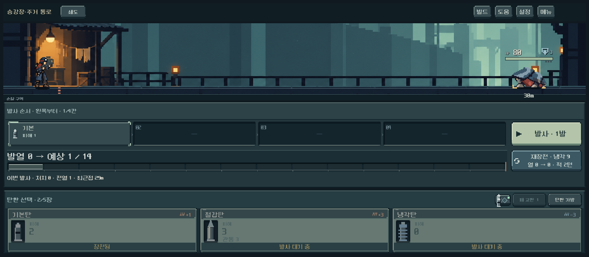
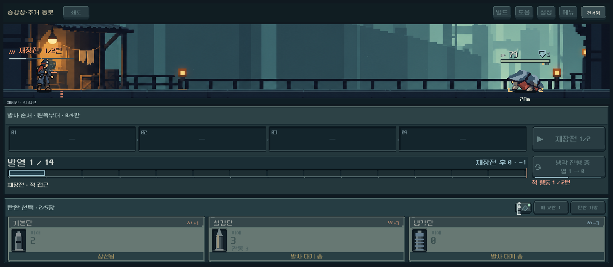
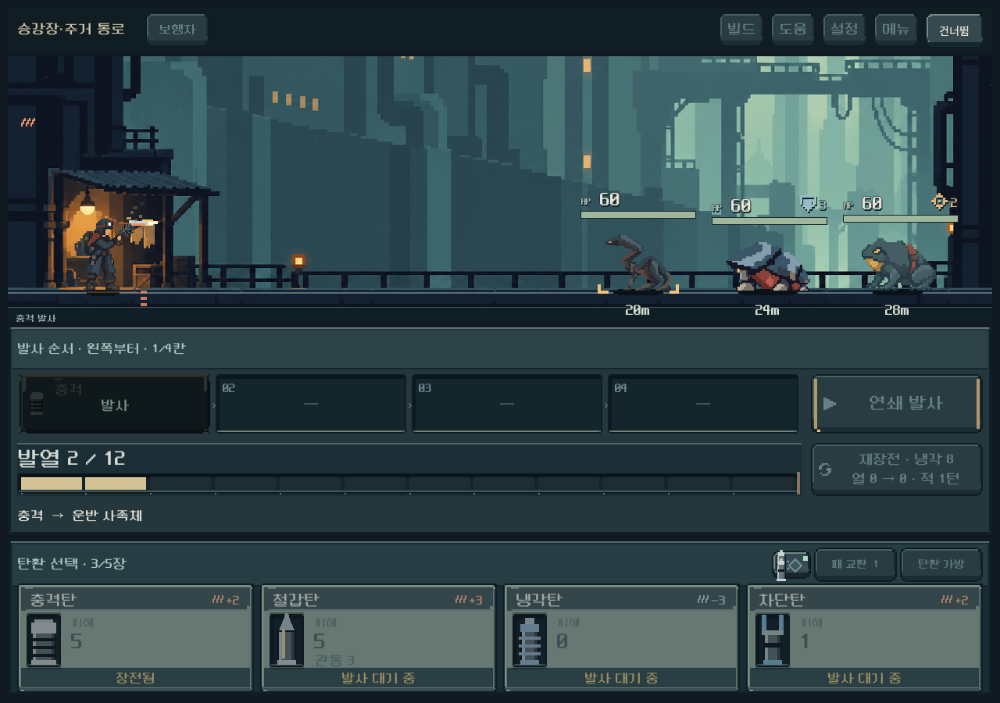
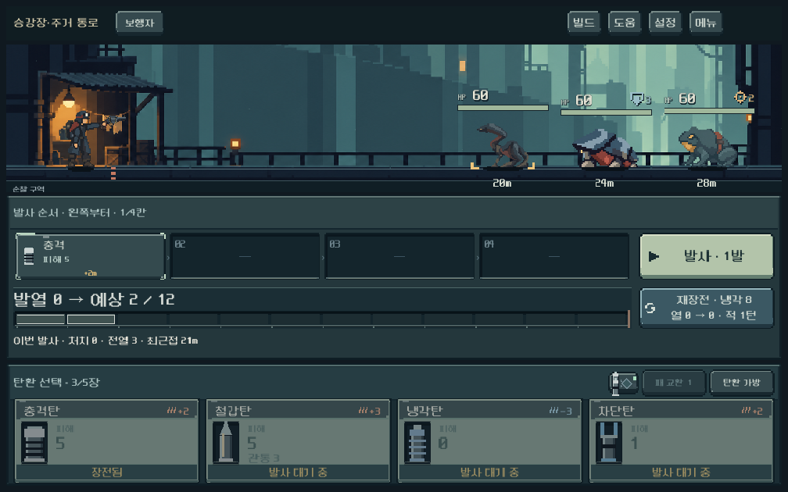
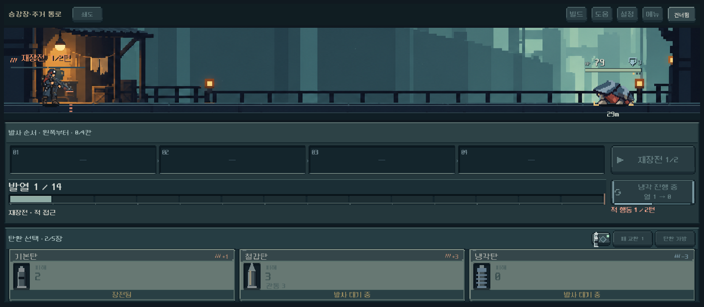

# 총기 계열별 전투 동작 — 2026-10-11

## 사용자 테스트 후 수정 — 팔 방향·크기·재장전/반동

사용자가 권총 팔의 과한 길이/좌우 일관성, 쇄도의 몸 가림, 무기 동작이 느껴지지 않음을 지적했다. 이전 기능 통과는 이 시각적 문제를 보장하지 못했다.

- 권총 v2: 카메라에 가까운 오른팔이 조준/반동/재장전에서 계속 총을 잡는다. 조준 팔꿈치를 굽혀 손을 가슴 가까이 두고, 반대 팔은 몸 뒤로 내려둔다. 셀별 손/발 기준점을 다시 등록했다.
- 장총 v2: 두 손 간격을 줄이고 가슴 앞에서 지지한다. 손 간격 기반 고정 총기 배율이 이전 대비 약44% 작아졌다. 쇄도는 얼굴/어깨를 가리던 큰 개머리판·총몸이 줄었다. 장총 반동은 조준 그림 재사용 대신 별도 반동 셀을 사용한다.
- 원인 수정: 기존 `_recoil`은 `shot_power`가0인 일반탄에서 이동량도0이었다. 기본 반동2픽셀에 강화분을 더하고, 다섯 총에 서로 다른 손잡이 중심 회전 반동을 연결했다. 총구 효과도 같은 변환을 사용한다.
- 재장전: 두 고정 부품 위치만 바꾸던 방식을 실제 재장전 진행률에 따른 추출 → 개방 유지 → 삽입으로 바꿨다. 부품 이동 폭을 실제 화면에서도 보이게 확대했다. 증강은 총열을36도 꺾어 연다. 매 프레임 변화가 있는 동안 합성 화면도 갱신한다.
- 기존 턴/발열/냉각/RNG/저장 규칙 유지. 연출 축소에서는 반동을 생략하고 건너뛰기는 기존 기능을 따른다.

실제 동작 **501검사/실패0**, 2,802프레임 관찰. 기존 상태명 검사 외에 **동일 몸 자세에서 실제 GPU 출력의 반동 변화·부품 추출·완전 삽입**을 다섯 총 모두 비교했다. 실제 발사 중 기본 반동과 재장전 중5단계 이상 부품 이동을 확인했다. 3해상도·과열·기존2턴 재장전·건너뛰기 포함. 전투 피드백 회귀도911검사/실패0으로 통과했다. 이번 수정 합계 **1,412검사/실패0**. 사용자 자세 선호와 Galaxy 실기기는 후속 확인이다.

[권총 자세 점검표](weapon_motion_fix_2026-10-11_assets/poses_single.png) · [쇄도 자세 점검표](weapon_motion_fix_2026-10-11_assets/poses_burst.png) · [생성 전체 프롬프트·원본/참조 해시](../../../새-게임-프로젝트/assets/art/weapon_motion_20261011/provenance-v2.json). 내장 image_gen 편집 원본은 같은 폴더의 `pistol_body_v2.png`, `long_body_v2.png`로 보존했다. 비트맵 후처리 없이 Godot 등록/합성으로 연결한다.

아래는 최초 적용 당시 기록이다. v1 그림과 최초 통과 수치는 이력이며, 현재는 위 수정과v2가 우선한다.

사용자가 승인한 권총형/장총형 분리 방향을 본편에 적용했다. 장비 선택에서 고른 리볼버가 전투에서는 고정 소총으로 보이던 불일치를 해소한다.

## 구현

- 보행자·증강: 한 손 조준/반동, 재장전할 때 보조 손 사용.
- 쇄도·산개·압쇄: 양손 지지. 압쇄는 압력통이 얼굴을 가리지 않도록 가슴 높이에서 사격한다.
- 장비 화면의 같은 다섯 총기 PNG를 몸 위에 합성하고 손가락만 총 위로 표시한다. 원본 이미지는 편집하지 않았다.
- 대기 → 장전 확정 후 조준 → 발사 → 반동 → 재장전 개방/삽입 → 냉각/대기 흐름을 기존 실제 전투 이벤트에 연결했다. 별도의 가짜 턴이나 지연을 추가하지 않는다.
- 리볼버 약실, 쇄도 탄창, 산개 회전 약실, 압쇄 압력통, 증강 꺾이는 총열을 부품 영역으로 분리하여 재장전 때 움직인다. 정교한 기계 내부 작동 시뮬레이션은 아니다.
- `weapon_actor.gd`가 가족별 몸·손·발과 총별 그립/총구/부품 등록을 소유한다. 새 총은 같은 계열 등록을 추가할 수 있다. 전투 계산·저장·RNG 변경 없음.
- 투명 SubViewport 하나를 자세 변경 때만 갱신하고, 전장의 기존 그리기 순서에서 표시한다. 기존 피격/발사 효과가 주인공 위로 정상 표시된다. nearest/alpha cutoff를 사용한다.

## 실제 화면

큰 상태별 제작 점검표: [보행자](weapon_motion_2026-10-11_assets/poses_single.png), [증강](weapon_motion_2026-10-11_assets/poses_amplifier.png), [쇄도](weapon_motion_2026-10-11_assets/poses_burst.png), [산개](weapon_motion_2026-10-11_assets/poses_scatter.png), [압쇄](weapon_motion_2026-10-11_assets/poses_heavy.png). 점검표는 실제 플레이 화면과 구별한다.

## 확인

- 격리 저장 `qa_runtime/actor_motion`, 실제 Godot4.7 Compatibility 실행.
- `tools/run_actor_motion_checks.ps1`: **453검사 / 실패0**. 14,033프레임 관찰 중 거리 순서 오류0·검사한 적의 접지 이탈0.
- 1280×900 /1008×630 /1440×630에서 권총의 실제 입력 흐름과 다섯 총의 모든 자세별 그립/총구 등록을 검사했다. 다섯 무기 모두 실제 장전·발사·재장전을 재생했다.
- 쇄도 재장전2턴, 과열 강제 재장전/냉각, 정지 원거리 적 앞의 재장전, 처치, 연출 축소, 건너뛰기와 모델 일치를 확인했다.
- `tools/run_combat_feedback_checks.ps1`: **911검사 / 실패0**. 새 렌더러에서도 일반·증폭·다중 명중·장갑·전격·냉각·과열·즉시 연출의 모델/RNG 일치와 효과 정리, 피해 숫자와 UI 배치를 확인했다. 두 검사군 합계 **1,364검사 / 실패0**.
- 시각 검토: 권총/장총 팔 구별, 손과 총의 접점, 바닥 고정, 발사 효과 위치, 작은 화면 잘림. 압쇄 얼굴 가림을 수정하고 증강 총열 개방을 힌지 회전으로 수정했다.

## 원본과 남은 범위

[전체 생성 프롬프트·참조·SHA256](../../../새-게임-프로젝트/assets/art/weapon_motion_20261011/provenance.json). 두 원본1536×1024, 각3×2셀. 이전 승인 주인공을 참조하여 내장 image_gen으로 만들었다. 원본 PNG를 보존하고 셀/총기 영역의 합성은 Godot에서 수행한다.

장총은 조준 셀과 절차형 후퇴를 반동으로 사용한다. 생성된 장총 반동 셀은 손 정합성이 낮아 사용하지 않는다. 연속 중간 프레임을 모두 새로 그린 애니메이션은 아니다. 등록 좌표는 현재 원본 기준이며 변경 때 다시 검수한다.

기본 청회색 복장의 전투 동작만 적용했다. 복장별 능력치는 기존대로 작동하지만 다른 복장·헬멧을 전투 몸체에 조합하는 기능은 아직 후속이다. 사용자 동작 선호와 Galaxy 성능/실기기 판독은 미검증이다. APK·커밋·푸시는 수행하지 않았다.
