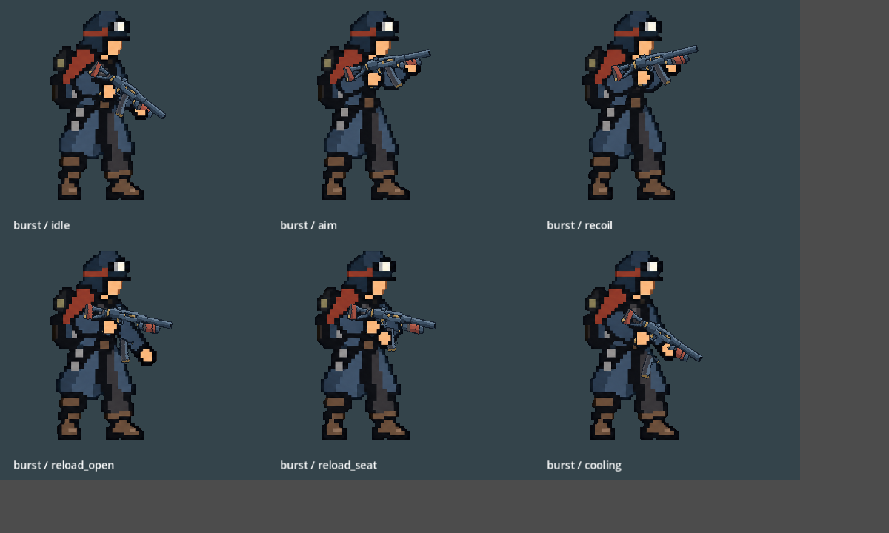
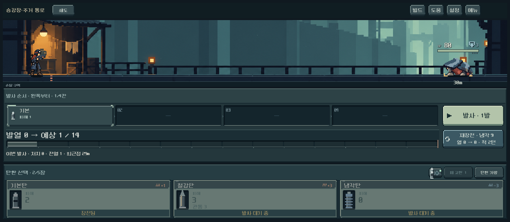

# 전투 총열·총구 가독성 — 2026-10-11

**후속 원인 정정:** 사용자 재검수에서 같은 형상이 남았다. 최신 캡처를 확대하고 발열0/1을 재현한 결과, 사용자가 지목한 돌출 막대의 원인은 총기 그림이 아니라 `risk_battle_view.gd`의 `heat_debt > 0` 사각형 효과였다. 아래 총열/손 가림 수정은 별도의 시각 개선이며 해당 결함 해결 증거가 아니었다. [실제 결함 수정·재현 검사](weapon_heat_artifact_2026-10-11.md).

## 문제와 원인

사용자가 허리 옆의 작은 회색 형상을 Bone처럼 느꼈고, 총과 함께 움직인다고 확인했다. 몸·총·전경 손을 분리해서 렌더링한 결과 해당 부분은 실제 총열/총구였다. 디버그 노드나 별도 부유물이 아니었다. 장비 화면용 세밀한 총기를 전투 크기로 축소하면서 홈·밝은 고리가 작은 조각처럼 보였고, 앞손 전체를 다시 그리는 영역이 총열 연결부를 가렸다.

## 적용

- 기존 다섯 총의 실루엣·재료를 참조해 **전투용 단순화 이미지 5종**을 제작했다. 장비 선택 원화는 기존 그대로 사용한다.
- 쇄도의 작은 총구 홈, 압쇄의 흰 고리 반복을 연속된 강철 총열로 정리했다. 보행자·증강·산개도 작은 장식과 단절되는 밝은 선을 줄였다.
- 총 전체 크기·손잡이 기준·반동 회전은 유지했다. 장총 앞손은 총열 아래쪽 손가락만 전경에 다시 그려 연결부를 살렸다.
- 새 원본의 약실·드럼·압력통 영역에 맞춰 재장전 분할 위치를 등록했다. 총구 효과는 기존 동일 변환을 따른다.
- `weapon_layer_inspector.gd`도 실제 게임의 손가락 영역 함수를 사용한다.

새 PNG는 내장 image_gen의 편집 결과를 그대로 복사했다. 비트맵 후처리는 없으며 기존 nearest/alpha-cutout 표시 경로를 사용한다. [전체 프롬프트·참조·SHA256](../../../새-게임-프로젝트/assets/art/weapons_combat_20261011/provenance.json).

## 시각 확인

[이전 레이어](weapon_readability_2026-10-11_assets/layers_before.png) · [수정 레이어](weapon_readability_2026-10-11_assets/weapon_layers.png) · [보행자](weapon_readability_2026-10-11_assets/poses_single.png) · [증강](weapon_readability_2026-10-11_assets/poses_amplifier.png) · [산개](weapon_readability_2026-10-11_assets/poses_scatter.png) · [압쇄](weapon_readability_2026-10-11_assets/poses_heavy.png).

5종×6자세를 직접 확인했다. 총열의 연결과 앞손 가림은 개선되었고 기존 축소 크기를 유지한다. 제작 점검표는 크게 표시한 검수용이고, 실제 전투 크기는 별도 캡처로 구분한다.

## 기능 검증과 한계

- Godot 4.7 Compatibility, 격리 저장. 동작 **501검사/실패0**, 2,793프레임. 세 해상도, 실제 장전·발사·반동·부품 추출/삽입, 2턴 재장전·과열·건너뛰기·연출 축소 포함.
- 전투 피드백 회귀 **911검사/실패0**. 발사 효과·피해 표시·모델/RNG 일치·연출 종료 정리 통과. 합계 **1,412검사/실패0**. [동작 로그](weapon_readability_2026-10-11_assets/actor_motion.log) · [전투 로그](weapon_readability_2026-10-11_assets/combat_feedback.log).
- 사람의 판독성 선호와 Galaxy 실기기 확인은 후속이다. 자동 검사는 미적 만족을 보장하지 않는다.
