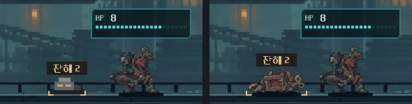

# 금형공 잔해 시험

저장 경로를 분리한 주조장 시험 전투를 [PLAY_WRECKAGE_TRIAL.cmd](../../../../PLAY_WRECKAGE_TRIAL.cmd)로 엽니다. 리벳으로 금형공을 먼저 사격하면 재받이가 잔해 뒤에서 접근합니다. 일반탄을 써서 잔해를 한 칸 깎고 철갑탄으로 걷어내거나, 첫 사격 뒤 냉각과 탄창 교체를 해서 재받이가 잔해까지 나오기를 기다려 볼 수 있습니다. 창을 닫고 다시 실행하면 첫 상태에서 시작합니다.

## 시험 규칙

- 금형공이 쓰러진 위치에 내구도 2의 잔해가 남습니다. 한 교전에서 동시에 남는 잔해는 한 개입니다. 처치한 탄의 연계 효과가 정산된 뒤 같은 연발의 다음 탄부터 가립니다.
- 잔해보다 뒤에 있는 적을 향한 직접 공격은 잔해에 맞습니다. 일반탄은 1칸, 철갑탄은 2칸, 연타탄은 타격 수만큼 깎습니다. 잔해를 파괴한 탄의 남은 타격도 뒤쪽 적에게 넘어가지 않습니다.
- 적이 잔해와 같은 거리나 앞쪽으로 나오면 직접 맞힐 수 있습니다. 잔해 타격은 적 처치로 세지 않으며 교전 승리를 가로막지 않습니다.
- 압력탄 직접 요격과 이미 발동한 화상·전이는 잔해의 영향을 받지 않습니다. 전격탄 자체가 잔해에 막히면 직접 맞은 적이 없어 전이가 시작되지 않습니다.

## 비교할 선택

철갑탄을 빨리 쓰면 뒤 적에게 다음 탄을 통과시킬 수 있습니다. 냉각과 교체로 기다리면 잔해를 부술 탄을 아끼고 새 탄창을 얻는 대신 적이 더 가까워집니다. 플레이 확인에서는 두 선택이 체감상 갈리는지, 다음 탄의 조준과 스택 표시만으로 엄폐를 이해할 수 있는지 봅니다. 현재 범위는 금형공 한 종류의 시험 전투입니다.

## 금형공 도트 반영

사용자 피드백에 따라 이전 사각형 잔해를 금형공의 녹슨 몸통 판과 떨어진 집게, 황동 태엽이 남은 낮은 스프라이트로 교체했습니다. 그림은 발이 닿았던 바닥에 고정하고, 탄환 적중점은 잔해 몸통으로 맞췄습니다. 엄폐와 내구도 판정은 기존 시험 규칙을 따릅니다.

[살아 있는 금형공](mold_standing_1008.png) · [잔해 두 칸](mold_wreckage_1008.png) · [잔해 한 칸](mold_chipped_1008.png) · [제작 입력과 프롬프트](wreckage_art_provenance.json)

## 검증

도트 교체 뒤 규칙 검사 184개와 실제 화면 검사 52개가 통과했습니다. 1280×800과 1008×454에서 새 그림의 바닥 접지, 탄환 적중 위치와 내구도 표시를 확인했습니다. 같은 연발의 다음 탄 차단, 산개총의 50% 잔해 예측, 화상 처치 후 생성, 잔해가 남은 승리, 압력탄 요격, 내구도가 한 칸 남은 상태의 저장·복원도 확인했습니다. 시험 도입 때는 기존 표면 효과 322개와 빌드 643개 검사도 통과했습니다. 모바일 실기기와 플레이 체감은 별도 확인 대상입니다.
